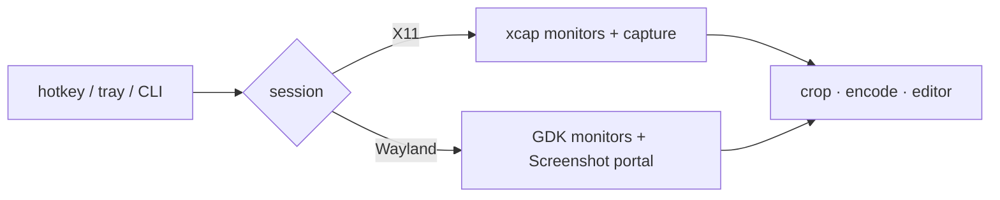

# capz on Linux Wayland — design (CP-0094)

Owner decision 2026-11-02: support Wayland for the widest reach, not X11 only.
Ubuntu 25.10+ and 26.04 LTS have no Xorg session, so X11-only v1 would not run
on a default install of the current LTS.

## What we measured (Ubuntu 26.04, GNOME 50.1, xdg-desktop-portal 1.21)

| Probe | Result |
|---|---|
| capz 0.19.0 test build, any capture | `Cannot find required wayland protocol` |
| Cause | xcap's Wayland path calls **libwayshot** (wlroots-only protocols) for monitor scale → fails on GNOME/KDE before any pixel is read |
| Screenshot portal, non-interactive, 1st call | permission dialog ("Allow … to take screenshots?") |
| Same, after Allow | **silent, 57 ms**; stored in the permission store under app id `''` (all host apps) |
| Side effect | every call writes `~/Pictures/Screenshot-N.png` — we must delete it |
| Portals present | Screenshot v2, ScreenCast v5, GlobalShortcuts v1, RemoteDesktop v2, InputCapture |

## Principle

Keep the app's flow and frontend unchanged; swap the **backends** that X11/xcap
provided for portal + GTK equivalents, chosen at runtime by session type
(`is_wayland_session`, already in #147). X11 sessions keep the xcap path.

## Pieces

| Need | X11 (today) | Wayland (new) | Works on |
|---|---|---|---|
| Monitor list + geometry | xcap / RandR | GDK monitors (main thread): logical rect + scale | every compositor |
| Pixels | xcap `XGetImage` | Screenshot portal → PNG → crop to monitor / region; delete the portal's file | GNOME, KDE, wlroots, Hyprland (all ship a Screenshot portal) |
| Overlay placement | position + always-on-top | `gtk_window_fullscreen_on_monitor` (compositors ignore client positions), built **focused** — GNOME stacks a window with `accept_focus(false)` *below* the focused one | every compositor |
| Overlay see-through | transparent window | **freeze frame**: screenshot first, show it as the overlay backdrop, crop the selection from that image (GNOME drew the transparent fullscreen overlay solid black) | every compositor |
| Global hotkeys | tauri global-shortcut (X grabs) | **GlobalShortcuts portal**; fallback **`capz --capture full\|area\|window\|ring`** for a desktop custom shortcut (single-instance forwards it) | portal: GNOME 48+, KDE, Hyprland · CLI: everywhere |
| Window capture | xcap window list | no window list on Wayland → **interactive portal** (the desktop's own picker, which has a window mode) | every compositor with a Screenshot portal |
| Cursor / hold-ring modifiers | X11 `QueryPointer` | none on Wayland → ring opens on primary; hold gesture hidden (same as an unsupported platform) | — |
| Scroll capture | repeated region capture | **hidden in the first Wayland PR** (each frame is a portal round-trip + a file); ScreenCast + PipeWire later | — |

Mapping coordinates: GNOME renders a multi-monitor screenshot at one scale for
the whole stage, so a monitor's pixel rect in the image is
`logical_rect × (image_width / desktop_logical_width)`; a region from the
overlay (CSS px × devicePixelRatio) is divided by the monitor's scale first.
This keeps fractional / mixed scales correct without asking the compositor.

## Live test results (W1, GNOME 50 Wayland, 2026-11-02)

| Mode | Result |
|---|---|
| Window (interactive portal) | ✅ GNOME's picker → 1920×1080 into the editor |
| Area, transparent overlay | ❌ invisible (stacked below), then solid black once focused |
| Area, freeze frame | ✅ backdrop visible, selection cropped exactly (1153×648), temp files removed |
| Full screen | not yet confirmed |

## Phases (each a PR, stacked on #148)

1. **W1 — capture works** (this PR): GDK monitor list, portal capture
   (full / area), overlays fullscreen-on-monitor, no X11 queries under
   Wayland, Wayland notice no longer says "log in with Xorg"; scroll hidden.
2. **W2 — hotkeys**: GlobalShortcuts portal + `--capture` CLI + a Settings
   hint for desktops without the portal.
3. **W3 — window capture** via interactive portal.
4. **W4 — release notes / README**: Wayland supported; X11 still best for
   window picking and scroll capture.

Later, optional: ScreenCast + PipeWire for scroll capture and no-file captures;
register an app id (`org.freedesktop.host.portal.Registry`) so the permission
is per-app instead of shared.

## Risks

- **First capture asks for permission**, and the dialog must be answered before
  anything happens. Onboarding should explain it.
- **Clipboard**: GNOME has no `wlr-data-control`; arboard falls back to the
  XWayland clipboard. Needs a live check.
- **Portal implementations differ** (KDE's may always prompt). Only GNOME is
  tested here.
