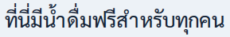
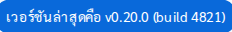
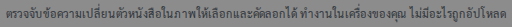

# OpenThai 2.0 OCR กับ capz — อ่านไทยปนอังกฤษได้ไหม และควรแจกจ่ายแบบไหน (CP-0096)

**วันที่:** 15 พ.ย. 2026 · **ticket:** CP-0096 · **branch:** `spike/cp0096-openthai-ocr`
**แผน:** [`docs/superpowers/plans/2026-11-15-openthai2-ocr-spike.md`](../superpowers/plans/2026-11-15-openthai2-ocr-spike.md)
**หลักฐาน:** [`docs/research/evidence/openthai2-ocr/`](evidence/openthai2-ocr/) · **harness:** [`scripts/ocr-eval/`](../../scripts/ocr-eval/)

## TL;DR

**Q1 — อ่านไทยกับอังกฤษพร้อมกันได้ไหม: ได้ และได้ดี**
- บน test split (ภาพหน้าจอสังเคราะห์ 240 ภาพ ประโยคไม่ซ้ำกับชุดที่ใช้ tune และมีฟอนต์ที่ไม่เคยเห็น 2 ตัว) OpenThai ได้ CER **3.01%**
- บรรทัดที่ไทยปนอังกฤษในบรรทัดเดียวกันได้ **1.89%** ซึ่งดีที่สุดในทุกหมวด
- recall ของวรรณยุกต์, สระบน, ละติน และตัวเลขบนบรรทัดผสม ≥ 98.7%
- เทียบ Vision ที่ capz ใช้บน Mac ได้ **เทียบเท่า** (3.17%) และดีกว่า Tesseract ของ PR #84 **5.7 เท่า** (17.16%)

**Q2 — bundle หรือให้ผู้ใช้โหลดเอง: bundle**
- โมเดลมีแค่ 3.8 MB ขนาดส่วนใหญ่มาจาก inference runtime ซึ่งต้องอยู่ในแอปที่เซ็นแล้วอยู่ดี
- บน Windows จะเพิ่มราว **9.2 MB** (ค่าประเมิน) น้อยกว่า Tesseract bundle ของ PR #84 (12 MB)
- การให้ผู้ใช้โหลดเองประหยัดได้แค่ 3.8 MB แต่ต้องเพิ่มเส้นทาง network, UI และแก้ privacy policy

**Port เข้า capz ได้จริง**
- Rust prototype ให้ข้อความตรงกับ reference ของ iApp **98.1%** ของบรรทัด (noise floor 98.3%) และ CER เท่ากัน
- **แต่ยังไม่ผ่านเกณฑ์ความเร็ว:** p50 1.25 s บน laptop CPU กับภาพที่มีข้อความเต็มจอ และ ORT บน macOS ใช้ RAM 3 GB

**คำแนะนำ**
- Windows: ใช้ OpenThai แทน PR #84 โดยมีเงื่อนไขว่าต้องวัดความเร็วบนเครื่อง Windows จริงให้ผ่านก่อน
- macOS: คง Vision ไว้
- Linux: ใช้ OpenThai เมื่อเปิด OCR โดยมีเงื่อนไขเดียวกับ Windows (P1 ไม่ผ่านบนเครื่อง Linux ด้วย)
- ระหว่างทางพบว่า **PR #84 น่าจะพังบน Windows** (Tesseract ไม่เขียนไฟล์ TSV เพราะ bundle ไม่มี `configs/`)

| gate | ผล | | gate | ผล |
|---|---|---|---|---|
| H1 harness: engine อ่านอังกฤษตัวใหญ่ได้ | ✗ (ฝั่ง Tesseract, §7) | | W1 ชนะ Tesseract ≥ 20% | ✓ −14.1 pt |
| H2 GT ตรงกับพิกเซล | ✓ (render ซ้ำครบ 490 ภาพ) | | W2 อังกฤษไม่ถอย | ✓ |
| A1 port แค่บางส่วนก็พอ | ✓ −0.02 pt | | M1 เทียบ Vision | เทียบเท่า |
| Q1a mixed ≤ 5% (mac/win) | ✓ 1.48% / 1.84% | | R1 parity Rust | ✓ 98.1% |
| Q1b ปนภาษาแล้วไม่แย่ลง | ✓ | | P1 ความเร็ว/RAM | ✗ (§3.2) |
| Q1c recall รายชนิดตัวอักษร | ✓ ≥ 98.7% | | S1 ≤ 12 MB ต่อ target (backend ort) | ✗ Linux 12.91 MB (§4) |

ผลของทุก gate อยู่ใน [`evidence/openthai2-ocr/gates.json`](evidence/openthai2-ocr/gates.json) และสรุปไว้ใน [`summary.md`](evidence/openthai2-ocr/summary.md)

---

## 1. สิ่งที่วัด และทำไมถึงเชื่อตัวเลขได้โดยไม่ต้องมีคนตรวจ

### 1.1 Corpus: ภาพหน้าจอสังเคราะห์ที่รู้คำตอบแน่นอน

สร้างภาพจาก HTML ใน Chromium แบบ headless แล้วดึง ground truth (ข้อความ + กรอบราย grapheme) จาก DOM โดยตรง
ไม่มีการถอดข้อความด้วยมือเลย

| แกน | ค่า |
|---|---|
| หน้าจอ (template) | chat, settings, ตาราง, บทความ, terminal, code editor, dialog ทับหน้าเว็บ, เมนู |
| ฟอนต์ | Noto Sans Thai, Loma (หัวกลมแบบ Tahoma), Sarabun, IBM Plex Sans Thai, Prompt · **test เท่านั้น:** Anuphan, Noto Sans Thai Looped · terminal/code ใช้ Noto Sans Mono แล้ว fallback เป็นฟอนต์ไทย |
| ขนาด (CSS px) | 11, 12, 13, 14, 16, 20 |
| DPR | 1, 1.25, 1.5, 2 (ครอบคลุม Windows 100–150% และ Retina) |
| ธีม | light, dark, tinted (พื้นสี) |
| การครอป | ทั้งจอ 70% · ครอปเฉพาะส่วน (เลียนแบบ area capture) 30% |
| ข้อความ | string จริงของ capz (`src/i18n/locales/th`, `en`), ประโยคไทยปนอังกฤษที่คัดไว้ 130 บรรทัด (`scripts/ocr-eval/data/phrases_mixed.txt`), ร้อยแก้วไทยจากเอกสารใน repo |

- **dev** 240 ภาพ ใช้ปรับค่า · **test** 240 ภาพ ใช้วัดครั้งเดียว ประโยคใน test ไม่ซ้ำกับ dev (แบ่งด้วย sha1 ยกเว้น string สั้นกว่า 4 ตัวอักษร และข้อความคงที่ของ template เช่น `Export CSV` หรือคำสั่งใน terminal) และมีฟอนต์ 2 ตัวที่ dev ไม่เคยเห็น
- **perf** 10 ภาพ ข้อความแน่นเต็มจอ 2560×1600 ใช้วัดความเร็ว

**ตรวจตัวเองว่า GT ตรงกับพิกเซล (gate H2)** — render แต่ละภาพสองรอบ รอบที่สองทำให้ข้อความโปร่งใส
ส่วนต่างของสองภาพคือ "หมึก" ของตัวอักษรทั้งหมด หมึกต้องอยู่ในกรอบ GT ≥ 99.5%
กรอบ GT ทุกกรอบต้องมีหมึกจริง (ไม่มีข้อความล่องหน) และ render ซ้ำต้องได้ไฟล์เหมือนเดิมทุกไบต์
ข้อความที่ถูก modal บัง หรือถูกขอบภาพตัดครึ่ง จะถูกตัดออกจาก GT

**ผล H2: ผ่าน** coverage ต่ำสุดของ dev 0.9973, test 0.9977, perf 0.9981 และ render ซ้ำ**ครบทุกภาพ** (240 + 240 + 10) ได้ไฟล์เหมือนเดิมทุกไบต์
ระหว่างทำงานเจอบั๊กของ harness เองสองตัวจากการไล่ error แล้วแก้ก่อนเชื่อตัวเลขใด ๆ
(ข้อความใต้ modal ยังอยู่ใน GT, และการเรียงกล่องในแถวเดียวกันสลับกัน) รายละเอียดอยู่ใน commit ของ `scripts/ocr-eval`

### 1.2 Metric ที่ไม่ขึ้นกับวิธีตัดบรรทัดของแต่ละ engine

- จับคู่บรรทัดที่ engine อ่านได้กับ GT ด้วยตำแหน่ง (ทับกันแนวตั้ง ≥ 50% และแนวนอน ≥ 30%) แล้วรวมเป็นกลุ่ม
  เพราะ engine หนึ่งอาจอ่านแถวตารางเป็นบรรทัดเดียว อีก engine อาจตัดเป็นห้าช่อง
- **CER** = ระยะ Levenshtein ÷ จำนวนตัวอักษร GT หลัง normalize ทั้งสองฝั่ง:
  NFC, เรียงสระ/วรรณยุกต์ให้เป็นลำดับเดียว, รวม `ํ`+`า` เป็น `ำ`, map PUA ของฟอนต์เก่ากลับ และตัดช่องว่างทั้งหมด (ภาษาไทยไม่เว้นวรรคระหว่างคำ)
- error ทุกตัวถูกคิดให้ GT fragment ที่มันเกิดขึ้นจริง ตาม alignment ทำให้ CER แยกตามหมวด (`thai` / `english` / `mixed`) ใช้ตัวหารเดียวกันทุก engine
- **`mixed`** = บรรทัด GT ที่มีทั้งอักษรไทยและละติน**ในบรรทัดเดียวกัน** คือคำถามข้อ 1 ตรง ๆ
- **slice ที่ใช้บ่อย:** `mac_typical` (DPR 2, 13–16 px, light/dark) · `win_typical` (DPR 1–1.5, 12–14 px, light/dark) · `easy` (ภาษาอังกฤษ ≥ 16 px, DPR 2, light)
- **class recall** = สัดส่วนตัวอักษร GT ที่อ่านถูก แยกตามชนิด: พยัญชนะไทย, สระบน, สระล่าง, วรรณยุกต์, ละติน, ตัวเลข, สัญลักษณ์
- เทียบสอง engine ด้วย **paired bootstrap** ข้ามภาพ 1000 รอบ แล้วรายงานช่วงความเชื่อมั่น 95%

### 1.3 Engine ที่เทียบ (ภาพชุดเดียวกันทั้งหมด)

| engine | config | ทำไมต้องเทียบ |
|---|---|---|
| **OpenThai2.0-OCR-Text** (Python reference ของ iApp) | ONNX Runtime, revision `40e8e9ff` | ตัวที่กำลังประเมิน |
| **Tesseract 5** | config ของ PR #84 ทุกจุด: tessdata_fast `tha+eng`, `--psm 6`, upscale ไม่เกิน 4000 px, แก้ `ํา`→`ำ` | ตัวที่ PR #84 จะ ship บน Windows |
| **macOS Vision** | setting เดียวกับ `src-tauri/src/services/ocr/macos.rs` รันบน M1 Pro ผ่าน SSH | ตัวที่ capz ใช้บน Mac อยู่แล้ว |
| **Rust prototype** (`rust-proto/`) | port pipeline หลักของ OpenThai เป็น Rust (backend `ort` และ `tract`) | ตอบว่า port เข้า capz ได้จริงไหม |

### 1.4 เกณฑ์ที่ล็อกไว้ก่อนเห็นข้อมูล

ตารางเต็มอยู่ในแผน (§ Gates) ส่วนตัวเลขถูกตรึงด้วย `tests/test_gates.py::test_thresholds_match_plan`
แก้เกณฑ์ไม่ได้โดยไม่ทำให้เทสต์ตก ข้อไหนที่ผลไม่เป็นไปตามเกณฑ์จะรายงานตามจริงในหัวข้อ deviation

---

## 2. Q1 — อ่านไทยปนอังกฤษได้ไหม

### 2.1 ผลบน test split (240 ภาพ, 91,205 ตัวอักษร, วัดครั้งเดียวด้วย config ที่ freeze ไว้แล้ว)

| engine | CER ทั้งหมด | ไทย | อังกฤษ | **ไทยปนอังกฤษในบรรทัดเดียว** | mac typical · mixed | win typical · mixed | FP / 1k |
|---|---|---|---|---|---|---|---|
| **OpenThai** (tuned) | **3.01%** | **2.88%** | 4.54% | **1.89%** | 1.48% | 1.84% | 0.1 |
| macOS Vision | 3.17% | 3.24% | **2.70%** | 3.06% | 1.68% | 2.62% | 0.1 |
| Tesseract (PR #84) | 17.16% | 20.67% | 14.38% | 18.08% | 14.00% | 17.53% | 4.7 |

ที่มา: `evidence/openthai2-ocr/metrics-ot_test.json`, `metrics-tess_test.json`, `metrics-vision_test.json`

**คำตอบ Q1: ใช่** และบรรทัดที่ปนสองภาษากลับอ่านได้ดีที่สุดในทุกหมวด ผ่าน gate ทั้งสามข้อ:

- **Q1a** — CER ของบรรทัด mixed ใน slice ที่เหมือน Mac จริง = 1.48% และที่เหมือน Windows จริง = 1.84% (เกณฑ์ ≤ 5%)
- **Q1b** — mixed 1.89% เทียบกับเพดาน 7.31% แปลว่าการปนภาษาไม่ทำให้แย่ลง
- **Q1c** — recall รายชนิดตัวอักษรบนบรรทัด mixed (เกณฑ์ละติน/ตัวเลข ≥ 97%, วรรณยุกต์/สระบน ≥ 95%):

| ชนิด | OpenThai | Vision | Tesseract |
|---|---|---|---|
| พยัญชนะไทย | 99.2% | 97.1% | 86.8% |
| สระบน | 99.1% | 98.4% | 84.2% |
| สระล่าง | 99.8% | 93.7% | 84.3% |
| **วรรณยุกต์** | **98.8%** | 96.9% | 83.0% |
| เลขไทย (มีแค่ 9 ตัวบนบรรทัด mixed; ทั้ง split 233 ตัว: 99.6% / 91.8% / 46.4%) | 100.0% | 22.2% | 55.6% |
| ละตินตัวใหญ่ | 99.2% | 96.4% | 74.4% |
| ละตินตัวเล็ก | 98.9% | 98.5% | 81.6% |
| ตัวเลข | 98.7% | 98.1% | 92.6% |
| สัญลักษณ์ | 83.7% | 88.1% | 80.7% |

### 2.2 แยกตามเงื่อนไข (test split, CER)

| ขนาดตัวอักษร | OpenThai | Vision | Tesseract |
|---|---|---|---|
| ≤ 12 px | **3.48%** | 5.31% | 17.41% |
| 13–16 px | 3.02% | 2.26% | 17.92% |
| ≥ 17 px | 2.19% | 1.60% | 14.93% |

| ฟอนต์ | OpenThai | Vision | Tesseract |
|---|---|---|---|
| Noto Sans Thai | 3.27% | 6.22% | 14.84% |
| Loma (หัวกลมแบบ Tahoma) | 3.59% | 2.18% | 17.38% |
| Sarabun | 3.30% | 3.09% | 13.79% |
| IBM Plex Sans Thai | 2.58% | 3.35% | 20.69% |
| Prompt | 2.90% | 3.43% | 21.33% |
| **Anuphan** (ไม่เคยเห็นตอน tune) | 2.70% | 1.73% | 11.64% |
| **Noto Sans Thai Looped** (ไม่เคยเห็นตอน tune) | 2.93% | 1.78% | 23.05% |

| DPR | OpenThai | Vision | Tesseract | · | หน้าจอ | OpenThai | Vision | Tesseract |
|---|---|---|---|---|---|---|---|---|
| 1.0 | 3.25% | 2.86% | 14.34% | · | chat | 3.29% | 7.40% | 32.17% |
| 1.25 | 2.87% | 3.20% | 20.19% | · | settings | 2.48% | 2.02% | 26.07% |
| 1.5 | 3.55% | 3.86% | 19.89% | · | ตาราง | 1.74% | 1.66% | 5.38% |
| 2.0 | 2.58% | 2.88% | 13.90% | · | บทความ | 2.11% | 1.65% | 8.28% |
| | | | | · | terminal | 4.80% | 4.41% | 6.77% |
| | | | | · | code | 3.49% | 3.28% | 11.45% |
| | | | | · | dialog | 3.55% | 2.14% | 50.88% |
| | | | | · | เมนู | 6.15% | 6.92% | 13.56% |

ข้อสังเกต:
- ฟอนต์สองตัวที่ไม่เคยเห็นตอน tune ได้ผลดีพอ ๆ กับตัวที่เคยเห็น และ CER ของ dev กับ test ต่างกันแค่ 0.16 pt แปลว่าไม่ได้ overfit กับชุดที่ใช้ปรับ
- OpenThai ดีกว่า Vision ชัดเจนบนตัวอักษรเล็ก (≤ 12 px) และดีกว่าบนเลขไทย (ทั้ง split 99.6% เทียบกับ 91.8%, 233 ตัว) ส่วน Vision ดีกว่าบนภาษาอังกฤษล้วน
- เมนูยากที่สุดสำหรับทุก engine เพราะมี `⌘ ⇧ ▾` ซึ่งอยู่นอก dictionary ของ OpenThai (ดู `scripts/ocr-eval/REFERENCE.md`)

### 2.3 Error ที่เหลือของ OpenThai

ตัวอย่างบรรทัดที่ OpenThai, Vision และ Tesseract อ่านหายไปทั้งบรรทัด:

| OpenThai อ่านไม่ออก (ช่องตาราง, Sarabun 13 px, พื้นสี) | Vision อ่านไม่ออก แต่ OpenThai อ่านได้ตรงทุกตัว | Tesseract อ่านไม่ออก (dialog, 11 px) |
|---|---|---|
|  |  |  |
| `ที่นี่มีน้ำดื่มฟรีสำหรับทุกคน` → ∅ | `เวอร์ชันล่าสุดคือ v0.20.0 (build 4821)` → OpenThai ตรงทุกตัว | `ตรวจจับข้อความเปลี่ยนตัวหนังสือ…` → ∅ |

error บน dev ของ config สุดท้ายแบ่งได้ดังนี้
- 18% มาจากบรรทัดที่หายไปทั้งบรรทัด recognizer อ่านไทยเป็นตัวละตินที่หน้าตาคล้าย (น→U, พ→W, ร→S) แล้ว filter ความมั่นใจตัดทิ้ง
- 5% มาจากการสลับตัวพิมพ์เล็กกับใหญ่ (s/S, 0/O)
- ที่เหลือเป็นเครื่องหมาย (— อ่านเป็น –, … อ่านเป็น ., → อ่านเป็น –)
- ลองผ่อน filter แล้ว ช่วยได้แค่ 0.04 pt จึงไม่ใช้ (`evidence/openthai2-ocr/iterations.md`)

### 2.4 การ tune บน dev

ทำ coordinate descent กับ 9 knob รวม 43 run (ดู [`iterations.md`](evidence/openthai2-ocr/iterations.md)) มีค่าที่ผ่านเกณฑ์ ≥ 0.2 pt สองค่า:
- `det.v_pad = 0.15` ขยายกรอบบรรทัดขึ้นลงเพื่อไม่ให้ตัดวรรณยุกต์ที่ซ้อนอยู่เหนือสระบน ได้ **−0.78 pt**
- `rec.min_chars = 1` ไม่ทิ้งช่องที่มีตัวอักษรเดียว เช่นตัวเลขในตาราง ได้ −0.23 pt

ผลบน dev ลดจาก 3.84% เป็น 2.85% ค่าที่เหลือ เช่น ขนาด input ของ detector, การขยายภาพก่อน และโหมดสี ไม่มีค่าไหนดีขึ้นถึงเกณฑ์
ค่า default ของ iApp ทั้งสองข้อถูกตั้งไว้สำหรับเอกสารราชการที่สแกนมา ไม่ใช่สำหรับภาพหน้าจอ

### 2.5 ชุดข้อมูลประกอบ (ไม่ได้ใช้ตัดสิน gate)

| ชุด | OpenThai | Vision | Tesseract |
|---|---|---|---|
| fixtures ของ capz (`thai_latin.png` + `ocr-thai-mixed.png` จาก PR #84) | 0.99% | 0.00% | 7.89% |
| หน้าจริง `capz.yadobi.com` (CER บนข้อความใน DOM) | 2.75% | 2.52% | 36.93% |

หน้า Wikipedia ภาษาไทย 3 หน้าถูกตัดออกเพราะ ink coverage ต่ำกว่า 0.99 (มีข้อความใน pseudo-element ที่ DOM ไม่เห็น)
ส่วนหน้า landing มีภาพหน้าจอแอปฝังอยู่ ทุก engine จึงอ่านข้อความในภาพนั้นออกมาเป็น FP สูง จึงรายงานเฉพาะ CER

---

## 3. Port เป็น Rust เพื่อเข้า capz ได้จริงไหม

`scripts/ocr-eval/rust-proto/` เป็น crate แยก (ไม่ได้อยู่ใน `src-tauri`) ที่ port ส่วนต่อไปนี้มาจาก reference
- detector, crop, การปรับสีแบบ `flatten`, CTC แบบ batch
- filter ตัดชิ้นสระ/วรรณยุกต์ที่หลุดออกมาเป็นกรอบแยก
- `canonical` / `fix_scripts` และ filter บรรทัด
- **กรอบรายคำ** ซึ่ง `OcrLine.words` ของ capz ต้องใช้

ส่วนที่ไม่ port ได้แก่ orientation, deskew, `split_gap` และการเรียงลำดับแบบคอลัมน์
**Gate A1** วัดแล้วว่าการปิดส่วนเหล่านี้บนภาพหน้าจอทำให้ต่างแค่ −0.02 pt (CI [−0.08, +0.04]) จึงตัดได้

มี backend ให้เลือกสองตัว
- `ort` คือ ONNX Runtime 1.24 ที่ link แบบ static ไม่มีไฟล์ `.so`/`.dll` แยก
- `tract` เป็น Rust ล้วน ไม่มี native library

ต้องให้ tract สร้าง plan แยกตาม shape เพราะ shape inference ของ tract แก้สูตร ceil-div ของ det.onnx (export จาก paddle2onnx) ไม่ได้

### 3.1 Parity (gate R1): ผ่าน

| | CER (test) | บรรทัดที่ข้อความตรงกับ Python reference |
|---|---|---|
| Python reference (config เดียวกัน, ไม่มี ori/split_gap) | 3.02% | — |
| Rust + ort | 3.00% | **98.1%** |
| Rust + tract | 3.00% | **98.1%** |
| *noise floor: Python กับตัวเองเมื่อเติม noise ±1 ลงใน 1% ของพิกเซล* | — | *98.3%* |

ตอนแรก parity อยู่ที่ 91.5% ซึ่งต่ำกว่าเกณฑ์ 95% จึง dump ค่าระหว่างทางมาเทียบกับ Python ทีละขั้น พบสาเหตุสองข้อ:
1. **`cv2.resize` ใช้ fixed-point แบบ SIMD** ภาพ input ต่างกัน ±1 อยู่ 0.8% ของค่า แต่ทำให้ prob map ต่างได้ถึง 0.14 และกรอบเลื่อนไปทั้งกรอบ
   แก้ด้วยการเขียน resize ให้ตรงกับ OpenCV ทุกบิต (ตรวจกับภาพสุ่ม 6 ล้านค่า ต่าง 0) ส่วน ORT สองเวอร์ชันให้ผลต่างกันแค่ 0.002
2. **pyclipper ทำงานบนจุดจำนวนเต็ม** และสร้างมุมโค้งเป็นจุดไม่กี่จุด กรอบบรรทัดที่เอียงเล็กน้อยจึงต่างจาก "ขยายกรอบ d ทุกด้าน" 1–2 px
   แก้ด้วยการเขียน `ClipperOffset` ให้ตรงตัว (ตรวจกับ pyclipper 500 กรณี ตรงทั้งหมด)

หลังแก้สองข้อนี้ parity ขึ้นเป็น 98.1% ซึ่งใกล้ noise floor ส่วนที่เหลือมาจาก crop แบบ bicubic ที่ยังไม่ได้ทำให้ตรงทุกบิต

สคริปต์ที่ใช้ได้ตัวเลขเหล่านี้อยู่ใน `scripts/ocr-eval/tools/` (`noise_floor.py`, `resize_exact_check.py`, `pyclipper_emulation_check.py`) ค่าระหว่างทางอยู่ใน `evidence/openthai2-ocr/notes.json` ส่วนผลของ tract อยู่ใน `metrics-rust_tract_test.json`

### 3.2 ความเร็วและหน่วยความจำ (gate P1): **ไม่ผ่าน** แต่ใช้งานได้

ทดสอบบนภาพหน้าจอ 2560×1600 ที่มีข้อความแน่นเต็มจอ (perf split, 10 ภาพ × 3 รอบ) ที่ 4 threads:

| เครื่อง | backend | p50 | p95 | cold (โหลด + ภาพแรก) | RAM สูงสุด |
|---|---|---|---|---|---|
| Linux i5-1235U (laptop 15 W) | ort | 1.25 s | 1.61 s | 1.23 s | 223 MB |
| Linux i5-1235U | tract | 3.62 s | 4.73 s | 2.94 s | 277 MB |
| Mac M1 Pro | ort | 0.70 s | 1.00 s | 1.99 s | **2,875 MB** |
| Mac M1 Pro | tract | 0.80 s | 1.01 s | 0.78 s | 713 MB |
| *เกณฑ์ P1* | | *≤ 1.0 s* | *≤ 2.0 s* | *≤ 2.5 s* | *≤ 400 MB* |

- ตกที่ p50 บน Linux (1.25 s, เกณฑ์ 1.0 s) เพิ่ม thread ช่วยน้อยมาก (2 threads 1.30 s, 8 threads 1.10 s)
  เพราะเวลาราว 0.8 s จาก 1.1 s อยู่ในการรันโมเดลเอง (det ~0.3 s + rec ~0.55 s) ไม่ใช่ในโค้ดที่ port มา
- ภาพทดสอบเป็นกรณีที่แย่ที่สุด (ราว 35 บรรทัดเต็มจอ) ส่วน area capture ทั่วไปเล็กกว่านี้มาก
  เวลาเฉลี่ยบน test split ที่ 1 thread และ 6 process พร้อมกันอยู่ที่ p50 1.36 s
- ORT ปิด memory arena เป็นค่า default แล้ว RAM ลดจาก 560 เหลือ 223 MB แลกกับความเร็วที่ลดลงราว 5%
- tract ช้ากว่า ort 3 เท่าบน x86 แต่ใกล้กันบน Apple Silicon และ RAM ของ tract ขึ้นตามจำนวน shape ที่ cache ไว้

- **ORT บน macOS ใช้ RAM ราว 3 GB** (ตรวจซ้ำได้ 2.99 GB เมื่อปิด arena และ 3.10 GB เมื่อเปิด) ในขณะที่บน Linux โค้ดเดียวกันใช้ 223 MB
  และโหลดโมเดลบน Mac ใช้ 1.1 s ยังไม่ได้หาสาเหตุ เพราะคำแนะนำสำหรับ macOS คือคง Vision ไว้อยู่แล้ว (§5)
  **บน Windows ยังไม่ได้วัด** ต้องวัดบนเครื่องจริงก่อน ship

---

## 4. Q2 — bundle หรือให้ผู้ใช้โหลดเอง

### 4.1 ขนาดที่เพิ่มเข้าแอป (zip -9, รวมโมเดล 3.78 MB)

| target | Rust + ort (static) | Rust + tract | ที่มา |
|---|---|---|---|
| Linux x86_64 | 12.91 MB | 12.15 MB | build จริงบนเครื่องนี้ |
| macOS arm64 | 11.31 MB | 10.48 MB | build จริงบน M1 Pro |
| Windows x64 | **9.24 MB** (ประเมิน) | — | `onnxruntime.dll` 1.24.4 ทางการ (14.2 MB, zip 5.25 MB, **เซ็นโดย Microsoft แล้ว**) + โค้ดของ crate + โมเดล |
| *เทียบ: Tesseract ใน PR #84* | *12 MB* (zip ที่ ship) | | design doc ของ PR #84 |
| *เกณฑ์ S1* | *≤ 12 MB ต่อ target* | | |

**S1: ไม่ผ่าน** S1 วัดที่ backend เดียวกับ P1 คือ ort: Linux 12.91 MB เกินไป 0.91 MB (ถ้าใช้ tract จะเกินแค่ 0.15 MB แต่ช้ากว่า 3 เท่า) ส่วน macOS 11.31 MB และ Windows 9.24 MB (ค่าประเมิน) อยู่ใต้เกณฑ์
สร้างตัวเลขซ้ำได้ด้วย `uv run ocr-eval size --mac`

### 4.2 ทำไมการให้ผู้ใช้โหลดเองจึงไม่คุ้ม

- **ส่วนใหญ่ของขนาดคือ runtime ไม่ใช่โมเดล** โมเดลทั้งสองไฟล์รวมกันมีแค่ 3.78 MB (zip) ส่วน ONNX Runtime มีขนาด 5–9 MB
- **runtime ต้องอยู่ในแอปที่เซ็นแล้วอยู่ดี**
  - macOS ที่เปิด hardened runtime จะโหลด dylib ที่ดาวน์โหลดมาทีหลังไม่ได้ เว้นแต่ปิด library validation ซึ่งลดความปลอดภัยของทั้งแอป
  - Windows: การโหลด DLL ที่ดาวน์โหลดเองจะข้ามการเซ็นของ SignPath
  - การโหลดเองจึงประหยัดได้แค่ไฟล์โมเดล 3.78 MB
- **ราคาที่ต้องจ่ายถ้าให้โหลดเอง:**
  - มีเส้นทาง network ใหม่ ต้อง pin URL ที่ HF revision `40e8e9ff…` หรือ mirror ไว้บน GitHub release พร้อม sha256 (ค่าครบอยู่ใน `scripts/ocr-eval/src/ocr_eval/pins.py`)
  - ต้องมี UI ใน Settings สำหรับดาวน์โหลดและลบ
  - ต้องรองรับกรณี offline และกรณีดาวน์โหลดพัง
  - ต้องแก้ privacy policy ใน README: SignPath ยอมให้ผู้ใช้กดโหลดเองได้ แต่ต้องเขียนบอกไว้ชัดเจน
- ข้อดีเพียงข้อเดียวคือ Tauri updater โหลด bundle ทั้งก้อนทุกครั้งที่อัปเดต ผู้ใช้ทุกคนจึงจ่ายส่วนที่เพิ่มทุกครั้ง แต่ข้อนี้ใช้กับ runtime ด้วย ไม่ใช่แค่โมเดล

**คำตอบ Q2: bundle มาในตัวติดตั้ง**
- บน Windows ซึ่งเป็น platform เดียวที่ต้องใช้ตอนนี้ ขนาดจะเพิ่มราว 9.2 MB
- ถ้าเทียบกับ Tesseract ของ PR #84 ที่เพิ่ม 12 MB ตัวติดตั้งจะ**เล็กลง**ราว 3 MB และอ่านแม่นขึ้น 5.7 เท่า
- ถ้าเปิดใช้บน Linux ภายหลังแล้วต้องการให้ต่ำกว่า 12 MB มีสองทาง: ใช้ `libonnxruntime.so` ทางการ (zip 7.92 MB รวมแล้วราว 11.9 MB) หรือให้โหลดเฉพาะโมเดลเอง

### 4.3 ข้อควรระวังตอน integrate

- **License:** โมเดลและ runtime ของ iApp เป็น Apache-2.0 ต้องแนบไฟล์ `NOTICE` ของ repo (ให้เครดิต PaddlePaddle PP-OCRv6) ส่วน ONNX Runtime เป็น MIT
- **Telemetry:** ค่า default ของ `ort` คือ `with_telemetry(true)` ต้องตั้ง `false` (prototype ตั้งไว้แล้ว) ให้ตรงกับ privacy policy
- **macOS:** ORT แบบ prebuilt ของ `ort` ต้อง link ด้วย deployment target 13.4 และ `libclang_rt.osx.a` ส่วน dylib ทางการต้องการ macOS 14.0
  แต่ capz รองรับ macOS 12+ ถ้าจะใช้บน Mac ต้อง build ORT เองหรือใช้ tract ซึ่งไม่จำเป็นในตอนนี้ (§5)
- **Windows:** ยังไม่ได้วัดความเร็วและ RAM บนเครื่อง Windows จริงเลย ต้องทำก่อน merge ตัว backend ใหม่

---

## 5. คำแนะนำราย platform

| platform | ตอนนี้ | แนะนำ | เหตุผลจาก gate |
|---|---|---|---|
| **Windows** | `Windows.Media.Ocr` อ่านไทยไม่ได้เลย (PR #84 จะเปลี่ยนเป็น Tesseract) | **ใช้ OpenThai ผ่าน Rust (ort) แทน PR #84** โดยมีเงื่อนไขด้านล่าง | Q1 ✓ W1 ✓ (−14.1 pt) W2 ✓ R1 ✓ · **P1 ✗** |
| **macOS** | Vision | **คง Vision ไว้** | M1 = เทียบเท่า (−0.16 pt, CI คร่อม 0), ORT บน Mac ใช้ RAM 3 GB และต้องการ macOS ≥ 13.4 |
| **Linux** (CP-0081) | ซ่อน OCR | **ใช้ OpenThai** เมื่อเปิด OCR โดยมีเงื่อนไขเดียวกับ Windows | ทางเลือกเดียวที่ใช้ได้ (Tesseract 17%) · **P1 ✗** (p50 1.25 s บนเครื่อง Linux เอง) · S1 ✗ (ort เกิน 0.91 MB) |

**Windows กับกติกาที่ล็อกไว้:** แผนกำหนดว่าจะแนะนำให้แทน PR #84 ก็ต่อเมื่อผ่าน Q1+W1+W2+R1+**P1** แต่ P1 ตกที่ p50 1.25 s
(เกณฑ์ 1.0 s บน laptop CPU 15 W กับภาพที่มีข้อความเต็มจอ) **ตามกติกาจึงยังแนะนำแบบไม่มีเงื่อนไขไม่ได้**
ประเด็นที่ควรชั่งไปพร้อมกัน:
- ทางเลือกที่มีอยู่ทุกทางแย่กว่าในทุกมิติที่วัดได้ PR #84 (Tesseract) ช้ากว่าราว 2.8 เท่า (test split, 6 process คู่ขนานเหมือนกัน แต่รันคนละช่วงเวลาบน laptop ที่มีงานอื่นด้วย: p50 3.88 s เทียบกับ Rust+ort 1.36 s) และอ่านผิดมากกว่า 5.7 เท่า
- PR #84 น่าจะพังบน Windows อยู่แล้วด้วย (§6.1)

อีกข้อที่ต้องรู้: ภาพใน corpus ทั้งหมด render ด้วย Chromium บน Linux (FreeType, anti-alias แบบ grayscale)
**ไม่มี ClearType/DirectWrite และไม่มีฟอนต์ของ Windows** (Tahoma, Leelawadee UI, Segoe UI) slice `win_typical` จึงเลียนแค่ DPR กับขนาดของ Windows ไม่ได้เลียนการ render

ข้อเสนอคือทำ follow-up ticket ที่ให้ P1 **และความแม่นบนภาพหน้าจอ Windows จริง** เป็นเกณฑ์รับงานบน**เครื่อง Windows จริง** พร้อมงานด้าน performance
เช่น อ่านเฉพาะภาพที่ผู้ใช้ครอป, batch rec ตามความกว้าง, ใช้ ORT แบบ dynamic ที่ build ด้วย MSVC

**macOS:** OpenThai ดีกว่า Vision บนตัวอักษร ≤ 12 px (3.48% เทียบกับ 5.31%) และบนเลขไทย
(ทั้ง split 99.6% เทียบกับ 91.8%) แต่แพ้บนภาษาอังกฤษล้วน และยังมีปัญหา RAM กับเวอร์ชัน macOS ขั้นต่ำ จึงไม่คุ้มที่จะเปลี่ยนตอนนี้

---

## 6. สิ่งที่เจอระหว่างทาง (นอกคำถามหลัก)

1. **PR #84 น่าจะใช้ไม่ได้บน Windows**
   - PR #84 สั่ง `tesseract … --tessdata-dir <bundle>/tessdata txt tsv` ซึ่งเป็นชื่อไฟล์ config ที่ Tesseract หาใน `tessdata/configs/`
   - bundle ของ PR #84 ใส่มาแค่ `tha/eng.traineddata` Tesseract จึงพิมพ์ `read_params_file: Can't open tsv` แล้วไม่เขียนไฟล์ `.tsv`
   - ผลคือทุกครั้งที่กด Detect text จะได้ `tesseract wrote no tsv` (ทำซ้ำได้บน Linux ด้วย tessdata ที่ไม่มี `configs/`)
   - integration test ของ PR ผ่านเพราะไปใช้ `/usr/share/tesseract-ocr/5/tessdata` ซึ่งมี configs
   - แก้ได้ด้วย `-c tessedit_create_tsv=1` หรือใส่ `configs/` ลงใน bundle
2. **Vision ที่ตั้งค่าแบบเดียวกับ capz อ่านไทยบรรทัดสั้นเป็นอักษรซีริลลิก** เช่น `Hello สวัสดี 123` ได้ออกมาเป็น `Hello абай 123` (ภาพทดสอบของ adapter) และอ่านเลขไทยถูก 91.8% (OpenThai 99.6%)
3. **ค่า default ของ OpenThai ตั้งไว้สำหรับเอกสารสแกน** `v_pad 0` ตัดวรรณยุกต์ที่ซ้อนสูง ส่วน `min_chars 2` ทิ้งช่องที่มีตัวอักษรเดียว บนภาพหน้าจอควรใช้ `v_pad 0.15` และ `min_chars 1`
4. **ORT บน macOS** ใช้ RAM ราว 3 GB และต้องการ macOS ≥ 13.4 (§3.2, §4.3)

## 7. Deviation จากแผน (รายงานตามจริง)

| ข้อ | เกิดอะไร | ผลต่อข้อสรุป |
|---|---|---|
| **H1 ตก** (ฝั่ง Tesseract: ภาษาอังกฤษตัวใหญ่ 4.52% / 7.55% > 3%) | วินิจฉัยแล้วว่ามาจาก engine ไม่ใช่ harness เพราะ Vision ได้ 1.0% บน GT ชุดเดียวกัน และบรรทัดอังกฤษล้วนที่ Tesseract หาเจอก็อ่านผิดแค่ 1.69% ที่ตกเพราะ `--psm 6` หาบรรทัดไม่เจอทั้งบรรทัด และอ่านรวมทั้งแถวจน error จากภาษาไทยลามมา | harness ใช้ได้ ตัวเลขของ Tesseract สะท้อนสิ่งที่ PR #84 จะ ship จริง |
| **P1 ตก** | Linux p50 1.25 s และ Mac RAM 3 GB (ort) | Windows ได้คำแนะนำแบบมีเงื่อนไข (§5) |
| **S1 ตก** (Linux เท่านั้น: ort 12.91 MB เกิน 0.91 MB) | Windows (ประเมิน) และ macOS อยู่ใต้เกณฑ์ | ไม่กระทบคำตอบ Q2 |
| **คำแนะนำ Linux ขัดกับกติกา** (กติกาคือเปิดเมื่อผ่าน Q1+R1+P1 แต่ P1 ตกบน Linux) | ไม่มีทางเลือกอื่นบน Linux (Vision ไม่มี, Tesseract 17%) | คำแนะนำ Linux มีเงื่อนไขแบบเดียวกับ Windows |
| ชุด wild ไม่ได้ cache HTML ไว้ตามแผน และเหลือหน้าเดียว (436 ตัวอักษร) | ดึงสดตอน render | ใช้เป็นข้อมูลประกอบเท่านั้น ไม่ได้ใช้ยืนยันข้อสรุป |
| เปลี่ยนวิธีแบ่งหมวด `thai/english/mixed` จากราย component เป็นราย GT fragment | วิธีเดิมทำให้ตัวหารของแต่ละ engine ไม่เท่ากัน | ยุติธรรมขึ้น ทุก engine ใช้ตัวหารเดียวกัน |
| เพิ่ม knob `rec.min_chars` และเพิ่มการตรวจ "ข้อความล่องหน" กับ "ข้อความถูกบัง" ใน corpus | แผนไม่ได้ระบุไว้ | บันทึกเป็น ruling แล้ว |

## 8. ข้อจำกัด

- corpus เป็นภาพสังเคราะห์ (HTML ใน Chromium บน Linux) แม้จะมีตัวแปรหลายแกน ก็ยังไม่ใช่ภาพหน้าจอจากแอปจริงของผู้ใช้ และ**ไม่มีการ render แบบ Windows** (ClearType/DirectWrite, Tahoma/Leelawadee/Segoe UI)
- **ไม่มีเครื่อง Windows:** ขนาดบน Windows เป็นค่าประเมิน ส่วนความเร็วและ RAM บน Windows ยังไม่ได้วัดเลย
- Vision วัดผ่าน Swift CLI ที่ตั้งค่าเหมือน `macos.rs` ไม่ได้วัดผ่านตัวแอป ส่วน Tesseract วัดด้วยไบนารี 5.5.0 ของ Ubuntu ขณะที่ PR #84 ship 5.4.0 (ใช้ tessdata ชุดเดียวกัน)
- การวัดความเร็วบน Linux ทำบน laptop ที่มีงานอื่นรันอยู่ด้วยเล็กน้อย (load average ราว 3)

## 9. รันซ้ำ

```sh
cd scripts/ocr-eval
uv run ocr-eval fetch                                        # โมเดล, tessdata, ฟอนต์, chromium (ปัก sha256 ทุกไฟล์)
uv run ocr-eval corpus --split dev --split test --split perf # render + ตรวจ GT (H2)
uv run ocr-eval sweep --split dev                            # tune OpenThai (ได้ runs/sweep.json)
uv run ocr-eval run --engine openthai --split test --config @runs/best_config.json
uv run ocr-eval run --engine tesseract --split test
uv run ocr-eval run --engine vision --split test             # ต้อง ssh ไป macbook-pro ได้
uv run ocr-eval run --engine rust-ort --split test --config @runs/best_config.json
uv run ocr-eval all --split test --final                    # ทุก engine บน test ด้วย config ที่ freeze แล้ว + gate ทุกข้อ
uv run ocr-eval perf --mac && uv run ocr-eval size --mac    # P1 และ S1
uv run pytest -q && (cd rust-proto && cargo test --features backend-ort)
```
