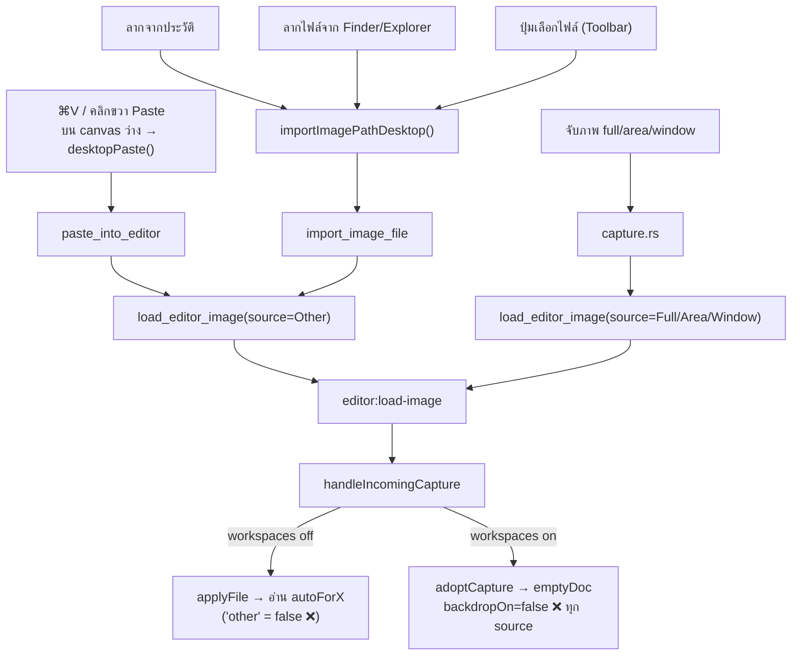
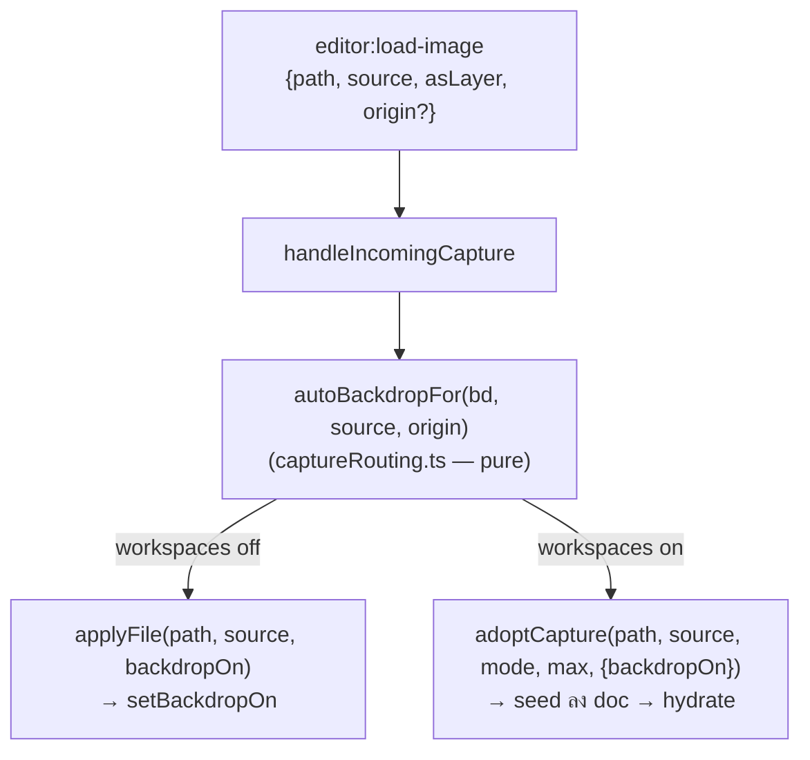

# แผน: ใส่ backdrop อัตโนมัติให้ภาพที่วาง (paste) และภาพที่เปิด/ลากเข้ามา

> สถานะ: แผน **rev 2** (หลัง scrutinize 3 รอบ) — ยังไม่ได้ลงมือ · 2026-10-16
> ทำงานบน worktree ใหม่จาก `origin/main` ตอนเริ่มทำจริง

## การตัดสินใจ (ล็อกแล้ว)

- ✅ **แยก 2 toggle** — `autoForPaste` / `autoForImport`
- ✅ **ค่าเริ่มต้น off ทั้งคู่** → migration v5→v6 เป็น identity
- ✅ **แก้โหมด workspaces ด้วย** (scrutinize พบว่าเป็น blocker — ดูด้านล่าง) ซึ่งจะแก้บั๊กเดิมที่การจับภาพก็ไม่ได้ backdrop ในโหมดนี้ไปพร้อมกัน

## ปัญหา

"ใส่พื้นหลังอัตโนมัติ" (`general.backdrop.autoForFull/Area/Window`) ทำงานแค่กับการจับภาพใหม่
ถ้า **วางภาพ (⌘V / Ctrl+V / คลิกขวา Paste)** หรือ **ลากภาพจากประวัติ / ลากไฟล์ / เลือกไฟล์** ลงใน canvas/workspace ว่าง จะไม่มี backdrop

### สาเหตุ (ตรวจในโค้ดแล้ว) — มี 2 ชั้น

1. **ทุกเส้นทางที่ไม่ใช่การจับภาพ ส่งมาเป็น `CaptureSource::Other`** แล้ว `applyFile` (`page.tsx:205-215`) map `"other"` → `false` ตายตัว — frontend แยก paste / import / startup restore ไม่ออก
2. **โหมด workspaces ไม่ผ่าน `applyFile` เลย** — `handleIncomingCapture` (`page.tsx:270-285`) เรียก `adoptCapture` แล้ว return
   → `fillEmpty` / `replaceActive` / `addWorkspace` สร้าง doc จาก `emptyDoc()` ที่ `backdropOn: false` (`workspaces.ts:158`)
   → `useWorkspaceSession` เรียก `hydrate(doc)` ทับ `backdropOn` (`editor.ts:644`)
   ⇒ ในโหมดนี้ **แม้แต่การจับภาพก็ไม่ได้ backdrop อัตโนมัติ** (บั๊กเดิม)



## การออกแบบ



- คำนวณ `backdropOn` **ครั้งเดียว** ใน `handleIncomingCapture` ก่อนแตก branch แล้วส่งให้ทั้งสองทาง → ทั้ง 2 โหมดใช้ logic เดียวกัน
- Rust ส่ง `origin: "paste" | "import"` ใน payload — optional, ไม่มี = ไม่ auto

### ทำไมส่ง `origin` แทนการเพิ่ม `CaptureSource` ใหม่

`"other"` มีความหมายเฉพาะในหลายที่: `archiveIncoming` ข้าม `"other"` (ไม่ archive ไฟล์ของผู้ใช้เอง),
`as_layer` ใน Rust ข้าม `Other` (`windows.rs:582`), ชื่อ tile ใน `WorkspaceBar`, และ `captureSource`
ที่ persist ใน `workspaces.json` — variant ใหม่กระทบทุกจุด ส่วน `origin` มีผลแค่ backdrop

### ทำไมใส่ใน payload ของ Rust แทน flag ฝั่ง frontend

ทำฝั่ง frontend ล้วนก็ได้ (ตั้ง pending-origin ก่อน `invoke` แล้วให้ listener ดึงไปใช้ตอน `source === "other"`,
ล้างเมื่อ invoke ล้มเหลว) — ไม่มี race ถ้าทำแบบนั้น แต่เป็น state ลอยข้าม async boundary ที่ต้องจำล้างทุก error path
ส่วนการใส่ใน payload ทำให้ "ภาพนี้มาจากไหน" เดินทางไปกับ event เดียวกัน ราคาราว 10 บรรทัด Rust → เลือก payload
(หมายเหตุ: ห้ามใช้วิธี "ตั้ง backdrop หลัง invoke resolve" — Rust emit จาก `run_on_main_thread` (`commands/editor.rs:110-117`)
โดยไม่รอ ลำดับ event กับ invoke response จึงไม่แน่นอน และ `applyFile` แบบ async จะทับค่า)

## รายละเอียดการแก้

### Commit 1 — Config schema v5 → v6

`src/lib/config.ts`
- type `general.backdrop`: เพิ่ม
  ```ts
  /** Auto-enable the backdrop for an image pasted onto an empty canvas. */
  autoForPaste: boolean;
  /** Auto-enable the backdrop for an image opened onto an empty canvas
   *  (history drag, file drop, file pick). */
  autoForImport: boolean;
  ```
- export alias `export type BackdropConfig = AppConfig["general"]["backdrop"];` (ยังไม่มี type ชื่อนี้)
- `DEFAULT_CONFIG.general.backdrop`: `autoForPaste: false, autoForImport: false`
- validator (`~line 866`): `autoForPaste: isBool, autoForImport: isBool`
- `CONFIG_SCHEMA_VERSION = 6`; `CONFIG_MIGRATIONS[5] = (o) => o` + comment "only ADDED `general.backdrop.autoForPaste/autoForImport` (default off)"
- Rust readers (`config.ts:498-508`): ตรวจแล้ว **ไม่มี** Rust อ่าน `general.backdrop` → ไม่ต้องแก้

Fixtures / tests
- `src/lib/__fixtures__/config/v6.json` — copy จาก v5 + `schemaVersion: 6` + **`autoForPaste: true, autoForImport: true`** (ค่าที่ไม่ใช่ default เพื่อให้ fallback เงียบ ๆ โผล่เป็น test fail)
- `shape.v6.json` — สร้างจาก `currentShape()` ตามที่ hint ใน `config.shape.test.ts:28` บอก (รัน test ครั้งแรกให้ fail แล้วเขียน shape ที่พิมพ์ออกมา หรือ script สั้น ๆ ใน vitest)
- `src/stores/settings.desktop.test.ts:4` — เปลี่ยน import `v5.json` → **`v6.json`** (ไม่เช่นนั้น test "does not rewrite or back up a clean current-version store" fail เพราะ v5 จะ migrate+rewrite — commit `98b352d` ของ v5 ก็แก้จุดนี้)
- `config.migrate.test.ts` — เพิ่ม import `v5.json` + test "v5 → v6: `autoForPaste/autoForImport` = false, ค่าอื่นคงเดิม"; อัปเดต comment รายการ fixture (`:17-23`, "v6 — current schema")
- `config.test.ts:137-160` — ขยาย block "per-capture auto-enable" เดิม: ค่าที่ไม่ใช่ boolean ตกกลับ default + มี issue

### Commit 2 — Rust: แนบ `origin` ใน `editor:load-image`

`src-tauri/src/windows.rs`
```rust
/// How a non-capture image reached the editor. Only drives the frontend's
/// auto-backdrop default; `None` (captures, startup) = no hint.
#[derive(Clone, Copy, serde::Serialize)]
#[serde(rename_all = "lowercase")]
pub enum LoadOrigin { Paste, Import }
```
- `LoadImagePayload` เพิ่ม `#[serde(skip_serializing_if = "Option::is_none")] origin: Option<LoadOrigin>`
- `load_editor_image(app, path, source, origin: Option<LoadOrigin>)` — callers (มีแค่ 3 จุด):
  - `commands/editor.rs:112` `paste_into_editor` → `Some(LoadOrigin::Paste)`
  - `commands/editor.rs:163` `import_image_file` → `Some(LoadOrigin::Import)`
  - `commands/capture.rs:131` → `None`
- แก้ doc comment ที่ล้าสมัย: `windows.rs:527-530` และ `:580` ("paste, flatten-to-new" — flatten-to-new ไม่มีแล้ว)
- test: serialize payload → มี `"origin":"paste"` เมื่อ Some, ไม่มี key `origin` เมื่อ None
- `cargo clippy --all-targets -- -D warnings` **ต้องรันบน Mac** (CI ไม่ build Rust บน PR)

### Commit 3 — Frontend: เลือกและ seed backdrop ทั้ง 2 โหมด

`src/lib/captureRouting.ts` (ที่อยู่ของ routing decision เดิม + มี test อยู่แล้ว — ไม่ใส่ใน `backdrop.ts` ซึ่งเป็น module render/geometry ที่หน้า landing เว็บก็ import)
```ts
export type LoadOrigin = "paste" | "import";

/** Whether a freshly loaded base image starts with the backdrop on. */
export function autoBackdropFor(
  bd: Pick<BackdropConfig, "autoForFull" | "autoForArea" | "autoForWindow" | "autoForPaste" | "autoForImport">,
  source: CaptureSource,
  origin?: LoadOrigin,
): boolean
```
- `full` → `autoForFull`; `area` / `systemArea` → `autoForArea`; `window` → `autoForWindow`; `scroll` → `false`
- `other` + `paste` → `autoForPaste`; `other` + `import` → `autoForImport`; `other` ไม่มี origin → `false`
- ใช้ `import type` สำหรับ `CaptureSource` / `BackdropConfig`

`src/app/editor/page.tsx`
- listener generic (`~line 368-370`, TS mirror ของ payload — ไม่มี shared type file): เพิ่ม `origin?: LoadOrigin` แล้วส่งต่อ
- `handleIncomingCapture(path, source, asLayer, origin?)`: ใน case `"base"` คำนวณ
  `const backdropOn = autoBackdropFor(useSettings.getState().config.general.backdrop, source, origin)` แล้ว
  - workspaces on → `adoptCapture(path, source, mode, max, { backdropOn })`
  - workspaces off → `applyFile(path, source, backdropOn)`
- `applyFile(path, source, backdropOn = false)`: แทน ternary เดิมด้วย `setBackdropOn(backdropOn)`
  (`applyFile` ถูกเรียกหลัง `await useSettings.getState().init()` — ให้คำนวณใน `handleIncomingCapture` หลัง config พร้อม;
  listener ทำงานหลัง `configReady` อยู่แล้ว แต่ตอนลงมือให้ยืนยันอีกครั้ง ถ้าไม่ชัวร์ให้ `await init()` ก่อนคำนวณ)
- startup restore (`page.tsx:306-316`) — ไม่ผ่าน `autoBackdropFor`, ยัง `false` เหมือนเดิม (ภาพที่ค้างไว้ไม่ควรเปลี่ยน backdrop เอง)

`src/stores/workspaces.ts`
- `adoptCapture(path, source, mode, max, opts?: { backdropOn?: boolean })`
- `NewDocSeed` เพิ่ม `"backdropOn"`; `addWorkspace` spread ลง doc
- `fillEmpty` / `replaceActive` รับ `backdropOn` แล้วใส่ใน doc ใหม่ (ทับ `emptyDoc()`)
- ไม่แตะ `adoptBlob` / `setActiveImage` (เว็บ) / `createEmpty`

Tests
- `captureRouting.test.ts`: ตาราง source × origin × toggle ครบ รวม `other` ไม่มี origin = false และ `scroll` = false
- `workspaces.test.ts`: `adoptCapture(..., { backdropOn: true })` → doc มี `backdropOn: true` ทั้งกรณี **filled** (workspace ว่าง), **replaced**, **added**; ไม่ส่ง opts → `false`
  (unit test ของ helper อย่างเดียวจะผ่านทั้งที่ workspace path ยังพัง — ต้องมี test นี้)

### Commit 4 — Settings UI + i18n

`CapturePage.tsx` — เพิ่ม 2 แถวต่อจาก Full/Area/Window ใน list checkbox เดิม

| key | en | th |
|---|---|---|
| `settings.capture.backdrop.paste` | Pasted images | ภาพที่วาง |
| `settings.capture.backdrop.import` | Opened or dropped images | ภาพที่เปิดหรือลากเข้ามา |

- hint en/th: "captures" → "images" ("Starts the padded backdrop on for these images; still togglable per image.")
- ตรวจคำไทยกับ `src/i18n/GLOSSARY.md` (backdrop = พื้นหลัง)
- `registry.ts` `"capture.backdrop"`: เพิ่ม keywords `paste`, `import`, `drop`, `history`, `open` / `วาง`, `ประวัติ`, `ลาก`, `เปิด`
- **ไม่ใส่ `addedIn`** — row นี้อยู่ใน Advanced (พับไว้) และ `markPageSeen` ล้างป้าย New ทันทีที่หน้า Capture render (`SettingsView.tsx:54-61`, `settingNews.ts:123-128`) ผู้ใช้จะไม่เห็นป้ายอยู่ดี และ `registry.ts:64-67` ห้ามใส่ `addedIn` กับ row ที่มีอยู่แล้ว → ใช้ search keywords + release note แทน

### Commit 5 — `PROGRESS-FEATURE.md`

บันทึก feature + หมายเหตุว่าแก้บั๊ก auto-backdrop ในโหมด workspaces ด้วย

## ขอบเขตที่ไม่ทำ

- **Paste/drop บนภาพที่มีอยู่แล้ว** → overlay layer ไม่ผ่าน Rust (`elementClipboard.ts:266`, `importImage.ts:22`) — backdrop ไม่เปลี่ยน ถูกต้องแล้ว
- **Web `/paste`** — เว็บไม่มีหน้า Settings และไม่อ่าน backdrop config เลย (`applyBlob` → `setActiveImage` spread doc เดิม, `workspaces.ts:437-444`) จึงไม่มีอะไรต้องต่อ
- **ภาพจากประวัติจำชนิดการจับเดิม** (ภาพ window → `autoForWindow`) — ต้องเก็บ kind ใน archive metadata; งานถัดไปถ้าต้องการ
- **`nextPinNumber` seed ในโหมด workspaces** — `applyFile` seed เลขหมุดตาม `pins.continuityMode` แต่ `adoptCapture` ไม่ทำ (บั๊กข้างเคียงแบบเดียวกัน) — จดไว้ ไม่แก้ใน PR นี้

## Manual QA (Mac, ทั้ง workspaces **on** และ **off**)

| กรณี | คาดหวัง |
|---|---|
| toggle paste on → ⌘V บน canvas ว่าง | มี backdrop |
| toggle paste on → คลิกขวา Paste บน canvas ว่าง | มี backdrop |
| toggle paste off → ⌘V | ไม่มี |
| toggle import on → ลากจากประวัติ / ลากไฟล์จาก Finder / ปุ่มเลือกไฟล์ | มี backdrop |
| ⌘V หรือลากไฟล์บนภาพที่มีอยู่ | เป็น overlay, backdrop ไม่เปลี่ยน |
| restart แอปที่มีภาพค้าง | backdrop ไม่เปลี่ยน |
| จับภาพ window (default `autoForWindow: true`) ในโหมด workspaces | **ตอนนี้มี backdrop แล้ว** (เดิมไม่มี) |
| สลับ workspace ไปมา | backdrop ของแต่ละ workspace คงเดิม |
| ค้นหา "paste" / "วาง" ใน Settings | เจอ row และ Advanced เปิดให้ |

## สรุปผล scrutinize (3 รอบ)

| ผล | ที่มา | สิ่งที่แก้ใน rev 2 |
|---|---|---|
| 🔴 โหมด workspaces ไม่ผ่าน `applyFile` → toggle ไม่มีผล (และการจับภาพก็พังอยู่แล้ว) | ทั้ง 3 รอบ | คำนวณใน `handleIncomingCapture`, seed `backdropOn` ผ่าน `adoptCapture` + test |
| 🟠 `settings.desktop.test.ts` import `v5.json` จะ fail หลัง bump | รอบ 3 | ชี้ไป `v6.json` ใน commit 1 |
| 🟠 `addedIn` ไม่มีใครเห็น + ผิดกติกา registry | รอบ 1, 2 | ตัดออก ใช้ keywords |
| 🟡 `BackdropConfig` ไม่มีอยู่จริง | รอบ 1, 3 | export alias ใน `config.ts` |
| 🟡 helper ควรอยู่ `captureRouting.ts` ไม่ใช่ `backdrop.ts` | รอบ 3 | ย้าย |
| 🟡 fixture/test wiring ไม่ครบ (v5 import, ค่าไม่ใช่ default, วิธีสร้าง shape) | รอบ 1, 3 | ระบุใน commit 1 |
| 🟡 เหตุผล "race" ของ frontend-only เกินจริง; เหตุผลเรื่องเว็บผิด | รอบ 2 | แก้ข้อความ |
| ⚪ doc comment "flatten-to-new" ล้าสมัย; `LoadOrigin` serialize; ไดอะแกรมขาดปุ่มเลือกไฟล์ | รอบ 1, 3 | แก้ |
