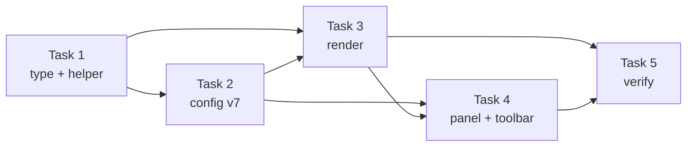

# CP-0076 — Shapes: dashed / dotted stroke style (rect, ellipse, line) — Implementation Plan

> **For agentic workers:** REQUIRED SUB-SKILL: Use superpowers:subagent-driven-development (recommended) or superpowers:executing-plans to implement this plan task-by-task. Steps use checkbox (`- [ ]`) syntax for tracking.

**Goal:** The Shapes tool's rectangle, ellipse ("circle") and line can each be drawn solid, dashed or dotted; the style is a tool default and is editable on a selected shape.

**Architecture:** One new enum `StrokeStyle` and one pure helper (`src/lib/strokeStyle.ts`) that turns `(style, strokeWidth)` into Konva stroke props. `RectAnnotation` and `ArrowAnnotation` gain an optional `strokeStyle`; renderers spread the helper's props. The Shapes tool's `"dashline"` shape kind is folded into `line` + `strokeStyle:"dashed"` by a v6→v7 config migration. The Shapes panel gets a 3-way style picker that also shows for a selected rect/ellipse/line.

**Tech Stack:** Next.js 15 static export, TypeScript 5 strict, react-konva/konva, Zustand 5, Vitest. pnpm only.

**Spec:** PM ticket **CP-0076** (`pm task get --id CP-0076`).

## Global Constraints

- Settings schema: any persisted change bumps `CONFIG_SCHEMA_VERSION` (6 → 7) with a `CONFIG_MIGRATIONS[6]` step, a `__fixtures__/config/v7.json` fixture, and a regenerated `shape.v7.json` (CLAUDE.md "Settings schema"). No Rust reader touches `tools.*` / `lastUsed.rect`, so no Rust change.
- Every user-visible string through `t()` with keys in `src/i18n/locales/{en,th}/editor.ts`; Thai terms per `src/i18n/GLOSSARY.md` (เส้น = line).
- No `localStorage`; persistence goes through the existing `patchLastUsed` / `updateSettings("tools", …)` pair, exactly as sibling controls do.
- `cargo clippy` untouched (no Rust); `pnpm test:unit` and `pnpm exec tsc --noEmit` must be clean.
- Out of scope: a dotted option for the **Arrow** tool (it keeps its dash toggle) and for magnify.

## Decisions (what the implementer cannot infer)

| Question | Decision | Why |
|---|---|---|
| Field shape | `strokeStyle?: StrokeStyle` where `type StrokeStyle = "solid" \| "dashed" \| "dotted"`; absent = `"solid"` | Additive, old docs/history/templates render unchanged. |
| Arrow's existing `dash?: boolean` | Kept. Arrows (and lines) resolve via `arrowStrokeStyle(a) = a.strokeStyle ?? (a.dash ? "dashed" : "solid")` | Old saved lines carry `dash:true`; Arrow tool keeps writing `dash`. |
| `"dashline"` shape kind | Removed from `RectShapeKind` and validators; migration maps it to `shape:"line"` + `strokeStyle:"dashed"` | With a style picker it is a duplicate of `line`+`dashed`. |
| Style scope | One style shared by every Shapes-tool kind (like color/width). A migrated `dashline` user who then picks Rectangle draws dashed until they change it — accepted. | Per-kind styles would be three more persisted keys for no asked-for benefit. |
| Migration per slot | Every `rect` slot (tools **and** lastUsed) that has a `shape` and no `strokeStyle` gets `strokeStyle = shape === "dashline" ? "dashed" : "solid"` | `effectiveTools` merges field by field; writing the style only into the dashline slot would leak `"dashed"` into the other slot's solid rect (e.g. `tools.rect.shape:"dashline"` + `lastUsed.rect.shape:"rect"`). |
| Dash pattern (sw = strokeWidth) | solid → `{}`; dashed → `{ dash:[2sw, 2sw], lineCap:"round", lineJoin:"round" }`; dotted → `{ dash:[0.001, max(2sw, sw+3)], lineCap:"round", lineJoin:"round" }` | dashed = today's line/arrow look, so existing dashed lines don't change; dotted = round dots of diameter sw at 2sw pitch, with ≥3px clear gap so 1–2px dots don't read as a solid line when zoomed out. `0.001` not `0`: zero-length dash segments are not reliably capped across engines (verify on WKWebView). |
| Solid rects | No `lineCap`/`lineJoin` change (helper returns `{}`) | Don't alter every existing rect's mitered corners. |
| Draft (while dragging) | Line draft uses the helper; rect/ellipse draft keeps its `[6,4]` marquee | The marquee is the established "drawing in progress" look. |
| Closed-path seam | Not corrected (no perimeter-fitting of the pattern). Checked manually in Task 5; revisit only if it looks bad. | Fitting needs perimeter math for rounded rects and ellipses; YAGNI until seen. |
| Legacy Arrow-tool arrow saved with `heads:"none"` | Opens the Shapes panel too — indistinguishable from a Shapes-tool line; accepted (its color/width already persist under `rect`, `Toolbar.tsx:258`). | — |
| Selected line's panel | A headless line (`arrow` + `heads:"none"`) routes to the **Shapes** panel, not the Arrow panel | It was drawn by the Shapes tool; also fixes today's bug where its dash toggle writes `lastUsed.arrow.dash`. |

## Review Focus

1. **Old saved line with `dash:true`** (history, workspace, template, element clipboard) must still render dashed and show "Dashed" in the picker → Task 1 `arrowStrokeStyle` test (renderer and ctx both call it); picker display checked manually in Task 5 Step 3.
2. **Store with `tools.rect.shape:"dashline"` or `lastUsed.rect.shape:"dashline"`** must not silently become a solid line, and must not make the *other* slot's rect dashed → Task 2 migration tests incl. the cross-slot case.
3. **Very thin (1px) / very thick (20px) dotted stroke** must still read as dots, not a solid line or blobs → Task 1 asserts the gap floor and scaling; manual check at 1 and 20, zoomed out, in Task 5.
4. **A selected Arrow-tool arrow** must keep the Arrow panel and never get the style picker / touch rect defaults → Task 1 `isShapesToolAnnotation` test (an arrow with heads `"end"`/`"both"`/absent is false); Toolbar uses it for both `panelKind` and the ctx.
5. **Export matches screen** — Konva `toDataURL` reuses node attrs, so this holds by construction; verified manually in Task 5 (copy to clipboard, paste, compare).

---

### Task 1: `StrokeStyle` type + dash helper

**Files:**
- Modify: `src/stores/editor.ts` (types near `RectShapeKind`, `RectAnnotation`, `ArrowAnnotation`)
- Create: `src/lib/strokeStyle.ts`
- Test: `src/lib/strokeStyle.test.ts`

**Interfaces:**
- Produces:
  - `export type StrokeStyle = "solid" | "dashed" | "dotted"` (in `src/stores/editor.ts`)
  - `RectAnnotation.strokeStyle?: StrokeStyle`, `ArrowAnnotation.strokeStyle?: StrokeStyle` (doc comment on `dash` says "legacy; superseded by strokeStyle when set")
  - `export type StrokeDashProps = { dash?: number[]; lineCap?: "round"; lineJoin?: "round" }`
  - `export function strokeDashProps(style: StrokeStyle | undefined, strokeWidth: number): StrokeDashProps`
  - `export function arrowStrokeStyle(a: Pick<ArrowAnnotation, "strokeStyle" | "dash">): StrokeStyle`
  - `export function isShapesToolAnnotation(a: Annotation | null): a is RectAnnotation | (ArrowAnnotation & { heads: "none" })` — true for `rect`, and for `arrow` with `heads === "none"`

- [ ] **Step 1: Write the failing tests** (`describe("strokeDashProps")`, `describe("arrowStrokeStyle")`)

```ts
expect(strokeDashProps("solid", 4)).toEqual({});
expect(strokeDashProps(undefined, 4)).toEqual({});
expect(strokeDashProps("dashed", 4)).toEqual({ dash: [8, 8], lineCap: "round", lineJoin: "round" });
expect(strokeDashProps("dotted", 4)).toEqual({ dash: [0.001, 8], lineCap: "round", lineJoin: "round" });
expect(strokeDashProps("dotted", 1).dash).toEqual([0.001, 4]); // gap floor sw+3
expect(strokeDashProps("dotted", 2).dash).toEqual([0.001, 5]);
expect(strokeDashProps("dotted", 20).dash).toEqual([0.001, 40]);

expect(arrowStrokeStyle({})).toBe("solid");
expect(arrowStrokeStyle({ dash: true })).toBe("dashed");
expect(arrowStrokeStyle({ dash: false })).toBe("solid");
expect(arrowStrokeStyle({ dash: true, strokeStyle: "dotted" })).toBe("dotted");
expect(arrowStrokeStyle({ dash: true, strokeStyle: "solid" })).toBe("solid");

expect(isShapesToolAnnotation(rect)).toBe(true);           // fixtures: minimal rect/arrow literals
expect(isShapesToolAnnotation({ ...arrow, heads: "none" })).toBe(true);
expect(isShapesToolAnnotation({ ...arrow, heads: "end" })).toBe(false);
expect(isShapesToolAnnotation({ ...arrow, heads: undefined })).toBe(false);
expect(isShapesToolAnnotation(null)).toBe(false);
```

- [ ] **Step 2:** `pnpm test:unit src/lib/strokeStyle.test.ts` → FAIL (module not found).
- [ ] **Step 3:** Add the types and implement the three functions.
- [ ] **Step 4:** Same command → PASS; `pnpm exec tsc --noEmit` clean.
- [ ] **Step 5:** `git commit -m "feat(shapes): StrokeStyle type and dash-pattern helper (CP-0076)"`

### Task 2: Config v7 — `rect.strokeStyle`, drop `dashline`

**Files:**
- Modify: `src/lib/config.ts` — `lastUsed.rect` type (~L203), `tools.rect` type (~L262), `DEFAULT_CONFIG.tools.rect`, `CONFIG_SCHEMA_VERSION` + its history comment, `CONFIG_MIGRATIONS[6]`, `tools` validator (~L898), `lastUsed` `keep("rect", …)` (~L1005), `EffectiveTools.rect`, `effectiveTools`
- Modify: `src/stores/editor.ts` — `RectShapeKind = "rect" | "ellipse" | "line"` and its doc comment
- Create: `src/lib/__fixtures__/config/v7.json`, `src/lib/__fixtures__/config/shape.v7.json`
- Modify: `src/stores/settings.desktop.test.ts:4` — `import current from "@/lib/__fixtures__/config/v7.json"` (the "clean current-version store" test, `:78-84`, otherwise sees a v6 store migrate + get rewritten; #130 made the same edit 5→6)
- Test: `src/lib/config.migrate.test.ts`, `src/lib/config.test.ts`

**Interfaces:**
- Consumes: `StrokeStyle` (Task 1)
- Produces: `AppConfig["tools"]["rect"].strokeStyle: StrokeStyle` (default `"solid"`), `lastUsed.rect.strokeStyle?: StrokeStyle`, `EffectiveTools["rect"].strokeStyle: StrokeStyle`

- [ ] **Step 1: Write the failing tests** in `config.migrate.test.ts` — `describe("v6 → v7: rect strokeStyle, dashline folded into line")`:

```ts
it("tools.rect dashline becomes line + dashed", () => {
  const { config, issues } = load({ ...v6, tools: { ...v6.tools, rect: { ...v6.tools.rect, shape: "dashline" } } });
  expect(issues).toEqual([]);
  expect(config.tools.rect).toMatchObject({ shape: "line", strokeStyle: "dashed", strokeColor: "#ef4444", strokeWidth: 3 });
});
it("lastUsed.rect dashline becomes line + dashed", () => {
  const { config } = load({ ...v6, lastUsed: { rect: { shape: "dashline" } } });
  expect(config.lastUsed?.rect).toEqual({ shape: "line", strokeStyle: "dashed" });
});
it("dashline in one slot does not make the other slot's rect dashed", () => {
  const { config } = load({
    ...v6,
    general: { ...v6.general, rememberLastTool: true },
    tools: { ...v6.tools, rect: { ...v6.tools.rect, shape: "dashline" } },
    lastUsed: { rect: { shape: "rect" } },
  });
  expect(effectiveTools(config).rect).toMatchObject({ shape: "rect", strokeStyle: "solid" });
  expect(config.tools.rect).toMatchObject({ shape: "line", strokeStyle: "dashed" });
});
it("a v6 rect/ellipse/line keeps its shape and gains solid", () => {
  const { config } = load(v6);
  expect(config.schemaVersion).toBe(7);
  expect(config.tools.rect).toMatchObject({ ...v6.tools.rect, strokeStyle: "solid" });
});
it("a v7 store keeps stored values", () => {
  const { config, issues } = load(v7);
  expect(issues).toEqual([]);
  expect(config.tools.rect).toEqual(v7.tools.rect);
});
```

  In `config.test.ts`: an invalid `tools.rect.strokeStyle: "wavy"` falls back to `"solid"` with an issue; `effectiveTools` returns `lastUsed.rect.strokeStyle` when `rememberLastTool` is on and `tools.rect.strokeStyle` when off.

- [ ] **Step 2:** `pnpm test:unit src/lib/config src/stores/settings` → new tests FAIL; shape test still PASS (nothing changed yet).
- [ ] **Step 3: Implement.** Bump to 7; comment `// v7 (CP-0076): added tools.rect.strokeStyle / lastUsed.rect.strokeStyle; removed RectShapeKind "dashline".` Step 6 is the only non-identity part:

```ts
// v6 → v7 (CP-0076): the Shapes tool's "dashline" kind is now line + a
// dashed stroke style. Carry it across in both slots; everything else gains
// strokeStyle via its default.
6: (o) => {
  // Each slot that names a shape gets an explicit style, so effectiveTools'
  // field-by-field merge can't leak one slot's "dashed" into the other's rect.
  const fold = (r: unknown) => {
    if (!isPlainObject(r)) return r;
    if (r.shape === "dashline") return { ...r, shape: "line", strokeStyle: r.strokeStyle ?? "dashed" };
    if (r.shape === undefined || r.strokeStyle !== undefined) return r;
    return { ...r, strokeStyle: "solid" };
  };
  const tools = isPlainObject(o.tools) ? { ...o.tools, rect: fold(o.tools.rect) } : o.tools;
  const lastUsed = isPlainObject(o.lastUsed) ? { ...o.lastUsed, rect: fold(o.lastUsed.rect) } : o.lastUsed;
  return { ...o, tools, lastUsed };
},
```

  Validators: `shape: inSet("rect", "ellipse", "line")`, `strokeStyle: inSet("solid", "dashed", "dotted")` in both the `tools` and `lastUsed` sections. `v7.json` = `v6.json` with `schemaVersion: 7` and `tools.rect.strokeStyle: "dotted"` (non-default on purpose). Regenerate `shape.v7.json` from `currentShape()` (same procedure as `shape.v6.json`; diff must show only the added `strokeStyle` leaves and `dashline` removed). Add `v7` to the fixture list comment and change `v6`'s line to "schema of v0.18.x". Change the existing `expect(config.schemaVersion).toBe(6)` (`config.migrate.test.ts:164`) to `toBe(CONFIG_SCHEMA_VERSION)`.
- [ ] **Step 4:** `pnpm test:unit src/lib/config src/stores/settings` → all PASS (including `config.shape.test.ts` and `settings.desktop.test.ts`); `tsc` will now flag every `"dashline"` use — those are fixed in Tasks 3–4, so run `tsc` at the end of Task 4, not here.
- [ ] **Step 5:** `git commit -m "feat(config): v7 — rect strokeStyle, fold dashline into line (CP-0076)"`

### Task 3: Render + draw with the style (EditorStage)

**Files:**
- Modify: `src/components/editor/EditorStage.tsx` — `lastUsedPatchForAnnotation` (~L140), pointer-down line branch (~L1175), line commit (~L1381), line draft (~L1765), `RectShape` (~L2216), `ArrowShape` `dash=` (~L2450)
- Create: `src/lib/lastUsedPatch.ts` — move `lastUsedPatchForAnnotation` here verbatim (it is pure); EditorStage imports it. Don't import `EditorStage.tsx` in a unit test — it drags in konva/react-konva/stores.
- Test: `src/lib/lastUsedPatch.test.ts` (new)

**Interfaces:**
- Consumes: `strokeDashProps`, `arrowStrokeStyle` (Task 1); `toolsCfg.rect.strokeStyle` (Task 2)

- [ ] **Step 1: Write the failing test** for `lastUsedPatchForAnnotation`:

```ts
expect(lastUsedPatchForAnnotation({ id: "a", type: "rect", x: 0, y: 0, w: 1, h: 1, stroke: "#f00", strokeWidth: 2, shape: "ellipse", strokeStyle: "dotted" }))
  .toEqual({ rect: { strokeColor: "#f00", strokeWidth: 2, shape: "ellipse", cornerRadius: undefined, strokeStyle: "dotted" } });
expect(lastUsedPatchForAnnotation({ id: "l", type: "arrow", x1: 0, y1: 0, x2: 9, y2: 9, stroke: "#f00", strokeWidth: 2, heads: "none", dash: true }))
  .toEqual({ rect: { strokeColor: "#f00", strokeWidth: 2, shape: "line", strokeStyle: "dashed" } });
// a pre-feature rect (no strokeStyle) yields an explicit "solid" — the patch replaces the whole rect slot
expect(lastUsedPatchForAnnotation({ id: "a", type: "rect", x: 0, y: 0, w: 1, h: 1, stroke: "#f00", strokeWidth: 2 }).rect?.strokeStyle).toBe("solid");
```

- [ ] **Step 2:** run it → FAIL.
- [ ] **Step 3: Implement.**
  - `lastUsedPatchForAnnotation`: rect adds `strokeStyle: a.strokeStyle ?? "solid"`; headless line adds `shape: "line", strokeStyle: arrowStrokeStyle(a)` (`scheduleLastUsedWrite` replaces the whole `rect` slot — `EditorStage.tsx:398-400`).
  - Line commit: also call `scheduleLastUsedWrite(lastUsedPatchForAnnotation(a))` after `add(a)`, like the rect commit (`:1341`) — today a drawn line remembers nothing, which makes the headless branch above dead code. (A legacy store with `tools.arrow.heads:"none"` reaches it from the Arrow tool too and would flip the Shapes tool to line; accepted, that store is already inconsistent.) Fix the stale "Persists under the arrow's config" comment at `:1381`.
  - Pointer-down: line branch is `toolsCfg.rect.shape === "line"` only.
  - Rect commit (~L1338): add `strokeStyle: toolsCfg.rect.strokeStyle`.
  - Line commit: replace `dash: … === "dashline"` with `strokeStyle: s, dash: s === "dashed"` (`s = toolsCfg.rect.strokeStyle`) — `dash` keeps a dashed line dashed when an older capz opens the same history/workspace, and matches what the selected-line edit writes.
  - Line draft: replace the `dash`/`lineCap`/`lineJoin` props with `lineCap="round" lineJoin="round" {...strokeDashProps(toolsCfg.rect.strokeStyle, toolsCfg.rect.strokeWidth)}`.
  - `RectShape`: add `...strokeDashProps(a.strokeStyle, a.strokeWidth)` to `shared` — the ellipse `sceneFunc` calls `c.strokeShape(shape)`, which applies the node's dash/cap, so both variants are covered.
  - `ArrowShape`: replace the `dash=` prop with `dash={strokeDashProps(arrowStrokeStyle(a), a.strokeWidth).dash}` (cap/join stay `round`).
- [ ] **Step 4:** run the test → PASS.
- [ ] **Step 5:** `git commit -m "feat(shapes): render rect/ellipse/line stroke style (CP-0076)"`

### Task 4: Style picker in the Shapes panel (Toolbar + panel + i18n)

**Files:**
- Modify: `src/components/editor/toolbar/panels/types.ts` — add `StrokeStyleCtx`
- Modify: `src/components/editor/toolbar/panels/kit.tsx` — add `SolidLineIcon` (the `DashLineIcon` SVG without the dasharray, so "Solid" doesn't reuse the `Minus` already used for "Line") and `DotLineIcon` (`strokeDasharray="0.01 3"`, `strokeLinecap="round"`) next to `DashLineIcon`
- Modify: `src/components/editor/toolbar/panels/ShapesPanel.tsx` — drop the `dashline` option; add the style picker
- Modify: `src/components/editor/toolbar/panels/ToolOptionsPanel.tsx` — prop + pass-through for `rect`
- Modify: `src/components/editor/toolbar/panels/ArrowPanel.tsx` — doc comment no longer mentions headless line
- Stale comments to fix: `Toolbar.tsx:286` ("line/dashline draw a 2-point segment"), `ShapesPanel.tsx:18` ("rect/ellipse/line/dashed")
- Modify: `src/components/editor/Toolbar.tsx` — build `strokeStyleCtx` (L253–335 selected branch, L733 tool branch); `panelKind` (L1389)
- Modify: `src/i18n/locales/en/editor.ts`, `src/i18n/locales/th/editor.ts`, `src/i18n/GLOSSARY.md` (row: solid / dashed / dotted line = เส้นทึบ / เส้นประ / เส้นจุด)
- Modify: `docs/manual-qa.md:63,67` — replace the "line / dashed-line options" and line dash-toggle checks with the style-picker checks
- Test: `src/components/editor/toolbar/panels/ShapesPanel.test.tsx` (new)

**Interfaces:**
- Consumes: `StrokeStyle`, `arrowStrokeStyle`, `isShapesToolAnnotation` (Task 1); `toolsCfg.rect.strokeStyle` (Task 2); Task 3 has removed every EditorStage `"dashline"` use (else this task's `tsc` gate fails)
- Produces: `export type StrokeStyleCtx = { value: StrokeStyle; onChange: (v: StrokeStyle) => void }`; `ShapesPanel` prop `strokeStyleCtx: StrokeStyleCtx | null`

- [ ] **Step 1: Write the failing test** (`ShapesPanel.test.tsx`; first line `// @vitest-environment jsdom` and `afterEach(cleanup)` like `SettingRow.test.tsx` (globals are off, so RTL doesn't auto-clean); English pinned by `setupLang`; `@testing-library/user-event` is **not** installed — use `fireEvent`):

```tsx
it("offers rect/circle/line only — no dashed-line shape", () => {
  // base = { colorCtx: null, widthCtx: null, cornerCtx: null, colorInputRef: { current: null }, selected: false }
  render(<ShapesPanel {...base} rectShapeCtx={{ value: "rect", onChange: vi.fn() }} strokeStyleCtx={null} />);
  expect(screen.queryByRole("button", { name: "Dashed line" })).toBeNull();
});
it("picks a stroke style", () => {
  const onChange = vi.fn();
  render(<ShapesPanel {...base} rectShapeCtx={null} strokeStyleCtx={{ value: "solid", onChange }} />);
  fireEvent.click(screen.getByRole("button", { name: "Dotted" }));
  expect(onChange).toHaveBeenCalledWith("dotted");
});
```

  (`ToggleIconButton` sets `title`, which is the accessible name — `kit.tsx:45`.)
- [ ] **Step 2:** run → FAIL.
- [ ] **Step 3: Implement.**
  - i18n keys (en / th): `editor.panel.strokeStyle` "Line style" / "รูปแบบเส้น"; `editor.panel.solid` "Solid" / "เส้นทึบ"; `editor.panel.dashed` "Dashed" / "เส้นประ"; `editor.panel.dotted` "Dotted" / "เส้นจุด". Keep `editor.panel.dashedLine` (Arrow/Magnify use it).
  - `ShapesPanel`: render the "Shape" `SectionLabel` only with `rectShapeCtx`; then its own `<SectionLabel>{t("editor.panel.strokeStyle")}</SectionLabel>` + `IconSegmented<StrokeStyle>` (same key for `title`/`ariaLabel`) with options solid (`SolidLineIcon`), dashed (`DashLineIcon`), dotted (`DotLineIcon`); rendered when `strokeStyleCtx` is non-null (independent of `rectShapeCtx`, which is hidden while a shape is selected).
  - `Toolbar` — one helper inside the component:
    `const persistRectStyle = (v: StrokeStyle) => remember ? patchLastUsed({ rect: { strokeStyle: v } }) : void updateSettings("tools", { rect: { strokeStyle: v } } as Partial<AppConfig["tools"]>);`
    - selected `rect`: `strokeStyleCtx = { value: rectSel.strokeStyle ?? "solid", onChange: v => { updateAnnotation(id, { strokeStyle: v }); persistRectStyle(v); } }`
    - selected headless line: same, `value: arrowStrokeStyle(lineSel)`, patch `{ strokeStyle: v, dash: v === "dashed" }` (keeps `dash` truthful for anything still reading it); **delete** the `arrowDashCtx` block for headless lines.
    - no selection, `tool === "rect"`: `{ value: toolsCfg.rect.strokeStyle, onChange: persistRectStyle }`; delete the "Solid vs. dotted line is chosen via the shape picker" comment.
    - Gate both the selected-shape ctx and `panelKind` on `isShapesToolAnnotation(selected)`: `panelKind = isShapesToolAnnotation(selected) ? "rect" : selected ? selected.type : tool`.
  - Pass `strokeStyleCtx` through `ToolOptionsPanel` to `ShapesPanel`.
- [ ] **Step 4:** run the new test → PASS; then `pnpm exec tsc --noEmit` (no `"dashline"` left: `rg '"dashline"' src -g '!**/__fixtures__/**'` → only the migration step and its tests; historic `shape.v2–v6.json` fixtures must keep it) and full `pnpm test:unit` → PASS.
- [ ] **Step 5:** `git commit -m "feat(shapes): solid/dashed/dotted picker in the Shapes panel (CP-0076)"`

### Task 5: Interactive verification + trackers

**Files:**
- Modify: `PROGRESS-FEATURE.md` (one entry for CP-0076)

- [ ] **Step 1:** Build on the Mac (`mac-app-build` skill) or run `pnpm dev` for the web `/paste` editor. Check, each at width 1, 4 and 20: rect (radius 0 and 24), ellipse, line — solid / dashed / dotted. Dots must be round, dashed must match an old dashed line. Look at the closed-path seam (rect top-left, ellipse 3 o'clock) and at sharp rect corners for dotted; at 50% zoom a 1px dotted line must still read as dots.
- [ ] **Step 2:** Select an existing rect, ellipse and line: Shapes panel (not Arrow panel) opens, picker shows the current style; changing it updates the shape; Cmd/Ctrl+Z reverts it in one step. Select an Arrow-tool arrow: Arrow panel, no style picker.
- [ ] **Step 3:** Open a history entry / workspace saved by v0.18.x that has a dashed line: still dashed, picker shows "Dashed".
- [ ] **Step 4:** Copy to clipboard and paste into another app: the export matches the canvas.
- [ ] **Step 5:** Commit tracker update; move CP-0076 `doing → completed`.

## Execution order



## Scrutiny log

**Round 1 — fix-then-ship.** Applied: per-slot explicit style in the v6→v7 migration + cross-slot test (major); `lastUsedPatchForAnnotation` moved to `src/lib/lastUsedPatch.ts` so it's testable without EditorStage (major); ShapesPanel test uses `fireEvent` + jsdom pragma (major); existing `toBe(6)` assertion updated (major); Review Focus 1/4 now point at real tests via `isShapesToolAnnotation` (major); `?? "solid"` and `shape:"line"` in the lastUsed patch, dotted gap floor `sw+3`, own `SolidLineIcon`, seam/corner manual checks (nits). Verified OK by reviewer: all code refs, migrate-before-validate ordering, Konva dash on `strokeShape`, hit-test ignores dash, react-konva clears removed props, one undo step per update, clones carry the field.

**Round 2 — fix-then-ship.** Applied: `settings.desktop.test.ts` fixture import → v7 (major); line commit also writes `dash` for older-build compat; migration folds `dashline` before the "already has a style" guard; `manual-qa.md` + GLOSSARY updates; `afterEach(cleanup)`; legacy `heads:"none"` arrow decision recorded (nits). Verified OK: `isPlainObject` in scope, every slot combination of the fold, `patchLastUsed` per-slot merge vs `scheduleLastUsedWrite` replace, `vsec` issues vs silent `keep()`, type predicate narrowing, `tsc` catches leftover `"dashline"`, no consumers in e2e/worker/Settings/stories.

**Round 3 — fix-then-ship.** Applied: `T3 → T4` dependency (major — Task 4's `tsc` gate needs Task 3's `dashline` removals); `rg` excludes historic fixtures; line commit now calls `scheduleLastUsedWrite` (the headless lastUsed branch was dead code) + corrected test comment; own "Line style" label, "Shape" label only with the shape picker; stale comments listed; test `base` spelled out (nits). Verified OK: no commit hook / CI tsc gate blocks intermediate commits; panel title for a selected line resolves to "Shapes"; Magnify keeps `arrowDashCtx`; `remember=false` path; v0/v1 migration tests unaffected.
