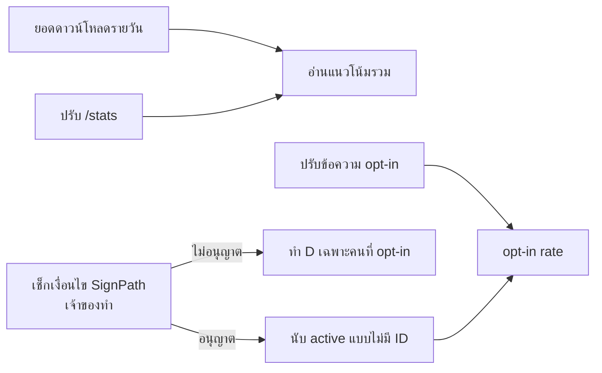

# แผนปรับปรุง analytics ของ capz

เป้าหมาย: รู้จำนวนเครื่องที่ใช้งานจริงโดยไม่เก็บตัวระบุเครื่องเพิ่ม และไม่ผิดจาก privacy policy ที่ SignPath กำหนด

**ลำดับ:** ยอดดาวน์โหลด และ `/stats` ทำได้ทันทีและทำขนานกันได้ ส่วนข้อความ opt-in ก็เริ่มได้เลย การนับ active ต้องรอคำตอบเรื่อง SignPath ก่อน

**ยังไม่ทำ:** การนับการใช้ฟีเจอร์ จนกว่าจะมีเครื่อง opt-in อย่างน้อยหลักสิบ, การเปิด install id เป็นค่าเริ่มต้น, การเก็บ IP หรือ fingerprint, และ SDK analytics ภายนอก

<!-- card:downloads -->
# CP-0088 [analytics] เก็บ snapshot ยอดดาวน์โหลดรายวันจาก GitHub Releases

## Proposal
GitHub ให้แค่ยอดดาวน์โหลดสะสม จึงเห็นแนวโน้มรายวันไม่ได้ ให้ Worker เก็บยอดของทุก asset วันละครั้งลง D1 แล้วแสดงยอดเพิ่มรายวันใน `/stats` งานนี้ไม่แตะแอปและไม่เก็บข้อมูลใดจากผู้ใช้

## Decisions
- ใช้ cron เดิม `17 3 * * *` ไม่เพิ่ม trigger ใหม่
- เรียก GitHub API แบบไม่ใช้ token เพราะ repo เป็น public และเรียกแค่วันละครั้ง
- ไม่นับ draft release
- เก็บทุก asset รวม `.app.tar.gz` เพื่อดูการอัปเดตบน macOS
- snapshot พังต้องไม่กระทบการ prune และ retry feedback ใน cron

## Questions
ไม่มี

## Plan
1. เพิ่ม `worker/migrations/0002_download_snapshots.sql`: ตาราง `download_snapshots(day, tag, asset, count)` โดยมี PK เป็น `(day, tag, asset)`
2. เพิ่ม `worker/src/downloads.ts`
   - `parseReleaseAssets()` แปลง JSON จาก `GET /repos/wadjakorn/capz/releases?per_page=100` เป็นแถวข้อมูล โดยไล่ทุกหน้า
   - `recordDownloadSnapshot(env)` เขียนด้วย `INSERT ... ON CONFLICT DO UPDATE` เพื่อให้รันซ้ำได้
3. เรียกจาก `scheduled` ใน `worker/src/index.ts` โดยห่อ `try/catch` แยกจากงานเดิม
4. เพิ่ม `downloads_daily_30d` ใน `/stats`: ยอดเพิ่มต่อวันแยกตาม tag และ asset คำนวณด้วย `LAG()` และไม่นับวันแรกของแต่ละ asset เป็นยอดเพิ่ม
5. เขียน test ด้วย fake DB แบบ `worker/src/latest.test.ts`: parse, การ upsert และ error จาก GitHub
6. อัปเดตตาราง route และหัวข้อ Data stored ใน `worker/README.md`

## Verify
- `pnpm worker:typecheck` และ `pnpm vitest run worker` ผ่าน
- หลัง deploy รัน cron จริงหรือ `wrangler dev --test-scheduled` แล้วเห็นแถวครบทุก asset และรันซ้ำแล้วจำนวนแถวไม่เพิ่ม
- CI รัน migration และ deploy ให้เองตอน merge เข้า `main`

## ข้อควรระวังตอนแปลผล
`latest.json` ชี้ Windows ไปที่ทั้ง `.msi` และ `setup.exe` ยอดของสองไฟล์นี้จึงอาจปนการอัปเดตกับการติดตั้งใหม่ และ `.dmg` ที่นิ่งอยู่ที่ 2–3 ครั้งอาจมาจากบอทหรือเครื่องของเราเอง

## STATUS
- 2026-11-01 planning: สร้างการ์ดและแผน

<!-- card:stats -->
# CP-0089 [analytics] ปรับ /stats ให้อ่านผลได้ถูกต้องและปิด ?token=

## Proposal
ตอนนี้ `/stats` มีข้อมูล anon แค่ `anon_today` ค่า `dau` เป็นของวันที่ยังไม่จบ และรวมเครื่องของเจ้าของไว้ด้วย ให้เพิ่มข้อมูล anon ย้อนหลัง, DAU เมื่อวาน, การตัดเครื่องของเจ้าของ และเลิกรับ token ผ่าน URL

## Decisions
- คงฟิลด์เดิมทุกตัวไว้ เพิ่มเฉพาะฟิลด์ใหม่
- เลิกรับ `?token=` รับเฉพาะ `Authorization: Bearer` เพราะไม่พบผู้เรียก `/stats` ด้วย query ใน `scripts`, `.github`, `.claude`, `src`
- เก็บเครื่องที่ตัดออกเป็น hash ในตาราง D1 เพราะ `ID_SALT` อยู่บน Cloudflare เท่านั้น จึงต้องให้ Worker เป็นคนคำนวณ hash

## Questions
ไม่มี เจ้าของจะหา install id ของตัวเองได้จาก `telemetry.json` ในแต่ละเครื่อง

## Plan
1. เพิ่ม migration ตาราง `excluded_ids(id_hash PRIMARY KEY)` ใช้เลขไฟล์ถัดไปที่ว่าง
2. เพิ่ม `POST /stats/exclude` รับ `{ id }` ต้องใช้ Bearer token ตรวจว่าเป็น UUID ด้วย `isUuidV4` แล้วเก็บด้วย `saltedHash`
3. แก้ query ใน `worker/src/stats.ts` ให้ตัด `excluded_ids` ออกจากทุก query ของ `pings`
4. เพิ่มฟิลด์ `dau_yesterday`, `anon_daily_30d`, `anon_by_version_30d`, `anon_by_platform_30d`
5. เอาการอ่าน `?token=` ออกจาก `isAuthorized`
6. เขียน `worker/src/stats.test.ts` (ยังไม่มีไฟล์นี้): auth ผ่าน header ผ่าน, ผ่าน query ไม่ผ่าน, id ที่ไม่ใช่ UUID ได้ 400 และเครื่องที่ตัดออกไม่ถูกนับ
7. อัปเดต `worker/README.md`

## Verify
- `pnpm worker:typecheck` และ `pnpm vitest run worker` ผ่าน
- หลัง deploy: `?token=` ได้ 401 และ Bearer ได้ 200
- เจ้าของ exclude เครื่องตัวเองแล้ว `mau` ลดลงตามจำนวนเครื่องนั้น

## STATUS
- 2026-11-01 planning: สร้างการ์ดและแผน

<!-- card:signpath -->
# CP-0090 [analytics] ยืนยันกับ SignPath ว่าแนบ flag ไปกับการเช็กอัปเดตได้หรือไม่

## Proposal
การนับ active แบบไม่มี ID จะเพิ่มข้อมูลในคำขออัตโนมัติ ต้องรู้ก่อนว่าขัดกับเงื่อนไข SignPath Foundation หรือไม่ การ์ดนี้เจ้าของเป็นคนตัดสินใจ ไม่มีการแก้โค้ด

## Decisions
- ถ้ายังไม่ได้คำตอบ ให้ถือว่าไม่อนุญาต การ์ดนับ active จะทำแบบเฉพาะคนที่ opt-in

## Questions
1. เงื่อนไขอนุญาตให้แนบ flag แบบนี้ไปกับการเช็กอัปเดตที่เปิดอยู่เป็นค่าเริ่มต้นหรือไม่ หากระบุใน privacy policy ชัดเจน
2. ถ้าไม่ได้ การมีตัวเลือกให้ผู้ใช้ปิดการเช็กอัปเดตเพียงพอหรือไม่

## Plan
1. อ่านเงื่อนไขล่าสุดของ SignPath Foundation
2. ถ้าเงื่อนไขไม่ชัด ส่งคำถามให้ SignPath พร้อมร่างด้านล่าง
3. บันทึกคำตอบใน `## Decisions` ของการ์ดนับ active แล้วปิดการ์ดนี้

## ร่างคำถาม
> capz's update check runs automatically, can be turned off, and currently sends only the app version, OS name and CPU architecture. We want to add flags meaning "first check of this day / week / month" so the server can sum active installs. The flags carry no identifier and cannot link a machine across requests. The privacy policy would describe them. Is this compatible with the requirement that the program does not transfer information unless requested by the user?

## STATUS
- 2026-11-01 planning: สร้างการ์ดและแผน

<!-- card:active -->
# CP-0091 [analytics] นับ DAU/WAU/MAU แบบไม่มี ID ผ่าน flag ในการเช็กอัปเดต

## Proposal
ให้แอปจำช่วงเวลาที่ส่งล่าสุดไว้ในเครื่อง แล้วแนบ flag ไปกับการเช็กอัปเดตครั้งแรกของแต่ละวัน สัปดาห์ และเดือน Server แค่รวมยอด จึงได้จำนวน active และ install ใหม่โดยไม่มีตัวระบุเครื่อง

## Decisions
- รอคำตอบจากการ์ด SignPath ก่อนเริ่ม ถ้าไม่อนุญาต ให้ส่ง flag เฉพาะเมื่อ `updates.shareInstallId` เปิดอยู่
- ส่งผ่าน header `X-Capz-Active` เช่น `day,week,month` เพราะ `check({ headers })` ใช้กับ header ได้อยู่แล้ว
- ใช้ช่วงเวลาแบบ UTC ให้ตรงกับ `utcDay` ของ Worker สัปดาห์เป็น ISO week และ WAU/MAU เป็นแบบปฏิทิน ไม่ใช่ rolling
- เก็บ state ใน `telemetry.json` ไม่แตะ `config.json` จึงไม่ต้อง bump `CONFIG_SCHEMA_VERSION`
- เครื่องเดิมที่ `general.onboardingCompleted` เป็น true อยู่แล้ว ต้องไม่ถูกนับเป็น install ใหม่ตอนอัปเดตมาถึงเวอร์ชันนี้
- Worker รับเฉพาะค่าที่รู้จัก ค่าอื่นทิ้ง

## Questions
รอผลจากการ์ด SignPath

## Plan
**Worker**
1. เพิ่ม migration ตาราง `active_counts(period_type, period_start, version, target, arch, n)` โดย PK เป็นทุกคอลัมน์ยกเว้น `n`
2. เพิ่ม `parseActiveFlags()` และเพิ่มยอดใน `recordPing` ของ `worker/src/latest.ts` ให้ทำงานใน `ctx.waitUntil` เดิม
3. เพิ่ม `active_estimate` ใน `/stats`: DAU เมื่อวาน, สัปดาห์และเดือนล่าสุดที่ครบ, install ใหม่ และ opt-in rate
4. เขียน test: flag ถูกต้อง, ค่าปลอมถูกทิ้ง, ไม่มี header แล้วพฤติกรรมเดิมไม่เปลี่ยน

**แอป**
5. เพิ่ม `activeFlagHeaders()` ใน `src/lib/installId.ts` อ่าน state และคำนวณ flag ด้วยฟังก์ชันที่รับ `now` เพื่อให้ test ได้
6. ใน `checkForUpdates` (`src/lib/updater.ts`) รวม header นี้กับ `installIdHeaders()` และบันทึก state หลัง `check()` สำเร็จเท่านั้น
7. เขียน test: ข้ามวัน ข้ามสัปดาห์ ข้ามเดือน, เรียกซ้ำในวันเดียวกัน, check ล้มเหลว และเครื่องเดิมไม่เป็น `new`

**เอกสาร**
8. แก้ privacy policy ใน `README.md` ส่วน "and nothing else" และ `worker/README.md` ให้ตรงกับที่ส่งจริงใน PR เดียวกัน
9. แก้ข้อความใน UI ถ้ามีจุดที่กล่าวถึงสิ่งที่ส่ง

## Verify
- `pnpm test:unit`, `pnpm worker:typecheck` และ `pnpm vitest run worker` ผ่าน
- ทดสอบบนเครื่องจริง: กด "ตรวจตอนนี้" สองครั้ง ครั้งแรกส่ง flag ครั้งที่สองไม่ส่ง
- ใช้ `Gate: owner-test` เพราะแตะ privacy policy และการส่งข้อมูล

## ข้อจำกัด
- นับเฉพาะเครื่องที่เปิดการเช็กอัปเดต และได้ยอดจริงต่อเมื่อผู้ใช้อัปเดตมาถึงเวอร์ชันนี้แล้ว ควรรอราว 1 เดือนก่อนเชื่อ MAU
- ลงแอปใหม่จะถูกนับเป็น install ใหม่ และเครื่องที่ใช้ endpoint สำรองบน gh-pages จะไม่ถูกนับ
- ติดตาม retention รายเครื่องไม่ได้ ซึ่งเป็นไปตามเจตนาของการออกแบบ
- endpoint เป็น public จึงมีคนปลอมยอดได้ เหมือนกับ `anon_pings` ตอนนี้

## STATUS
- 2026-11-01 planning: สร้างการ์ดและแผน รอการ์ด SignPath

<!-- card:optin -->
# CP-0092 [analytics] ปรับข้อความชวนเปิด install id ให้ชัดว่าเก็บอะไรและช่วยอะไร

## Proposal
ข้อความ nudge ตอนนี้บอกแค่ "Help count active capz installs?" และเขียนว่า "daily update check" ทั้งที่ตั้งเป็นทุก 6 ชั่วโมงได้ ให้เขียนใหม่ทุกจุดว่าส่งอะไร ไม่ส่งอะไร ปิดได้อย่างไร และข้อมูลช่วยอะไร โดยไม่เพิ่มความถี่ในการถาม

## Decisions
- คงค่าเริ่มต้นเป็นปิด และถามหนึ่งครั้งต่อเวอร์ชันเหมือนเดิม
- ไม่ใช้ dark pattern เช่น ซ่อนปุ่มปฏิเสธ
- ทุกข้อความต้องตรงกับ privacy policy ใน `README.md`

## Questions
ไม่มี

## Plan
1. รวบรวมทุกจุดที่พูดถึงเรื่องนี้: `app.nudge.*`, `settings.app.installId*`, ข้อความใน onboarding (`src/components/onboarding/OnboardingView.tsx`)
2. เขียนข้อความใหม่ใน `src/i18n/locales/en/` และ `th/` โดยใช้ `src/i18n/GLOSSARY.md`
3. ระบุให้ครบ: ส่ง ID สุ่มไปกับการเช็กอัปเดต, ไม่มีข้อมูลส่วนตัว, ไม่เก็บ IP, ปิดแล้ว ID ถูกลบ และใช้เพื่อรู้ว่ามีคนใช้เวอร์ชันและแพลตฟอร์มไหน
4. แก้คำว่า "daily" ให้ตรงกับช่วงเวลาที่ตั้งค่าได้
5. ตรวจความยาวข้อความใน toast และ onboarding ทั้งสองภาษาว่าไม่ล้นหรือตัดคำ

## Verify
- `pnpm test:unit` และ `tsc` ผ่าน (key ภาษาไทยขาดแล้ว `tsc` จะ fail)
- ดู nudge, Settings และ onboarding บนเครื่องจริงทั้งสองภาษา
- วัดผลจาก opt-in rate เมื่อการ์ดนับ active ปล่อยแล้ว ก่อนหน้านั้นดูได้แค่ MAU ของเครื่องที่มี id

## STATUS
- 2026-11-01 planning: สร้างการ์ดและแผน

<!-- end -->
