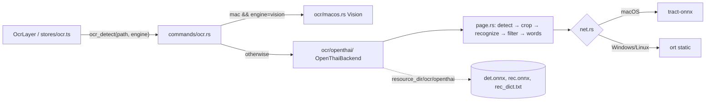

# CP-0097 — OpenThai OCR backend (Windows always, macOS opt-in)

Source: CP-0096 spike (PR #163, `docs/research/2026-11-15-openthai2-ocr.md` on branch
`spike/cp0096-openthai-ocr`). Owner decision (2026-11-15): option (b). macOS keeps Vision as
the default and gains a Settings choice to switch to OpenThai. Windows always uses OpenThai.

## Decisions taken in this plan

| question | decision | why |
|---|---|---|
| Inference runtime on macOS | **tract** (pure Rust) | Prebuilt ORT needs macOS ≥ 13.4 plus a `libclang_rt.osx.a` link hack, and peaked at 2.9 GB RSS on M1. capz promises macOS 12+. tract: p50 802 ms vs ORT 696 ms on M1, RSS 713 MB. The engine is opt-in on Mac, so the speed cost on Intel Macs (est. ~3.6 s) is acceptable. |
| Inference runtime on Windows / Linux | **ort 2.0.0-rc.12+ static** (`download-binaries`, api-24) | ORT is 2.9× faster than tract on x86 (1.25 s vs 3.62 s, Linux i5). Static rather than `load-dynamic`: one binary, no DLL search path, and no risk of picking up the older `onnxruntime.dll` that Windows 11 ships in System32. It costs ~3.7 MB more than the signed DLL. The ticket asked this question; this is the answer, revisit if SignPath objects. |
| Session lifetime | **load per call** | Load costs 82 ms (ort) / 12 ms (tract). A cached session would keep ~200–700 MB resident in a tray app all day. |
| Threads | `min(available_parallelism, 8)` | Spike: 8 threads 1.10 s vs 4 threads 1.25 s, RSS about equal. |
| Model files | committed under `src-tauri/resources/ocr/openthai/` (4.2 MB) | Builds stay offline and reproducible. sha256 pinned in a unit test. Apache-2.0 LICENSE and NOTICE ship next to them. |
| How Rust learns the engine | the webview passes `engine` to `ocr_detect` | No new Rust reader of `config.json`, so the schema bump needs no Rust change. |
| Linux | also routed to OpenThai | Free once models are bundled for every platform; CP-0081 inherits it. |
| Windows.Media.Ocr backend | removed | It has no Thai, and OpenThai reads English as well (spike Q1). |

Config used (spike sweep winner): iApp defaults from det.yml + config.json
(`thresh 0.2, box_thresh 0.4, unclip 1.4, drop_below 0.8, junk_below 0.9, junk_invalid 0.05`)
plus `det.v_pad = 0.15`, `rec.min_chars = 1`. These are compiled in as constants.

## Architecture

Module layout `src-tauri/src/services/ocr/openthai/`: `mod.rs` (backend + constants + mapping
to `OcrLine`/`OcrWord`), `net.rs` (tract on macOS, ort elsewhere), and `det.rs`, `rec.rs`,
`page.rs`, `text.rs`, `geom.rs`, `imgops.rs` ported from `rust-proto` with their tests.

## Tasks

1. **Port** rust-proto into `services/ocr/openthai/` (edition 2021 fixes, no env-var knobs, no
   JSON-config parsing). Carry over all 19 unit tests. Deps: `imageproc`, `unicode-normalization`;
   `tract-onnx` under `cfg(target_os = "macos")`, `ort` under `cfg(not(target_os = "macos"))`.
2. **Backend**: `OpenThaiBackend::new(model_dir)` implements `OcrBackend`. Languages
   `["en-US","th-TH"]`, so `thai_available = true`. Map quads to axis-aligned `OcrBox` and fill
   `OcrLine.words` from the CTC word boxes.
3. **Models**: copy the pinned files plus LICENSE/NOTICE into `src-tauri/resources/ocr/openthai/`
   and add the folder to `bundle.resources` in `tauri.conf.json`. Add a sha256 test.
4. **Command**: `ocr_detect(app, path, engine: Option<String>)`. Resolve the model dir with
   `app.path().resource_dir()`; in `cargo test` use `CARGO_MANIFEST_DIR`. Delete
   `ocr/windows.rs` and the `windows` crate features only it used.
5. **Example CLI** `src-tauri/examples/openthai_cli.rs`, with the same flags and JSONL output
   as `openthai-proto`, so the CP-0096 harness can score the shipped code.
6. **Setting**: `general.ocrEngine: "vision" | "openthai"`, default `"vision"`, schema v10 → v11
   (identity migration), fixture `v11.json` + `shape.v11.json`, validation `inSet`, migrate test.
7. **UI**: Settings → Editor row, macOS only (`currentPlatform() === "mac"`), a select with
   Vision / OpenThai and a hint. Registry entry, en + th strings, GLOSSARY entry if new terms.
   `stores/ocr.ts` passes the engine and keys cached results by engine.
8. **Docs/credits**: README third-party/credits line for OpenThai2.0 (Apache-2.0, iApp).
   Update `docs/OCR-THAI-WINDOWS.th.md` and the Windows Thai-unavailable toast path (Thai is
   now always available on Windows). Privacy policy unchanged: no network.
9. **Trackers**: PROGRESS-FEATURE.md row.

## Verification (no human needed until the last step)

| # | check | pass |
|---|---|---|
| V1 | `cargo test` + `cargo clippy --all-targets -- -D warnings` on Linux (ort path) | green |
| V2 | same on macbook-pro over SSH (tract path + Vision) | green |
| V3 | harness: `openthai_cli` (Linux, ort) on the spike test split vs the Python reference | R1 ≥ 95 % identical lines; CER within 0.2 pt of 3.01 % |
| V4 | same with tract on macbook-pro | R1 ≥ 95 % |
| V5 | perf split p50 / RSS, Linux ort + Mac tract | no worse than spike (1.25 s / 223 MB; 0.80 s / 713 MB) ±10 % |
| V6 | `pnpm test:unit`, `pnpm tsc --noEmit`, `pnpm lint` | green |
| V7 | `Build` workflow via `workflow_dispatch` on the branch | macOS arm64/x64 + Windows artifacts built |
| V8 | owner installs: Windows Detect text works (Thai + English); Mac switch Vision ↔ OpenThai | owner-test gate |

The Windows-only acceptance numbers (p50 ≤ 1.0 s, RSS ≤ 400 MB) need the owner's machine. The
PR states that and does not claim them.
