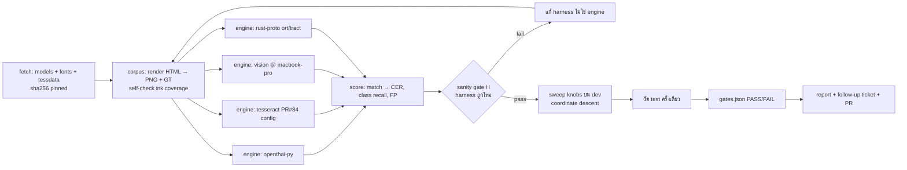

# OpenThai 2.0 OCR spike (CP-0096) — Implementation Plan

> **For agentic workers:** REQUIRED SUB-SKILL: Use superpowers:subagent-driven-development (recommended) or superpowers:executing-plans to implement this plan task-by-task. Steps use checkbox (`- [ ]`) syntax for tracking.

**Goal:** ตอบสองคำถามของ CP-0096 ด้วยตัวเลขที่ agent วัดและตัดสินเองได้ทั้งหมดโดยไม่ต้องมีคน
(1) OpenThai2.0-OCR-Text อ่านไทยปนอังกฤษได้ดีพอสำหรับ "Detect text" ไหม
(2) ควร bundle มาในตัวติดตั้ง หรือให้ผู้ใช้โหลดเอง

**Architecture:** สร้าง eval harness ภาษา Python ที่ `scripts/ocr-eval/` เป็นวงปิดที่ทำซ้ำได้
เริ่มจาก**สร้างภาพทดสอบจาก HTML ใน headless Chromium** ซึ่งให้ ground truth (ข้อความ + กรอบ) ตรงจาก DOM
จากนั้นส่งภาพเดียวกันให้ทุก engine ผ่าน adapter ที่คืน JSON รูปแบบเดียวกัน
แล้วให้คะแนนด้วย metric ที่ไม่ขึ้นกับวิธีตัดบรรทัดของแต่ละ engine
ปรับ knob ของ OpenThai บน split `dev` ก่อน แล้ววัดผลจริงบน split `test` ที่ไม่เคยเห็นเพียงครั้งเดียว
สุดท้ายตัดสินด้วย gate ที่ล็อกเกณฑ์ไว้ก่อนเห็นข้อมูล
เรื่องการ ship วัดจาก Rust prototype จริง (ใช้ `ort` และ `tract`) ซึ่งต้องให้ผลตรงกับ Python reference

**Tech Stack:** Python 3.12 (uv) · Playwright (Chromium) · onnxruntime + opencv-python-headless + pyclipper (สำหรับ reference runtime) · rapidfuzz · pytest · Tesseract 5 + tessdata_fast · Swift/Vision บน `macbook-pro` ผ่าน SSH · Rust (`ort` 2.x, `tract-onnx`, `image`, `imageproc`)

**Spec:** PM ticket **CP-0096** (`pm_get_task CP-0096`) งานก่อนหน้าที่แผนนี้ต่อยอด:
PR #80 (`docs/research/2026-08-19-oneocr-windows-thai.md` §8: Tesseract ได้ CER 6.1%) และ
PR #84 (`feat/tesseract-windows-ocr`: Tesseract bundle 12 MB บน Windows ซึ่งยังเปิดอยู่ และเป็นคู่แข่งตัวจริงบน Windows)

---

## วงปิดที่ทำงานเองโดยไม่ต้องมีคน



**กติกาที่ทำให้ไม่ต้องมีคน**
- ทุกขั้นจบด้วยคำสั่งที่ exit code และ output บอกผลได้เอง ไม่มีขั้นไหนให้ "ดูด้วยตา" เป็นเกณฑ์
- ground truth สร้างจากโปรแกรมทั้งหมด ไม่มีการถอดข้อความด้วยมือ
  ยกเว้น fixture สองรูปที่มีอยู่แล้ว และถึงตรงนั้น agent ก็ถอดเองแล้วตรวจไขว้กับ Vision
- เกณฑ์ทุกข้อล็อกไว้ในแผนนี้แล้ว (§ Gates) ห้ามแก้ตัวเลขหลังเห็นผล
  ถ้าเกณฑ์ข้อไหนดูผิดหลังจากเห็นข้อมูล ให้บันทึกเป็น "deviation" ในรายงานพร้อมเหตุผล และยังต้องรายงานผลตามเกณฑ์เดิมด้วย
- sanity gate H ต้องผ่านก่อนเชื่อตัวเลขของ engine ใด ๆ ถ้า Tesseract อ่านภาษาอังกฤษตัวใหญ่ไม่ได้
  แปลว่า harness พัง ให้แก้ harness ไม่ใช่สรุปว่า engine แย่
- ถ้าติดเรื่องภายนอก ให้ทำตามตารางนี้ ไม่ต้องรอคน

| ติดอะไร | ทำอย่างไร |
|---|---|
| Mac เข้าไม่ได้ (`ssh macbook-pro` timeout) | ลองใหม่ 3 ครั้ง ห่างกัน 10 นาที (ระหว่างนั้นทำ task อื่น) ถ้ายังไม่ได้ ให้ gate ที่ต้องใช้ Vision เป็น `SKIPPED` และระบุในรายงาน |
| HF / GitHub ดาวน์โหลดไม่ได้ หรือ sha256 ไม่ตรง | retry 3 ครั้ง ถ้ายังพัง ให้ comment `kind: question` ใน CP-0096 ย้ายไป `blocked` แล้วหยุด (เป็นกรณีเดียวที่ต้องให้คนช่วย) |
| Rust port ไม่ผ่าน parity หลังลองแก้ 3 รอบ | ไม่ต้อง block ให้รายงานเป็น finding ว่าต่างตรงไหนและต้อง port อะไรเพิ่ม |
| ดิสก์ Mac เหลือน้อย (ตอนวางแผนเหลือ 18 GiB) | ส่งไปแค่ PNG ของ split ที่ใช้ แล้วลบ `~/ocr-eval-tmp/<run>` ทุกครั้งที่รันจบ |

- commit ทุก task และ push ตั้งแต่ commit แรก เพราะ session อื่นอาจลบ branch ได้
  (`git push -u origin spike/cp0096-openthai-ocr`)
- รายงานความคืบหน้าผ่าน `pm_comment` (kind `note`) ใน CP-0096 สี่จุด:
  แผนเสร็จ, baseline เสร็จ, sweep เสร็จ, รายงานเสร็จ

---

## Global Constraints

- Worktree: `/home/wadjakorn/development/capz-cp0096-openthai-ocr` branch `spike/cp0096-openthai-ocr` **ห้ามแตะ** `~/development/capz` เพราะ checkout ของ owner มีงานที่ยังไม่ commit
- **ไม่มี product code**: ห้ามแก้ `src/`, `src-tauri/`, `e2e/` และห้ามแตะ `CONFIG_SCHEMA_VERSION` งานทั้งหมดอยู่ใน `scripts/ocr-eval/`, `docs/research/`, `docs/superpowers/plans/`
- ห้าม commit ไฟล์โมเดล, ฟอนต์, ภาพ corpus หรือผล run ดิบ ให้อยู่ใน `~/.cache/capz-ocr-eval/` และ `scripts/ocr-eval/runs/` (gitignored)
  commit ได้เฉพาะ JSON/markdown สรุป และภาพ crop ตัวอย่างไม่เกิน 12 รูป (รวม ≤ 1 MB) ใน `docs/research/evidence/openthai2-ocr/`
- โมเดลปัก revision `40e8e9ff752b65153b1a71d521ec9390882afd7e` ของ `iapp/OpenThai2.0-OCR-Text` พร้อม sha256 ต่อไฟล์ ให้ตรงกับ `SHA256SUMS` ของ repo นั้น
  - `det.onnx` `193bab7a04fca699a6c82e6abb5b81bdb28177f0abd4062552b04908dafb19f8`
  - `rec.onnx` `82ec89533346faadcb30df96703dad2dd7521de65709e60d83fd9745b8968124`
  - `rec_dict.txt` `259ef2636cec0eeae225ae9fd9a63fa9305285650c22d7ec34fe8a82b24c2f1a`
  - `config.json` `11599c0dae206381cb8ea11c1b7ce130b2e7971c19219f409785ee8c02ab5d94`
  - `det.yml` `3ac018be6f97499a08faa3bbdeb33640968d9307f6736d152902747a9f259593`
  - `runtime/line_engine.py` `5d5d672658d2a82ca6b32e230bb551eefe5d1e4efa46ff21908bfcfd75e5495c`
  - `runtime/thai_norm.py` `53a03ac139fb0de3e7aec0f5b8ab69b0b519fb5e636f7c1de09cb357b023344a`
  - `NOTICE` `4c0e4f27877836de51e29aec3918b6c743c3028cd4163b6661fd540336db32b3`
- runtime ของโมเดลเป็นโค้ดที่ดาวน์โหลดมา จึงถือว่า untrusted
  - เก็บในไดเรกทอรีของตัวเอง
  - รันใน subprocess ด้วย `python -I`
  - ก่อนรันครั้งแรกให้ grep หา `socket|urllib|requests|http|subprocess|os\.system|eval\(|exec\(` แล้วบันทึกผลใน `REFERENCE.md`
- ให้ reference ใช้ backend `onnxruntime` (`runtime.backend = "onnxruntime"`) เพราะเป็นตัวเดียวกับที่ `ort` ใน Rust จะใช้ ไม่ใช้ OpenVINO
- Tesseract ใช้ config ของ PR #84 ทุกจุด
  - `-l tha+eng --psm 6`
  - upscale `clamp(4000/long_side, 1.0, 3.0)` ด้วย Lanczos
  - post-process `ํา → ำ`
  - tessdata_fast ที่ commit `87416418657359cb625c412a48b6e1d6d41c29bd`
    - `tha` `294227cc2d1292b0acb28d61d4115c88252b96d466ca90b417cf4cf0c67bf07c`
    - `eng` `7d4322bd2a7749724879683fc3912cb542f19906c83bcc1a52132556427170b2`
- Vision ใช้ setting เดียวกับ `src-tauri/src/services/ocr/macos.rs`
  - `recognitionLevel = .accurate`
  - `usesLanguageCorrection = true`
  - `automaticallyDetectsLanguage = true`
  - `recognitionLanguages = ["en-US","th-TH"]`
- Python ไม่รับ dependency ที่ระบบ build ของ capz ต้องใช้ (`scripts/ocr-eval` แยกเป็น uv project ของตัวเอง)
  ส่วน Rust prototype ก็เป็น crate แยกที่ `scripts/ocr-eval/rust-proto/` ไม่เข้า `src-tauri`
- รายงานเขียนเป็นภาษาไทยตาม `docs/research/` เดิม ใช้ `src/i18n/GLOSSARY.md` สำหรับศัพท์
- commit แบบ conventional เช่น `chore(ocr-eval): …` และ `docs(research): …` พร้อม trailer `Co-Authored-By: Claude Opus 5.5 <noreply@anthropic.com>`

---

## Metric definitions (ใช้ทุก task)

- **normalize(s)** เพื่อให้ engine ไม่เสียคะแนนจากการสะกดต่างแบบที่ render ออกมาเหมือนกัน ใช้กับทั้ง GT และ prediction
  - NFC (ห้าม NFKC เพราะจะแยก ำ ออก)
  - map Thai PUA U+F700–F71A กลับเป็นตัวมาตรฐาน
  - ลบ zero-width (U+200B–200D, U+2060, U+FEFF, U+00AD) และแปลง NBSP เป็น space
  - เรียงเครื่องหมายหลังพยัญชนะเป็น สระบน/ล่าง → วรรณยุกต์/การันต์ → นิคหิต และยุบตัวที่ซ้ำ
  - `([่-๋]?)ํ([่-๋]?)า → \1\2ำ`, `เเ → แ`
  - ขั้นสุดท้าย**ลบ whitespace ทั้งหมด** เพราะภาษาไทยไม่เว้นวรรคระหว่างคำ และแต่ละ engine เว้นวรรคไม่เหมือนกัน
  - เขียนเองใน `metrics/normalize.py` โดยใช้กฎเดียวกับที่ `thai_norm.canonical` อธิบายไว้ (ห้าม import โค้ดของ iApp)
- **Matching** แต่ละ engine ตัดบรรทัดต่างกัน จึงจับคู่ด้วยเรขาคณิตแทน
  - เชื่อม GT fragment `G` กับบรรทัดที่ทาย `P` เมื่อ `overlap_y ≥ 0.5·min(hG,hP)` และ `overlap_x ≥ 0.3·min(wG,wP)`
  - ใช้ union-find แบ่งเป็น component
  - ในแต่ละ component ต่อข้อความ GT ตามลำดับ (แถว, x) ต่อข้อความที่ทายแบบเดียวกัน แล้วคิด `edits = Levenshtein(normalize(gt), normalize(pred))`
  - GT ที่ไม่มีคู่คิด `edits = len(gt)` ส่วน prediction ที่ไม่มีคู่นับเป็น **FP chars**
- **CER** = Σedits / ΣlenGT (micro) **CER_e2e** = (Σedits + ΣFP) / ΣlenGT **fp_per_1k** = 1000·ΣFP / ΣlenGT
- **Class recall** ได้จาก `rapidfuzz.distance.Levenshtein.opcodes` โดยนับตัว GT ที่อยู่ในช่วง `equal` แยกตาม class
  - `thai_cons` (ก–ฮ)
  - `thai_vowel_above` (ั ิ ี ึ ื ็)
  - `thai_vowel_below` (ุ ู ฺ)
  - `thai_tone` (่ ้ ๊ ๋ ์)
  - `thai_other` (ะ า ำ เ แ โ ใ ไ ๅ ฯ ๆ)
  - `thai_digit`, `latin_upper`, `latin_lower`, `digit`, `symbol`
- **Category** ของ component ดูจากข้อความ GT
  - `mixed` = มีทั้งอักษรไทยและละติน
  - `thai` = มีไทย ไม่มีละติน
  - `english` = มีละติน ไม่มีไทย
  - `other` = ไม่มีทั้งสองแบบ
  - flag เพิ่มเติม `numeric` (ตัวเลข ≥ 30%) และ `url` (ตรง regex URL/email/path)
- **Slices** ใช้ตัด CER ทุกตัว
  - `template`, `font`, `css_px` (≤12 / 13–16 / ≥17), `dpr` (1, 1.25, 1.5, 2), `theme`, `category`, `crop` (viewport/element)
  - `mac_typical` = dpr 2, css 13–16, theme light/dark
  - `win_typical` = dpr 1–1.5, css 12–14, theme light/dark
  - `easy` = english, css ≥ 16, dpr 2, light
- **ช่วงความเชื่อมั่น** ใช้ paired bootstrap ข้ามภาพ (1000 รอบ, seed 0) หาช่วง 95% ของ ΔCER ระหว่างสอง run บนชุดภาพเดียวกัน
- **Latency** วัดเป็น warm (โหลด session แล้ว) ต่อภาพ ได้ p50/p95 และ cold = โหลด + ภาพแรก **RSS** วัดค่าสูงสุดของ process ด้วย `/usr/bin/time -v` บน Linux และ `-l` บน Mac

## Gates (ล็อกก่อนเห็นข้อมูล, ใช้ test split ยกเว้นที่ระบุ)

| id | เงื่อนไข PASS | ใช้ตอบ |
|---|---|---|
| H1 | Tesseract บน slice `easy` ได้ CER ≤ 3.0% และ Vision (ถ้ามี) ≤ 2.0% | harness ถูก |
| H2 | ทุกภาพใน corpus มี ink coverage ≥ 99.5% และ render ซ้ำได้ PNG ตรงกัน 100% | GT ถูก |
| A1 | (dev) CER(reference เต็ม) − CER(ปิด `ori` และ `split_gap=0`) ≤ 0.3 pt | port แค่บางส่วนก็พอ |
| Q1a | OpenThai(best) CER ของ `mixed` ≤ 5.0% ทั้งใน `mac_typical` และ `win_typical` | Q1 |
| Q1b | CER(mixed) ≤ 1.5 × max(CER(thai), CER(english)) + 0.5 pt (ทั้ง split) | Q1: ปนภาษาแล้วไม่แย่ลง |
| Q1c | ใน component `mixed` ได้ recall `latin_*` ≥ 97%, `digit` ≥ 97%, `thai_tone` ≥ 95%, `thai_vowel_above` ≥ 95% | Q1 |
| W1 | CER ทั้ง split ต่ำกว่า Tesseract อย่างน้อย 20% (relative) และช่วง 95% ของ Δ ไม่คร่อม 0 | Windows: แทน PR #84 |
| W2 | CER(english) ≤ CER_Tesseract(english) + 1.0 pt และ fp_per_1k ≤ ของ Tesseract + 5 | Windows: ไม่ถอยในงานภาษาอังกฤษ |
| M1 | CER ≤ Vision หรือช่วง Δ คร่อม 0 → "เทียบเท่า" ถ้าไม่ถึง → "คง Vision ไว้" (ใช้เป็นข้อมูล ไม่ใช่เกณฑ์ผ่าน/ตก) | macOS |
| R1 | Rust proto เทียบ Python (config เดียวกัน) ได้ \|ΔCER\| ≤ 0.3 pt และข้อความหลัง normalize ตรงกัน ≥ 95% ของ component | port ได้จริง |
| P1 | Rust proto (runtime ที่ดีที่สุด) บน perf split 2560×1600 ที่ 4 threads: warm p50 ≤ 1.0 s, p95 ≤ 2.0 s, cold ≤ 2.5 s, RSS ≤ 400 MB ต้องผ่านทั้งบน Linux (i5-1235U) และ M1 Pro | เร็วพอ |
| S1 | ขนาดที่เพิ่ม (zip -9 ของโมเดล + ส่วนต่างของ binary ที่ strip แล้ว) ≤ 12 MB ต่อ target (ตัวเลขเดียวกับ bundle ของ PR #84 ที่ owner รับแล้ว) | Q2 |

**การตัดสิน**
- Q1 ได้ "ใช่" เมื่อผ่าน Q1a+Q1b+Q1c, ได้ "บางส่วน" เมื่อผ่านบางข้อ (ระบุ slice ที่ตก) ถ้าไม่ผ่านเลยคือ "ไม่"
- Q2 เลือก bundle เมื่อผ่าน S1 ถ้าไม่ผ่าน ให้ประเมินแบบโหลดเมื่อต้องใช้ ข้อสำคัญคือ native runtime ต้องอยู่ใน binary เสมอ
  เพราะ macOS hardened runtime โหลด dylib ที่ดาวน์โหลดมาไม่ได้ ถ้าไม่ปิด library validation
  แบบโหลดเองจึงประหยัดได้แค่ไฟล์โมเดล
- คำแนะนำแยกตาม platform
  - Windows ให้แทน PR #84 เมื่อผ่าน Q1+W1+W2+R1+P1
  - macOS คง Vision ไว้ เว้นแต่ M1 ได้ "เทียบเท่า" และมีเหตุผลอื่นประกอบ
  - Linux ให้เปิด OCR เมื่อผ่าน Q1+R1+P1

## Review Focus

1. **DPR เศษส่วน (1.25/1.5)** อาจทำให้กรอบ GT ปัดเศษเพี้ยนจากพิกเซลจริง จับคู่ไม่ได้ แล้วทุก engine จะดูแย่เท่ากันหมด ต้องให้ H2 ink coverage ครอบทุก dpr (Task 2 ใส่ test `test_coverage_all_dprs`)
2. **เครื่องหมายไทยที่ rect กว้างเป็น 0** อาจทำให้ลำดับข้อความใน GT เพี้ยน หรือหลุดออกเป็น fragment แยก ต้องเช็กว่าข้อความ GT ของ fragment ประกอบกลับได้เท่ากับ string ต้นทางทุกตัว (Task 2 `test_gt_roundtrip_tone_heavy`)
3. **พิกัดของแต่ละ engine** ไม่เหมือนกัน (Vision ใช้ normalized origin ล่างซ้าย, Tesseract ถูก upscale, OpenThai คืน quad, `pre.scale` ของเราเอง) กรอบผิดนิดเดียวจะกลายเป็น miss ปลอม ทุก adapter ต้องผ่าน `test_known_line_matches` บนภาพที่รู้กรอบแน่นอน (Task 4, 5, 8)
4. **ภาพแบบ element-crop** ต้องเลื่อนกรอบ GT ตามจุดเริ่มของ crop (Task 2 `test_element_crop_offsets`)
5. **emoji/icon ใน template** ไม่ควรอยู่ใน GT แต่ถ้า engine อ่านออกมาเป็นตัวอักษร ต้องนับเป็น FP ใส่ `data-gt-ignore` แล้วทดสอบ (Task 2 `test_gt_ignore_excluded`, Task 3 `test_fp_counted`)

---

## File Structure

```
scripts/ocr-eval/
  pyproject.toml  .python-version (3.12)  .gitignore (.cache/ runs/)  README.md
  REFERENCE.md                 — Task 4: pipeline ของ reference จริง (ค่าคงที่, ลำดับขั้น, ผล grep ความปลอดภัย)
  data/phrases_mixed.txt       — ประโยคไทยปนอังกฤษที่คัดเอง (~150 บรรทัด)
  data/fixtures/*.gt.json      — GT ของ fixture สองรูปที่มีอยู่แล้ว
  fonts.lock.json              — URL + sha256 ของฟอนต์ (ได้ตอน fetch ครั้งแรก แล้ว commit)
  ocr_eval/
    cli.py                     — คำสั่งย่อย fetch | corpus | run | score | compare | sweep | perf | size | gate | report | all
    paths.py  pins.py          — cache dirs; hash ที่ปักไว้ทั้งหมด (โมเดล, tessdata)
    fetch.py                   — ดาวน์โหลด + ตรวจ sha256 (โมเดล, tessdata, ฟอนต์)
    phrases.py                 — คลังประโยค: locale ของ capz (th/en), phrases_mixed, ร้อยแก้วไทยจาก docs
    corpus/spec.py             — สุ่ม sample spec ตาม split (seeded)
    corpus/templates.py        — template 9 แบบ เป็นฟังก์ชันที่คืน HTML
    corpus/gt_extract.js       — DOM → rect ราย grapheme → GT fragment
    corpus/render.py           — Playwright render → png + gt.json
    corpus/check.py            — H2: ink coverage, การทำซ้ำได้, กรอบอยู่ในภาพ
    engines/base.py            — schema ของ EngineResult + jsonl io
    engines/openthai.py  engines/openthai_worker.py
    engines/tesseract.py
    engines/vision.py  engines/vision_ocr.swift
    engines/rustproto.py
    metrics/normalize.py  metrics/match.py  metrics/score.py  metrics/bootstrap.py
    report.py  gates.py  sweep.py  perf.py  size.py
  tests/  test_normalize.py test_match.py test_score.py test_corpus.py test_engines.py test_gates.py test_sweep.py
  rust-proto/  Cargo.toml  src/{main.rs,det.rs,rec.rs,ctc.rs,text.rs,words.rs,backend.rs}
docs/research/2026-11-15-openthai2-ocr.md
docs/research/evidence/openthai2-ocr/  (gates.json, iterations.md, metrics-*.json, crops/*.png)
```

**รูปแบบข้อมูลที่ใช้ร่วมกันทุก task**

```python
# corpus/<split>/<id>.json
GT = {"id": "dev-0001", "split": "dev", "template": "chat", "font": "Sarabun", "css_px": 13,
      "dpr": 2.0, "theme": "dark", "crop": "viewport", "width": 2560, "height": 1600,
      "fragments": [{"text": "กด Save เพื่อบันทึก", "box": [x, y, w, h]}]}   # พิกเซลของภาพ, origin บนซ้าย
# runs/<run_id>/predictions.jsonl  (หนึ่งบรรทัดต่อภาพ)
Pred = {"id": "dev-0001", "width": 2560, "height": 1600, "elapsed_ms": 412.0,
        "lines": [{"text": "...", "box": [x, y, w, h], "conf": 0.97}]}
# runs/<run_id>/run.json
Run = {"run_id": "...", "engine": "openthai-py|tesseract|vision|rust-ort|rust-tract", "config": {...},
       "split": "dev", "corpus_hash": "...", "git_sha": "...", "host": "...", "started": "ISO"}
```

---

### Task 1: Scaffold + fetch ที่ปัก hash ไว้

**Files:**
- Create: `scripts/ocr-eval/{pyproject.toml,.python-version,.gitignore,README.md}`, `ocr_eval/{__init__.py,cli.py,paths.py,pins.py,fetch.py}`
- Test: `scripts/ocr-eval/tests/test_fetch.py`

**Interfaces:**
- Produces: `paths.CACHE = ~/.cache/capz-ocr-eval`, `paths.RUNS = scripts/ocr-eval/runs`, `paths.model_dir() -> Path` (`CACHE/models/<rev>`), `paths.tessdata_dir() -> Path`, `fetch.fetch_pinned(url: str, dest: Path, sha256: str) -> Path` (ข้ามถ้ามีไฟล์และ hash ตรงแล้ว, ถ้าไม่ตรงให้ raise `HashMismatch`), `cli` entry point `ocr-eval` (`[project.scripts]`)

- [ ] **Step 1:** `uv init --package --name ocr-eval` ใน `scripts/ocr-eval` แล้ว pin `3.12` และ `uv add numpy opencv-python-headless pyclipper onnxruntime pillow playwright rapidfuzz` กับ `uv add --dev pytest`
- [ ] **Step 2: Write failing tests**
  - `test_fetch_rejects_bad_hash`: เสิร์ฟไฟล์ผ่าน `http.server` ของ local แล้วส่ง sha256 ผิด ต้อง raise `HashMismatch` และ `dest` ต้องไม่มีอยู่
  - `test_fetch_skips_when_present`: เรียกครั้งที่สองต้องไม่มี HTTP request
- [ ] **Step 3:** `uv run pytest tests/test_fetch.py -q` → FAIL
- [ ] **Step 4:** implement `fetch_pinned` (เขียนลง `dest.tmp` ก่อน ตรวจ hash แล้วค่อย rename) จากนั้นทำ `ocr-eval fetch` ให้ดึงไฟล์โมเดลทุกตัวตาม Global Constraints (URL `https://huggingface.co/iapp/OpenThai2.0-OCR-Text/resolve/<rev>/<path>`) และ tessdata ทั้งสองไฟล์ (`https://raw.githubusercontent.com/tesseract-ocr/tessdata_fast/<commit>/<lang>.traineddata`) แล้ว `uv run playwright install chromium`
- [ ] **Step 5:** `uv run pytest -q` → PASS และ `uv run ocr-eval fetch && sha256sum -c` จาก `SHA256SUMS` ที่ดาวน์โหลดมา → ทุกบรรทัด `OK`
- [ ] **Step 6:** commit, `git push -u origin spike/cp0096-openthai-ocr`, `pm_comment` ว่าแผนอยู่ที่ไหนและเริ่มทำแล้ว

### Task 2: Corpus generator + GT + self-check (gate H2)

**Files:**
- Create: `ocr_eval/fonts` ส่วนหนึ่งของ `fetch.py` + `fonts.lock.json`, `ocr_eval/phrases.py`, `data/phrases_mixed.txt`, `ocr_eval/corpus/{spec.py,templates.py,gt_extract.js,render.py,check.py}`
- Test: `tests/test_corpus.py`

**Interfaces:**
- Consumes: `fetch.fetch_pinned`, `paths.CACHE`
- Produces: `spec.build_specs(split: str) -> list[SampleSpec]` (dataclass ที่มี field เท่ากับ GT ยกเว้น `fragments`), `render.render_split(split: str, workers: int = 4) -> Path` (คืน `CACHE/corpus/<split>/`), `check.check_split(split: str) -> CheckReport` (`ok: bool`, `coverage_min: float`, `bad: list[str]`), CLI `ocr-eval corpus --split S` (รัน render แล้ว check, ถ้า `ok=False` ให้ exit 1)

**ค่าที่ล็อกไว้**
- **Splits**
  - `smoke` 12 ภาพ (seed 0)
  - `dev` 240 ภาพ (seed 1)
  - `test` 240 ภาพ (seed 2)
  - `perf` 10 ภาพ (template `dense` viewport 1280×800 @2 = 2560×1600)
  - `fixtures` 2 ภาพ
  - `wild` ไม่เกิน 6 ภาพ (Task 9)
- **ฟอนต์**
  - dev+test: Noto Sans Thai, Sarabun, Loma (ระบบ, หน้าตาคล้าย Tahoma), IBM Plex Sans Thai, Prompt, และสำหรับ template `terminal`/`code` ใช้ Noto Sans Mono โดย fallback ไปที่ Noto Sans Thai
  - **test เท่านั้น**: Anuphan, Noto Sans Thai Looped (เพื่อดูว่า overfit กับฟอนต์ไหม)
  - ฟอนต์ที่ไม่มีในระบบดึงจาก `github.com/google/fonts/raw/main/ofl/<family>/…` แล้วบันทึก sha256 ลง `fonts.lock.json` ตอน fetch ครั้งแรก (TOFU) ครั้งต่อไปต้องตรวจกับค่าใน lock
- **แกนที่สุ่ม**
  - css_px ∈ {11, 12, 13, 14, 16, 20}
  - dpr ∈ {1, 1.25, 1.5, 2}
  - theme ∈ {light, dark, tinted}
  - crop ∈ {viewport 70%, element 30%}
  - viewport 1280×800 css
- **Template**: `chat`, `settings`, `table`, `article`, `terminal`, `code`, `dialog`, `menu`, `dense` (dense ใช้เฉพาะ perf)
- **ข้อความ**
  - string ใน `src/i18n/locales/{th,en}/*.ts` (ดึงด้วย regex จาก string literal แทน `{placeholder}` ด้วยค่าตัวอย่างที่ seed ได้)
  - `data/phrases_mixed.txt` เป็นประโยคที่คัดเองประมาณ 150 บรรทัด ต้องมีครบ:
    - คำที่วรรณยุกต์ซ้อนสระบน (ที่ นี้ เมื่อ ชื่อ ปั๊ม)
    - ำ และ ฤ
    - ราคา, วันที่ไทย (15 พ.ย. 2569), เวลา
    - URL, email, path, version (v0.20.0)
    - ชื่อแบรนด์ (LINE, Shopee)
    - หน่วย (GB, kg)
    - ตัวเลขไทย ๐–๙
    - ตัวที่หน้าตาคล้ายกันระหว่างไทยกับละติน (ร/s, บ/u, ๐/o)
  - ร้อยแก้วไทยดึงจาก `docs/**/*.th.md` และ `README.md` ส่วนภาษาไทย (ตัด markdown ออก)
  - ประโยคแต่ละอันลง dev หรือ test ตาม `sha1(phrase) % 2` เพื่อให้ test มีประโยคที่ไม่เคยเห็น
- emoji และ icon ใน template ห่อด้วย `<span data-gt-ignore>`
- **GT extraction** (`gt_extract.js`)
  - ใช้ `Intl.Segmenter('th', {granularity: 'grapheme'})` แล้วหา `Range.getClientRects()` ราย grapheme
  - รวมเป็น fragment เมื่อ vertical overlap ≥ 50% และ gap แนวนอน < 0.6em
  - คูณกรอบด้วย dpr แล้วลบด้วยจุดเริ่มของ crop
  - ข้ามสิ่งที่ `checkVisibility()` เป็นเท็จหรืออยู่นอกภาพ
- **Ink coverage** (H2)
  - render ซ้ำโดยตั้ง `color: transparent !important` ให้ข้อความทุกตัว
  - `ink = |gray(normal) − gray(transparent)| > 32`
  - `coverage = ink ภายใน union ของกรอบ GT ที่ขยายออก 2px / ink ทั้งหมด`
- ปิด animation และ caret ด้วย `animations: "disabled"` และรอ `document.fonts.ready` ก่อน screenshot

- [ ] **Step 1: Write failing tests** (render จริงด้วย Chromium บน split `smoke`)
  - `test_gt_roundtrip_tone_heavy`: ต่อ text ของ fragment ทุกตัวในภาพที่ใช้ประโยค `"น้ำที่นี่เมื่อชื่อปั๊ม ราคา 1,250 บาท"` แล้ว normalize ต้องได้เท่ากับ normalize ของประโยคเดิม
  - `test_coverage_all_dprs`: ทุก dpr ใน {1, 1.25, 1.5, 2} ต้องได้ `coverage ≥ 0.995`
  - `test_element_crop_offsets`: ภาพ element-crop ต้องมีกรอบ GT ทุกกรอบอยู่ใน `[0,width]×[0,height]` และ coverage ≥ 0.995
  - `test_gt_ignore_excluded`: ห้ามมี emoji ใน `fragments[*].text`
  - `test_render_deterministic`: render ภาพเดียวกันสองครั้งต้องได้ sha256 ของ PNG เท่ากัน
  - `test_split_disjoint_phrases`: ชุดประโยคที่ใช้ใน dev กับ test ต้องไม่ซ้ำกัน ยกเว้น string ของ locale ที่สั้นกว่า 4 ตัวอักษร
- [ ] **Step 2:** `uv run pytest tests/test_corpus.py -q` → FAIL
- [ ] **Step 3:** implement ตาม Interfaces และค่าที่ล็อกไว้ข้างบน
- [ ] **Step 4:** `uv run pytest -q` → PASS จากนั้นรัน `uv run ocr-eval corpus --split dev && uv run ocr-eval corpus --split test && uv run ocr-eval corpus --split perf` → exit 0 พร้อม `coverage_min ≥ 0.995` ถ้าไม่ถึงให้แก้ extractor อย่าลดเกณฑ์
- [ ] **Step 5:** commit `fonts.lock.json`, data และโค้ด

### Task 3: Metrics (normalize, match, score, bootstrap)

**Files:**
- Create: `ocr_eval/metrics/{normalize.py,match.py,score.py,bootstrap.py}`, CLI `score`, `compare`
- Test: `tests/test_normalize.py`, `tests/test_match.py`, `tests/test_score.py`

**Interfaces:**
- Produces:
  - `normalize(s: str) -> str`
  - `char_class(ch: str) -> str`
  - `match(gt: list[dict], pred: list[dict]) -> list[Component]` (`Component(gt_text: str, pred_text: str, gt_idx: list[int], pred_idx: list[int])` ถ้า `gt_idx` ว่างแปลว่าเป็น FP)
  - `score_run(run_dir: Path, corpus_dir: Path) -> dict` (เขียน `metrics.json` ที่มี `overall`, `slices[name][value]`, `class_recall`, `per_image`, `latency`)
  - `paired_bootstrap(a: dict, b: dict, n: int = 1000, seed: int = 0) -> tuple[float, float, float]` (ΔCER, lo, hi)
  - CLI `ocr-eval score RUN`, `ocr-eval compare RUN_A RUN_B` (พิมพ์ตาราง markdown ของ slice หลัก + Δ + CI)

- [ ] **Step 1: Write failing tests**
  - `normalize("นํ้า") == normalize("น้ำ") == "น้ำ"`
  - `normalize("ที่ นี่") == "ที่นี่"`
  - `normalize("ก") == normalize("่ก")`
  - `normalize("A​B") == "AB"`
  - `normalize("ก้ิ") == "กิ้"` (เรียงเครื่องหมาย)
  - `normalize("Save") == "Save"` (ห้ามเปลี่ยนตัวพิมพ์)
  - `test_match_merged_cells`: GT สองเซลล์ในแถวเดียวกัน prediction เป็นบรรทัดเดียวคร่อมทั้งสองเซลล์ ต้องได้หนึ่ง component และ CER = 0 เมื่อข้อความตรงกัน
  - `test_match_neighbor_columns_not_linked`: กรอบสองคอลัมน์ที่ทับกันแนวนอน 2px (น้อยกว่า 30%) ต้องได้สอง component
  - `test_unmatched_gt_full_deletion`: GT ที่ไม่มีคู่ต้องได้ `edits == len(normalize(gt))`
  - `test_fp_counted`: prediction ที่ไม่มีคู่ `"☺"` ต้องให้ `fp_per_1k > 0` และ CER ต้องไม่เปลี่ยน
  - `test_class_recall_tone`: GT `"ที่"` กับ pred `"ที"` ต้องได้ `thai_tone` recall 0.0 และ `thai_cons` 1.0
  - `test_bootstrap_identical_runs`: run เดียวกันเทียบกับตัวเองต้องได้ `(0.0, 0.0, 0.0)`
- [ ] **Step 2:** `uv run pytest tests/test_normalize.py tests/test_match.py tests/test_score.py -q` → FAIL
- [ ] **Step 3:** implement ตาม Metric definitions
- [ ] **Step 4:** รันซ้ำ → PASS
- [ ] **Step 5:** commit

### Task 4: OpenThai Python adapter + REFERENCE.md + ablation (gate A1)

**Files:**
- Create: `ocr_eval/engines/{base.py,openthai.py,openthai_worker.py}`, `scripts/ocr-eval/REFERENCE.md`, CLI `run`
- Test: `tests/test_engines.py`

**Interfaces:**
- Consumes: `paths.model_dir()`, `render` output, `score_run`
- Produces:
  - `base.write_predictions(run_dir: Path, preds: Iterable[dict])`
  - `base.new_run(engine: str, config: dict, split: str) -> Path`
  - `openthai.run(split: str, config: dict, workers: int = 6) -> Path` (คืน run_dir)
  - worker รับ `--model-dir --config-json --images-file --out` ทำงานใน `python -I` และ insert เฉพาะ `model_dir` ลง `sys.path`
  - config keys ส่งต่อเป็น `LineOCR(**overrides)` ตามรูปแบบ `{"det": {...}, "rec": {...}, "ori": {...}}` มี knob ของเราเองหนึ่งตัวคือ `pre.scale` (float, ค่าเริ่มต้น 1.0) ซึ่ง resize ภาพก่อนส่งเข้า engine แล้วหารกรอบกลับ โดยจำกัดด้านยาวไม่เกิน 4000 px
  - แปลงกรอบเป็น axis-aligned bbox จาก quad 4 จุด

- [ ] **Step 1:** อ่าน `runtime/line_engine.py` ทั้งไฟล์ แล้วเขียน `REFERENCE.md` ให้ครอบคลุม
  - ลำดับขั้นของ `read()` ทุกขั้น
  - ค่าคงที่ (`det.limit`, `thresh`, `box_thresh`, `unclip`, `rec.height=48`, `max_w`, mean/std ของ rec และ `_flatten`)
  - CTC decode
  - `fix_scripts`, `canonical`
  - `_words`
  - ผล grep ความปลอดภัยตาม Global Constraints
  - ตัวอักษรที่ `rec_dict.txt` ครอบคลุม (นับ Latin ตัวใหญ่/เล็ก, ตัวเลข, ตัวเลขไทย, `@ / : . - _`, space) และ string ใน corpus ที่มีตัวอักษรนอก dict (ตัวพวกนี้อ่านออกไม่ได้แน่นอน ให้รายงานแยก)
  - ไฟล์นี้คือ spec ที่ Task 8 จะใช้ port
- [ ] **Step 2: Write failing tests**
  - `test_known_line_matches[openthai]`: render ภาพ 800×200 ที่มีบรรทัดเดียว `"Hello สวัสดี 123"` ใน Noto Sans Thai 32px ที่กรอบที่รู้ค่าแน่นอน ต้องจับคู่ได้หนึ่ง component, IoU ระหว่างกรอบ pred กับ GT ≥ 0.5 และ CER ≤ 0.1
  - `test_pre_scale_boxes_in_input_coords`: ภาพเดียวกันที่ `pre.scale=2.0` ต้องได้กรอบ pred อยู่ห่างจากกรอบตอน `pre.scale=1.0` ไม่เกิน 4 px
- [ ] **Step 3:** `uv run pytest tests/test_engines.py -k openthai -q` → FAIL
- [ ] **Step 4:** implement แล้วรันซ้ำ → PASS
- [ ] **Step 5:** รัน baseline `B0 = {"runtime": {"backend": "onnxruntime"}}` และ ablation `B0 + {"ori": {"enabled": false}, "det": {"split_gap": 0}}` บน dev แล้ว score ทั้งคู่ และ `ocr-eval compare` เพื่อบันทึก A1
- [ ] **Step 6:** commit

### Task 5: Tesseract adapter (config PR #84) + Vision adapter + sanity gate H1

**Files:**
- Create: `ocr_eval/engines/{tesseract.py,vision.py,vision_ocr.swift}`
- Modify: `tests/test_engines.py`

**Interfaces:**
- Produces:
  - `tesseract.upscale_factor(w: int, h: int) -> float` (ค่าเท่ากับ `upscale_factor` ใน PR #84)
  - `tesseract.parse_tsv(tsv: str, scale: float) -> list[dict]` (จัดกลุ่มตาม `(block, par, line)` ต่อคำด้วย space, `ํา → ำ`, หารกรอบด้วย scale)
  - `tesseract.run(split, config={}, workers=6) -> Path`
  - `vision.run(split) -> Path | None` (คืน `None` เมื่อ Mac เข้าไม่ได้หลัง retry)
  - วิธีทำงานของ Vision:
    - rsync PNG ไปที่ `macbook-pro:~/ocr-eval-tmp/<run_id>/`
    - `swiftc -O vision_ocr.swift` บน Mac
    - รันแล้วได้ JSONL ตามรูปแบบ `Pred`
    - แปลงกรอบด้วยสูตรเดียวกับ `normalize_vision_box` ใน `mod.rs`
    - scp ผลกลับ แล้ว `rm -rf` ไดเรกทอรีบน Mac

- [ ] **Step 1: Write failing tests**
  - `upscale_factor(800, 600) == 3.0`
  - `upscale_factor(1248, 1828) == 4000/1828`
  - `upscale_factor(5000, 100) == 1.0`
  - `upscale_factor(0, 0) == 1.0`
  - `test_parse_tsv_groups_lines_and_unscales`: TSV ตัวอย่างสองบรรทัดที่ scale 2.0 ต้องได้สองบรรทัด และกรอบต้องถูกหารครึ่ง
  - `test_known_line_matches[tesseract]` (ภาพเดียวกับ Task 4)
  - `test_known_line_matches[vision]` (ข้ามด้วย `pytest.skip` เมื่อ ssh ไม่ได้)
- [ ] **Step 2:** รัน test → FAIL
- [ ] **Step 3:** implement แล้วรัน test → PASS
- [ ] **Step 4:** รัน tesseract และ vision บน dev, test, fixtures แล้ว score ทั้งหมด
  `uv run ocr-eval gate --only H1,H2` ต้องได้ `PASS` ถ้า H1 ตก ให้ debug ที่ harness (match tolerance, การคูณ dpr, normalize) จนผ่าน แล้วบันทึกว่าแก้อะไรใน `iterations.md`
- [ ] **Step 5:** commit แล้ว `pm_comment` ตาราง baseline (OpenThai B0 / Tesseract / Vision บน dev)

### Task 6: Gates + report generator

**Files:**
- Create: `ocr_eval/gates.py`, `ocr_eval/report.py`, CLI `gate`, `report`
- Test: `tests/test_gates.py`

**Interfaces:**
- Consumes: `metrics.json` ของแต่ละ run, `paired_bootstrap`, `perf.json`, `size.json` (Task 8)
- Produces:
  - `gates.evaluate(runs: dict[str, Path], perf: Path | None, size: Path | None) -> dict` (`{gate_id: {"status": "PASS|FAIL|SKIPPED", "value": ..., "threshold": ..., "why": str}}` เขียนลง `gates.json`)
  - `report.errors_md(run_dir: Path, top: int = 30) -> Path` (component ที่แย่ที่สุด พร้อม crop PNG, diff ข้อความ และตาราง substitution ที่เจอบ่อย 20 อันดับ)
  - `report.summary_md(runs) -> str` (ตารางรวมที่ใช้วางในรายงานได้ทันที)
  - CLI `ocr-eval all --split S [--final]` รันทุก engine ด้วย config ที่ freeze ไว้ (OpenThai อ่านจาก `sweep.json` ถ้ามี ถ้าไม่มีใช้ B0) แล้ว score, gate, report ตามลำดับ engine ไหนรันไม่ได้ให้ข้ามพร้อมบันทึกเหตุผล ส่วน `--final` เขียนผลลง `docs/research/evidence/openthai2-ocr/`

- [ ] **Step 1: Write failing tests** ใช้ `metrics.json` ปลอมที่สร้างใน test
  - `test_q1a_fails_when_one_slice_over`: `mac_typical.mixed = 4.0`, `win_typical.mixed = 5.5` → `FAIL` และ `why` ต้องมีคำว่า `win_typical`
  - `test_w1_requires_ci_excluding_zero`: ลดลง 25% แต่ CI = (−0.5, 1.2) → `FAIL`
  - `test_missing_vision_is_skipped`: ไม่มี run ของ vision → `H1` ใช้แค่ส่วนของ Tesseract และ `M1 == SKIPPED`
  - `test_thresholds_match_plan`: ค่าคงที่ใน `gates.py` ต้องเท่ากับตาราง Gates ของแผนนี้ทุกตัว (hard-code ค่าที่คาดไว้ใน test เพื่อกันคนแก้เกณฑ์ทีหลัง)
- [ ] **Step 2:** รัน test → FAIL แล้ว implement แล้วรันอีกครั้ง → PASS
- [ ] **Step 3:** `uv run ocr-eval report --run <openthai B0 dev>` ต้องได้ `errors.md` ที่มี crop อยู่จริงอย่างน้อย 10 ไฟล์
- [ ] **Step 4:** commit

### Task 7: Sweep ปรับ OpenThai บน dev แล้ววัด test ครั้งเดียว

**Files:**
- Create: `ocr_eval/sweep.py`, CLI `sweep`
- Test: `tests/test_sweep.py`

**Interfaces:**
- Consumes: `openthai.run`, `score_run`
- Produces:
  - `sweep.coordinate_descent(knobs: dict[str, list], base: dict, split="dev", max_passes=3, budget=60) -> dict` (best config)
  - เขียนทุก run ต่อท้าย `docs/research/evidence/openthai2-ocr/iterations.md` (run_id, diff ของ config, CER, CER_e2e, mixed, mac_typical, win_typical, การตัดสิน) และเขียน `sweep.json`

**Knobs ตามลำดับ**
- `det.limit` [960, 1280, 1600, 1920, 2560, 0]
- `pre.scale` [1.0, 1.5, 2.0]
- `rec.color` [flatten, stretch, gray_inv, gray]
- `det.v_pad` [0, 0.15, 0.3]
- `det.box_thresh` [0.4, 0.5, 0.6]
- `det.unclip` [1.4, 1.5, 1.7, 2.0]
- `det.thresh` [0.2, 0.3]
- `rec.drop_below` [0.0, 0.5, 0.8]

**กติกาการยอมรับค่าใหม่**
- CER_e2e บน dev ต้องดีขึ้น ≥ 0.2 pt และไม่มี slice ใดใน (category × dpr) แย่ลงเกิน 1.0 pt
- วนจนกว่าจะครบหนึ่งรอบที่ไม่มีค่าไหนผ่าน หรือครบ 3 รอบ หรือใช้งบครบ 60 run

**Hypothesis รอบเสริม (สูงสุด 3 ข้อ)**
- หลัง sweep ให้อ่าน `errors.md` ถ้าเจอ error ที่เกิดซ้ำเป็นระบบ เช่น `l↔I` หรือวรรณยุกต์หาย ให้เสนอ post-process หรือ knob ใหม่เป็น 1 ข้อ
- ประเมินด้วยกติกาเดียวกัน และต้องบันทึกสมมติฐานลง `iterations.md` **ก่อน**รัน

- [ ] **Step 1: Write failing tests** ใช้ฟังก์ชันประเมินปลอมแทน engine
  - `test_descent_accepts_only_over_threshold`: ค่าที่ดีขึ้น 0.1 pt ต้องไม่ถูกเลือก ค่าที่ดีขึ้น 0.3 pt ต้องถูกเลือก
  - `test_descent_rejects_slice_regression`: ดีขึ้นรวม 0.5 แต่ slice หนึ่งแย่ลง 1.2 → ต้องไม่เลือก
  - `test_budget_respected`: ห้ามเรียกฟังก์ชันประเมินเกิน `budget` ครั้ง
- [ ] **Step 2:** รัน test → FAIL แล้ว implement แล้วรันอีกครั้ง → PASS
- [ ] **Step 3:** `uv run ocr-eval sweep --split dev` ต้องได้ `sweep.json` ที่มี `best_config` และ `iterations.md` ต้องมีครบทุก run
- [ ] **Step 4:** รัน `best_config` บน **test ครั้งเดียว** แล้ว score และ `ocr-eval gate --only Q1a,Q1b,Q1c,W1,W2,M1`
  - ถ้า CER ของ dev กับ test ต่างกันเกิน 2 pt ให้ใส่คำเตือน overfit ใน `gates.json`
  - **หลังจากนี้ห้ามแก้ config อีก**
- [ ] **Step 5:** commit evidence แล้ว `pm_comment` ผล sweep พร้อม gate Q1/W/M

### Task 8: Rust prototype (ort + tract) → parity, perf, size (gates R1, P1, S1)

**Files:**
- Create: `scripts/ocr-eval/rust-proto/` (crate แยก, `cargo init --name openthai-proto`), `ocr_eval/engines/rustproto.py`, `ocr_eval/perf.py`, `ocr_eval/size.py`
- Modify: `tests/test_engines.py`

**Interfaces:**
- Consumes: `REFERENCE.md` (spec ของ pipeline), `best_config` จาก Task 7 (ใช้ส่วนที่ไม่อยู่ใน ablation, `pre.scale`, และ knob det/rec)
- Produces:
  - binary `openthai-proto --model-dir D --config C.json --images LIST --out OUT.jsonl [--threads N] [--repeat K]` ที่ให้ output แบบ `Pred`
  - features แยกกันชัด: `backend-ort` (`ort` 2.x + `download-binaries`, link แบบ static) และ `backend-tract` (`tract-onnx`) ห้ามมี default backend
  - `rustproto.run(split, config, backend) -> Path`
  - `perf.measure(engine, split="perf", threads=4) -> dict` (`{p50_ms, p95_ms, cold_ms, rss_mb, host}`)
  - `size.measure() -> dict` (ขนาด binary ที่ strip แล้วของ 3 build คือไม่มี backend / ort / tract, zip -9 ของโมเดล และส่วนต่าง ต่อ target `x86_64-linux` และ `aarch64-apple-darwin`)
- สิ่งที่ต้อง port ได้แก่ `detect` (pad, resize ×32, normalize, DB threshold, หา contour ด้วย `imageproc::contours`, `min_area_rect`, `box_score` ด้วย mask ของ quad, unclip), `crop_line`, `_flatten`/`prep_crop`, `_ctc_detail`, `canonical`, `fix_scripts`, `_words` และเรียงบรรทัดตามแถวแล้วตาม x
  - unclip ของกล่อง 4 จุดเท่ากับการขยายสี่เหลี่ยมออก `d = area·ratio/perimeter` ทุกด้าน ไม่ต้องใช้ clipper ให้ใส่เหตุผลนี้ไว้ใน `det.rs` ด้วย
  - ส่วนที่ไม่ port (`ori`, `split_one`, reading order แบบคอลัมน์, `_fragments`) ทำได้ก็ต่อเมื่อ A1 ผ่าน ถ้า A1 ตก ต้อง port ส่วนที่ ablation ชี้ว่ามีผล

- [ ] **Step 1: Write failing tests (Rust)** ใน `rust-proto/src/*` เป็น `#[cfg(test)]`
  - `ctc_collapses_repeats_and_blanks` (ลำดับ `[a,a,blank,a,b]` ต้องได้ `"aab"`)
  - `canonical_sara_am` (`"นํ้า"` → `"น้ำ"`)
  - `fix_scripts_lone_w` (`"Wระ"` → `"พระ"` ตาม regex `_LONE_W`)
  - `unclip_expands_rect_by_d` (สี่เหลี่ยม 100×20 ที่ ratio 1.5 ต้องขยายด้านละ `100*20*1.5/240 = 12.5`)
  - `det_resize_multiple_of_32`
- [ ] **Step 2:** `cargo test --features backend-tract` → FAIL
- [ ] **Step 3:** implement จนผ่าน แล้ว `cargo test --features backend-ort` และ `cargo clippy --all-targets --features backend-ort -- -D warnings` ต้องสะอาดทั้งคู่
- [ ] **Step 4:** Python test `test_known_line_matches[rust-ort]` และ `test_known_line_matches[rust-tract]` → PASS
- [ ] **Step 5:** รัน `rust-ort` และ `rust-tract` บน test ด้วย config เดียวกับ Python run ตัวสุดท้าย แล้ว `ocr-eval gate --only R1` ถ้าตก ให้ diff component ที่ต่างกันเทียบกับ `REFERENCE.md` แก้แล้วรันใหม่ (สูงสุด 3 รอบ ตามตาราง "ติดอะไร")
- [ ] **Step 6:** วัด `perf.measure` บน Linux และบน Mac
  - Mac: rsync crate กับโมเดลไปที่ `macbook-pro:~/ocr-eval-tmp/proto/` แล้ว build ด้วย `~/.cargo/bin/cargo build --release`
  - วัด `size.measure` ทั้งสอง target
  - Windows ไม่มีเครื่องให้ build จึงต้องประเมินเอา ให้ระบุในรายงานว่าเป็นตัวเลขประเมินและอธิบายวิธีคิด
  - `ocr-eval gate --only P1,S1`
- [ ] **Step 7:** ลบ `~/ocr-eval-tmp` บน Mac แล้ว commit (ไม่รวม `target/`)

### Task 9: ชุด wild + fixtures (ใช้เป็นข้อมูลประกอบ ไม่ใช่เกณฑ์ผ่าน/ตก)

**Files:**
- Create: `data/fixtures/{thai_latin.gt.json,ocr-thai-mixed.gt.json}`, ขยาย `corpus/render.py` ด้วย `--wild`

**Interfaces:**
- Consumes: `gt_extract.js` (ตัวเดียวกับ Task 2), engines ทั้งหมด
- Produces: split `fixtures` และ `wild` ที่ score ได้แบบเดียวกับ split อื่น

- [ ] **Step 1:** สร้าง GT ของ fixture สองรูป
  - `ocr-thai-mixed.png` เอามาจาก `git show origin/feat/tesseract-windows-ocr:src-tauri/tests/fixtures/ocr-thai-mixed.png` ส่วน GT ใช้ `LINES` จาก `scripts/make-ocr-fixture.py` ของ branch เดียวกัน (บรรทัดที่ i อยู่ที่ y = 20 + 55i)
  - `thai_latin.png` ให้ agent ถอดข้อความเอง แล้วเทียบกับผลของ Vision ทุกจุดที่ต่างกันต้อง crop ออกมาดูแล้วตัดสิน และบันทึกการตัดสินไว้ใน gt.json (`"notes"`)
- [ ] **Step 2:** ชุด wild ใช้หน้า Wikipedia ภาษาไทย 3 หน้า (บทความทั่วไป, ตารางข้อมูล, หน้าที่มีคำอังกฤษปนเยอะ), `https://capz.yadobi.com` และหน้า `/paste` ของ `pnpm dev` (ถ้าเปิด dev server ได้)
  - เก็บ HTML ไว้ใน cache พร้อม sha256 เพื่อให้รันซ้ำบนเครื่องนี้ได้
  - render แล้ว check ink coverage (ภาพที่ได้ < 0.99 ให้ตัดทิ้งและบันทึกเหตุผล)
- [ ] **Step 3:** รันทุก engine บน fixtures และ wild แล้ว score
- [ ] **Step 4:** commit เฉพาะ gt.json ของ fixtures และ metrics สรุป (ห้าม commit HTML หรือภาพของ wild)

### Task 10: รายงาน + follow-up ticket + PR

**Files:**
- Create: `docs/research/2026-11-15-openthai2-ocr.md`, `docs/research/evidence/openthai2-ocr/{gates.json,iterations.md,metrics-*.json,crops/*.png}`, `scripts/ocr-eval/README.md` (เขียนให้ครบ)

**Interfaces:**
- Consumes: ผลของทุก task, `report.summary_md`

- [ ] **Step 1:** `uv run ocr-eval all --split test --final` ต้องได้ `gates.json` ที่ไม่มีค่า `null` (ทุก gate เป็น PASS, FAIL หรือ SKIPPED พร้อม `why`)
- [ ] **Step 2:** เขียนรายงานภาษาไทยตามโครงนี้
  - TL;DR ที่ตอบ Q1 และ Q2 พร้อมตัวเลข
  - วิธีวัด (corpus, metric, gate ที่ล็อกไว้ก่อน)
  - ตารางผลของ 4 engine ตาม slice หลัก
  - class recall บน `mixed`
  - error analysis พร้อม crop
  - สรุปการ sweep (ลิงก์ `iterations.md`)
  - ablation A1
  - ความเป็นไปได้ของ Rust port (ort เทียบ tract: parity, perf, size)
  - ทางเลือกการแจกจ่ายพร้อมขนาดที่วัดได้ (bundle เทียบโหลดเอง: URL ที่ปัก revision, sha256, privacy policy ใน README, NOTICE ของ Apache-2.0, updater ที่โหลดทั้งก้อน)
  - คำแนะนำแยก platform และความเกี่ยวกับ PR #84
  - deviation (ถ้ามี)
  - ข้อจำกัด (corpus เป็นภาพสังเคราะห์, ไม่มีเครื่อง Windows)
  - คำสั่งสำหรับรันซ้ำ
- [ ] **Step 3:** ตรวจรายงานเอง
  - ทุกตัวเลขในรายงานต้อง grep เจอใน `gates.json` หรือ `metrics-*.json` เขียนเป็น script สั้น ๆ ที่ดึงเลขทศนิยมทุกตัวออกจากรายงานแล้วหาใน evidence ตัวที่หาไม่เจอให้แก้หรือระบุที่มา
  - ทุก gate ใน `gates.json` ต้องถูกพูดถึงในรายงาน
- [ ] **Step 4:** ถ้าคำแนะนำคือ "ทำต่อ" ให้สร้าง follow-up ticket ใน PM (status `backlog`, assignee `Claude`, link `relates` กับ CP-0096 และ `CP-0081` หรือ PR #84 ตามที่เกี่ยว) ที่มี proposal ระดับ implementation
  - `OcrBackend` ตัวใหม่ใน `src-tauri/src/services/ocr/`
  - วิธีแจกจ่ายที่เลือก
  - config knob ที่ได้จาก sweep
  - เทสต์ parity จาก harness นี้
- [ ] **Step 5:** commit, push แล้วเปิด PR `docs(research): OpenThai 2.0 OCR spike — Thai+English, bundle vs download (CP-0096)`
  - body มี TL;DR, ตาราง gate และลิงก์รายงาน และลงท้ายด้วย `🤖 Generated with [Claude Code](https://claude.com/claude-code)`
  - ถ้า `gh pr edit` พังให้ใช้ `gh api` แทน
  - ทำ `link_pull_request` แล้วย้าย CP-0096 ไป `completed` พร้อม `pm_comment` แบบ `handoff` ที่สรุปผลและลิงก์ PR
- [ ] **Step 6:** ให้ fresh reviewer subagent ตรวจทั้ง branch แบบไม่ส่งข้อสรุปของเราไปให้
  - คำถามที่ให้ตรวจ: (ก) metric ลำเอียงเข้าข้าง engine ไหนหรือเปล่า (ข) test split ถูกใช้ปรับ config หรือเปล่า (ค) ตัวเลขในรายงานตรงกับ evidence ไหม
  - แก้ทุกข้อที่ยืนยันได้ แล้ว push อีกครั้ง
