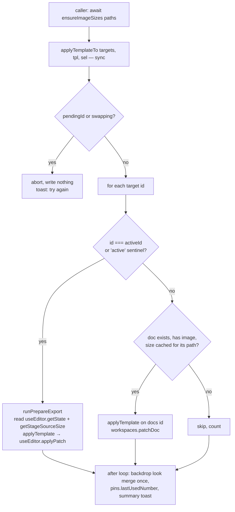

# Editor templates — design

Date: 2026-10-16 · Status: **rev 4.1, after three spec + one plan scrutinize round** · Scope: **desktop editor** (`/editor`)

## 1. Goal

Capture the edits made on one image and reapply them to other images:

- **directly**, to one or more images open in other workspaces, or
- **later**, from a saved template in a new sidebar panel. A template is applied by a button, by dropping it on the canvas, or by dropping it on a workspace tile.

**Primary use case (decided):** a series of screenshots of the **same UI**. They have the same or similar sizes and need the same blur, boxes and callouts in the same places. Annotations are therefore placed at **exact base-image pixel positions**.

### Decisions

| Question | Decision |
|---|---|
| Placement | Exact pixels in base-image space. Clamping only moves items that would land **entirely** outside the working area (§4.2) |
| What a template holds | Any user-chosen subset of: annotations (item by item), base-image crop, backdrop on/off, backdrop look |
| Granularity | Item-by-item multi-select, at both save and apply (§5) |
| Backdrop look | Merged into the global `general.backdrop`, so it affects every image. **Opt-in only**: unchecked by default, and never applied by a fast path |
| Target already has work | Annotations are appended on top |
| Crop | The template crop **replaces** the target's crop. If it does not fit inside the target image, it has no effect on that target |
| Pins | Same numbers and style as in the template |
| Keyboard shortcuts | **None.** Everything happens through the UI |
| Storage | New `templates.json` (tauri-plugin-store), loaded lazily |
| Platforms | **Desktop editor only in v1.** `/paste` has no sidebar tabs (`src/app/paste/page.tsx:330-366`) and no persistence |

### Non-goals in v1 (YAGNI)

- Proportional or anchored placement for images of a different size
- A backdrop appearance per image
- Exporting, importing or sharing template files
- Selecting several elements on the canvas (selection happens in the picker)
- Editing a template's contents after saving (rename and delete only)
- `/paste` support
- Keyboard shortcuts
- **A ghost preview at apply time.** Cut after the third review: on its own it needed a preview layer, export and thumbnail hiding, crop-space remapping and an e2e test. If it is wanted later, it should be drawn in a separate overlay `<Stage>` next to `OcrLayer`, which no export path can reach.
- **A thumbnail showing only the selected items.** The card shows the whole canvas as it was at save time (§6.1).

## 2. Existing code this builds on (verified over three review rounds)

**Editor store: `src/stores/editor.ts`**
- Annotation coordinates are relative to the crop (`:33-39`).
- `shiftAnnotation` (`:308-331`) handles every type: the arrow's curve point, pen and highlighter points, and magnify's source plus output. An image annotation's own `crop` is left alone, which is correct.
- `cloneAnnotation` is at `:338`.
- No annotation refers to another annotation's id. Blur's `imagesBelow` is derived from z-order.
- `Snapshot`, `HISTORY_LIMIT` and `pushHistory` (`:298`, `:491-497`) are private today.
- `backdropOn` is not part of undo (`:527`).
- `applyCrop` (`:656-678`) builds on the current crop, then resets `displayScale`, `userZoomed`, `selectedId` and `tool` (`applyPatch` additionally clears `nudgeRun`).

**Workspaces store: `src/stores/workspaces.ts`**
- `WorkspaceDoc` (`:34`) does not record the image size.
- `reviveDoc` (`:223-264`) builds docs explicitly.
- `historyStacks` (`:144-147`) is a private `{past: unknown[], future: unknown[]}`, and it is compatible with `restoreHistory` (`:746-750`).
- `persistNow` rewrites **every** doc (`:194-217`).
- `replaceActive` and `fillEmpty` keep the same id with a new image path (`:690-702`).
- `WORKSPACE_MAX_RANGE` allows up to 9 workspaces (`config.ts:661`).

**Workspace session: `src/hooks/useWorkspaceSession.ts`**
- Any `useEditor` change triggers a debounced `commitActive` (`:236-252`). It is skipped while an element is selected, so `docs[activeId]` can lag the live editor.
- `commitActive` only ever writes the current `activeId` from the live editor, and it bails while `swapping`.
- `addWorkspace`, `replaceActive`, `fillEmpty`, closing the active workspace and `reopenLastClosed` all set `swapping` without a `pendingId` (`workspaces.ts:463-694`).

**Stage: `src/components/editor/EditorStage.tsx`**
- `srcW`/`srcH` are natural sizes (`:703`).
- The layout effect at `:829-850` returns early when there is no image (`:834`), and calls `notifyStageImageReady()` (`:844`).
- `runPrepareExport` / `prepareExport` (`:1256-1273`) commit text, clear the selection, hover and guides, and empty both Transformers.
- The hover Transformer is `hoverTrRef`, and the selection one is `trRef`, both at `:1911-1934`.
- Magnify registers only its source group in `nodeRefs` (`:2642`). Its loupe and connector are sibling nodes (`:2706-2786`).

**Bitmaps**
- Konva `Stage.toDataURL` redraws every layer fresh and skips hidden nodes (konva 10.3.0 `Stage.js:209-231`), so a synchronous hide → `toDataURL` → restore works.
- The only stage `toDataURL` call sites are `exportRegion` (`src/lib/exportImage.ts:41-60`) and `renderThumb` (`workspaces.ts:272-293`). `recordInHistory` goes through `renderThumb(128)` (`exportImage.ts:239`).

**Store plugin**
- tauri-plugin-store 2.4.3 **swallows load errors**: `let _ = store_inner.load();` (`store.rs:216-222`). A corrupt file opens as an **empty** store.
- The store files live in `BaseDirectory::AppData` (`store.rs:30`).
- The fs scope already includes `$HOME/**` (`src-tauri/capabilities/editor.json:26-47`), and `fs:allow-copy-file` and `fs:allow-exists` are granted. **No capability change is needed.**

**Other pieces**
- Pin continuity: paste and duplicate update `pins.lastUsedNumber` (`elementClipboard.ts:205`, `duplicate.ts:52`).
- `src/stores/settings.ts:196-206`: `update(section, patch)` merges at section level, so the nested `backdrop` object is replaced whole.
- `BACKDROP_PRESETS` is defined at `src/lib/backdrop.ts:98`.
- Workspace tiles already carry `data-ws-tile={id}` in both full and rail mode (`WorkspaceBar.tsx:197,363`).
- The drag in `panels/CaptureHistorySection.tsx:531-626` uses window pointer listeners and a `pointer-events:none` ghost. It **has no tests**.
- `CanvasDropHint` has a two-value `data-mode`.
- The Toaster is Sonner with `visibleToasts={1}` (`src/app/editor/page.tsx:737-742`). Toasts with an id or an action already exist (`WorkspaceBar.tsx:138`).
- **e2e:** `tauri-mock` has a shared store bag and `emitTauriEvent` (`e2e/fixtures/tauri-mock.ts:140-174, 237`). It has no config-seeding helper, and it does not mock `persist_workspace_image`. Its `fs|exists` always returns `true`.

## 3. Data model and storage

### 3.1 `EditTemplate` (`src/lib/template.ts`)

```ts
/** Explicit allow-list — origin/main (#130) added autoForPaste/autoForImport; any future autoFor* must stay out. */
type BackdropLook = Pick<AppConfig["general"]["backdrop"], "style" | "presetId" | "solidColor" | "padding" | "cornerRadius" | "shadow">;

type EditTemplate = {
  id: string;
  name: string;
  createdAt: number;
  /** Natural size of the source base image (same-size fast path, scale warning, card label). */
  sourceSize: { w: number; h: number };
  /** Base-image crop. Absent = not part of this template. */
  crop?: ImageCrop;
  /** Absent = not part of this template. */
  backdropOn?: boolean;
  /** Absent = not part of this template. */
  backdropLook?: BackdropLook;
  /** In BASE-IMAGE space (crop offset removed), in source z-order. */
  annotations: Annotation[];
  /** ~160px data URL of the whole canvas at save time (§6.1). */
  thumb: string;
};
```

- Annotations are normalised to base-image space when the template is saved, with `shiftAnnotation(a, crop.x, crop.y)`.
- A template must contain at least one selected item.
- **Size limits.**
  - Overlay images (`ImageAnnotation.src`) are stored inline as data URLs, so the save popover shows the serialised size.
  - It warns at **2 MB** and refuses to save at **5 MB**. The reason is that each target's `workspaces.json` grows by the template's size, and `persistNow` rewrites every doc on each debounce (§2).
  - The Apply popover also warns when *(image-annotation bytes × number of targets)* is over **10 MB**.
- **Privacy.** `thumb` is a small picture of the screenshot, stored locally and deleted together with its template. Nothing leaves the machine, so the README privacy policy is unaffected.

### 3.2 Store (`src/stores/templates.ts`)

- **Shape.** A Zustand store `{ templates: EditTemplate[], loaded: boolean }` with `ensureLoaded()`, `save(tpl)`, `rename(id, name)` and `remove(id)`.
- **Storage.**
  - `tauri-plugin-store`, file `templates.json`, key `"templates"`, `autoSave: false`.
  - `ensureLoaded()` runs the first time the Templates tab opens. Nothing is loaded at startup.
  - Writes are debounced and gated by a **dirty flag**. The store flushes on blur or close **only when dirty**.
- **Validation.** `reviveTemplate`, modelled on `reviveDoc`, drops malformed entries with a logged warning.
  - It validates `backdropLook` against the config validators for `general.backdrop`, and fills missing or invalid fields from the current look. That protects against renames in later config schema versions.
  - An unknown `presetId` is kept at revive time and resolved at apply time (§4.3).
- **Corrupt-file guard.** The plugin hides load errors (§2), so a corrupt file shows up as an empty store. Before the **first write** in a session, the store checks:
  - `fs.exists(templates.json)` in `BaseDirectory.AppData` is true, **and**
  - the loaded store had no `"templates"` key.

  If both hold, it copies the file to `templates.corrupt.json` (`fs.copyFile`), shows a toast ("Couldn't read saved templates; a backup was kept"), and then writes.
- **Isolation.**
  - This is not part of `config.json`, so there is no `CONFIG_SCHEMA_VERSION` bump.
  - Rust never reads it.
  - It is never touched when `!isTauriRuntime()`.

### 3.3 Image sizes: a session cache, not persisted

`src/lib/imageSizeCache.ts` holds `Map<src, {w, h}>`. It lives only for the session and is keyed by **`srcForDoc(doc, cfs)`** (`useWorkspaceSession.ts:43`), which is the exact URL the stage loads. Keying by id is wrong because `replaceActive` and `fillEmpty` reuse the id with a new image. Keying by path is also wrong, because a cleared workspace that is then filled reuses `<id>.png` (CP-0074). `srcForDoc` already cache-busts with `?w=<id>&s=<sourcePath>`, for exactly this reason.

- `getImageSize(src)` returns the cached size or `undefined`.
- `ensureImageSizes(srcs)` decodes the missing srcs with `new Image()`, reads `naturalWidth/Height` on `onload`, and caches the result. Each decode times out after **4 s** and then counts as failed. Decodes are **not** routed through `preloadImage`, whose three-entry cache would evict the images kept for switching.
- **Callers.** It runs when the Apply popover opens, and when a template-card drag starts, for every workspace that has an image. That is at most 9 local files.
- **Active image.** Its size comes from the new `getStageSourceSize()`. A dedicated layout effect on `image` sets it to `image ? {naturalWidth, naturalHeight} : null`, and clears it on unmount. It is declared before the notify effect.
  - use-image returns `undefined` while a new `src` loads, so the size can be `null` while `hasImage` is still true.
  - Every "apply to active" path therefore requires `hasImage` **and** a non-null size. Otherwise the active target is skipped and counted.
- The cache never writes to `workspaces.json`, so nothing new is persisted and no race exists with switching or persistence. Round 3 found such races (M2) in the persisted `imageSize` design that this replaces.

## 4. Core logic

### 4.1 `captureTemplate(doc, sourceSize, backdrop, selection, meta) → EditTemplate` (pure)

```ts
type TemplateSelection = {
  crop: boolean;
  backdropOn: boolean;
  backdropLook: boolean;
  annotationIds: ReadonlySet<string>;
};
```

The function:

- clones the selected annotations with `cloneAnnotation`, keeping their order, and shifts them into base-image space;
- includes `crop`, `backdropOn` and `backdropLook` only when selected, and `crop` only when `imageCrop` is non-null.

The `doc` passed in is always built from the **live editor** (`useEditor.getState()`), never from `docs[activeId]`.

### 4.2 `applyTemplate(target, tpl, selection, targetSize) → { patch, cropSkipped, scaleMismatch }` (pure)

`targetSize` is the target's **natural** size (§3.3), never the cropped one.

```ts
type TemplatePatch = {
  annotations: Annotation[];
  nextPinNumber: number;
  imageCrop: ImageCrop | null;
  backdropOn: boolean;
  /** True when imageCrop changed; caller resets the view. */
  cropChanged: boolean;
  maxPinNumber: number | null;
};
```

1. **Crop.** When `crop` is selected and `tpl.crop` lies entirely inside `{0, 0, targetSize}`, the new crop is `tpl.crop`. It replaces whatever crop the target had. If it does not fit, the target's crop stays unchanged and `cropSkipped = true`. The template crop is never intersected or trimmed.
2. **Re-base existing annotations.** When the crop changes from `old` to `new` (an absent crop counts as `{0,0}`), shift every existing annotation by `old − new`. Each one then stays on the same base-image pixels.
   - These annotations are **not clamped**, which matches what a manual crop does today.
   - `applyCrop` cannot be reused, because it composes onto the current crop. This absolute shift has its own tests.
3. **Template annotations.**
   - Each gets a **fresh id** from `cloneAnnotation`, then `shiftAnnotation(a, −o.x, −o.y)`.
   - `o` is the origin of the **working area**. The working area is the resulting crop rect (`imageCrop`, whether the template's or the target's own), or the full target image when there is no crop.
4. **Clamping, minimal.** Nothing is clamped when **both** of these hold:
   - `targetSize` equals `tpl.sourceSize`, **and**
   - the working area equals the template's own working area (`tpl.crop`, or the full source image).

   In that case positions are exact, including callouts placed past the image edge on purpose. Otherwise, only an annotation whose bounds fall **entirely outside** the working area is moved just inside it. Partial overhang is left alone, because text bounds are only estimated (`annotationBounds.ts:37-44`).
5. **Append.** The template annotations go after the re-based existing ones, so they land on top.
6. **Pins.** Numbers and style stay exact. `nextPinNumber = max(target.nextPinNumber, maxPin + 1)`, and `maxPinNumber` is returned. Duplicate numbers on a target that already has pins are accepted.
7. **Backdrop on.** If selected, it is set to `tpl.backdropOn`.
8. **Backdrop look.** Not part of the patch; see §4.3.
9. **`scaleMismatch`.** True when `targetSize` is roughly 2× or 0.5× `sourceSize` (within 3 %), the sign of a Retina capture mixed with a 1× capture. It is reported, never corrected.

### 4.3 `applyTemplateTo(targetIds, tpl, selection)`: a synchronous write

`src/lib/applyTemplateTo.ts`. The caller awaits `ensureImageSizes` **before** calling it. The function itself is synchronous: it routes each target and writes it with no `await` in between, so no workspace switch can interleave.



1. **Guard.**
   - If `pendingId !== null` or `swapping === true`, abort and write nothing. A toast asks the user to retry.
   - A module-level `applying` flag also rejects re-entrant calls. On top of that, the Apply buttons are disabled for 400 ms after a click, which guards against double-clicks.
2. **The active target.** This is `activeId`, or the `"active"` sentinel when workspaces are disabled (in that case `activeId` is null). It requires `hasImage`.
   - First, `runPrepareExport()` commits an open text editor and clears the selection and the transient Transformers, so the snapshot and patch are deterministic.
   - The source is `useEditor.getState()`, and the size comes from `getStageSourceSize()`.
   - The new `useEditor.applyPatch(patch)`:
     - (precondition: `hasImage` and a non-null `getStageSourceSize()`; otherwise skip and count)
    - pushes the pre-apply `Snapshot` through `pushHistory` (capped at `HISTORY_LIMIT`) and clears `future`;
     - sets the patch fields;
     - when `cropChanged`, applies the same reset as `applyCrop`: `displayScale: 0, userZoomed: false, selectedId: null, tool: "select", nudgeRun: null`. If the crop tool was active, this ends it, as a manual crop does.
3. **Every other target.** A target is skipped and counted when its id is gone from `docs`, its `image` is null, or `getImageSize(srcForDoc(doc, cfs))` is undefined. Otherwise:
   - Run `applyTemplate(docs[id], …)`.
   - The new `workspaces.patchDoc(id, patch, preSnapshot)`:
     - merges the patch fields and bumps `updatedAt`;
     - when `cropChanged`, sets `displayScale: 0, userZoomed: false, scroll: null`;
     - pushes `preSnapshot` onto `historyStacks[id].past`, capped at `HISTORY_LIMIT`, and clears `future`. `editor.ts` exports `pushHistory`, `HISTORY_LIMIT` and `Snapshot` for this;
     - **keeps the old `thumb`**, which is re-rendered on the next activation;
     - schedules one persist.
   - The tile flashes a short "applied" ring (§6.2), so the user can see the change even though the tile picture is stale.
4. **Backdrop look**, if selected, is applied once: `update("general", { backdrop: { ...cur.backdrop, ...look } })`.
   - The spread keeps the `autoFor*` flags.
   - If `look.presetId` is not in `BACKDROP_PRESETS`, the current `presetId` is kept.
5. **Pins.** If any pins were applied, `pins.lastUsedNumber = max(current, maxPinNumber)`. It is never lowered.
6. **Toast** (fixed id `templates-apply`):
   - reports how many images were applied, plus how many were skipped, had `cropSkipped`, or had `scaleMismatch`;
   - if the backdrop look changed, offers **"Revert backdrop"** for 8 s, which restores the previous look in full;
   - known limitation: `visibleToasts={1}` means a later toast hides the action, and reverting discards any backdrop edit made after the apply. BackdropControl remains the durable way to change it.

**What undo covers** (stated in the toast and in the panel help text):
- On each image, Ctrl+Z reverts that image's **annotations and crop** in one step.
- Backdrop on/off has never been undoable (`editor.ts:527`), and that does not change.
- The backdrop look is reverted with the toast action or BackdropControl.

## 5. Item picker (`src/components/editor/templates/TemplateItemPicker.tsx`)

One component, used both at save time (items from the current image) and at apply time (items in the template).

```
☑ All (12)
── Image ─────────────────────
☑ Crop  1280×720 at (40, 88)
☑ Backdrop: on
☐ Backdrop look   [gradient · sunset]   ⚠ changes all images
── Annotations ─────────── ☑
☑ ▭ Rectangle  ■#ff3b30
☑ ➜ Arrow
☑ T "Click here"
▸ ☑ ◉ Pins (2)        ← 2+ of one type collapse; expand for per-item rows
▸ ☑ ▒ Blur (3)
☑ 🖼 Image 320×200  (1.8 MB)
```

- **Props:** `items: PickerItem[]`, `value: TemplateSelection`, `onChange`, and an optional `onHover(annotationId | null)`, used only at save time.
- **Row labels:**
  - a type icon and a short descriptor: text up to 24 characters, the pin number, a stroke swatch, the sticker emoji, or the image size and byte count;
  - rows are in z-order, topmost first.
- **Tri-state checkboxes** for "All", the Annotations group, and each type group.
- **Defaults:** everything is checked **except "Backdrop look"**, at both save and apply. Rows for items the template lacks are hidden.
- **The backdrop row shows its value** ("Backdrop: off"). A template saved with it off turns the backdrop **off** on its targets.
- **Keyboard:** Space toggles a row, ←/→ collapses or expands a group.

### 5.1 Hover highlight (save only)

- `useTemplatePreview` is a small transient store, **not** `useEditor`, so hovering never triggers `commitActive`. It holds `{ highlightId: string | null }`.
- `EditorStage` feeds `highlightId` into the existing hover Transformer (`hoverTrRef`), in the same way as its local `hoveredId`.
- The hover Transformer gets `name="hover-tr"`. `renderThumb` hides it around its `toDataURL`: find it by name, save and clear its `nodes()`, render, then restore in a `finally`. That stops a blur-triggered `commitActive` from baking the outline into the tile while the Save popover is open. `exportRegion` needs nothing extra, because `prepareExport` already empties both Transformers.
- `highlightId` is cleared when the popover closes and when the active workspace changes.

## 6. UI

### 6.1 Sidebar "Templates" tab

- **Tab wiring.** `SidebarTab` gains `"templates"` (`SidebarTabs.tsx:9`). The tab goes between History and the contextual tool tab, so Canvas and History do not move. `page.tsx` widens `rememberedTab` and adds `#sidebar-panel-templates`.
- **Width.** The bar is 240 px with underline tabs. Check it in **Thai**. If it does not fit, make the Templates tab icon-only (`LayoutTemplate`) with a tooltip, as the tool tab is.
- **Panel.** `src/components/editor/templates/TemplatesPanel.tsx` calls `ensureLoaded()` the first time the tab becomes active (tabpanels are always mounted, only hidden).

```
[ + Save as template ]  [ Apply this image's edits to… ]
┌ Login screen callouts ────── ⋯ ┐       (⋯ = rename / delete)
│ [thumb]  8 items · 1440×900   │
│ [Apply to this] [Apply to…]    │
└────────────────────────────────┘
(empty state: one line explaining save → drag a card onto an image)
```

- **Save as template.** Opens a popover containing a name field (default `Template N`), the picker for the current image, and the serialised size.
  - Opening it calls `runPrepareExport()`, which commits text and clears the selection and Transformers.
  - Disabled while `tool === "crop"`.
  - **Save** is disabled while the selection is empty or the template is ≥ 5 MB.
  - **Thumbnail:** `renderThumb(160)` of the live stage at the moment Save is clicked, showing the whole canvas. It does not try to show only the selected items: round 3 found that hiding nodes leaks magnify loupes, connectors and blur caches. The card label ("8 items") states what the template actually contains.
- **Apply this image's edits to…** applies without saving anything.
  - It opens the Apply popover with **What** listing the live editor's own items, and builds a temporary template with `captureTemplate` on confirm.
  - The active image is not offered as a target.
  - The button is hidden when workspaces are disabled or no other workspace has an image.
- **Apply to this** applies to the active image with the **picker defaults** (everything except backdrop look), without a popover. It is disabled while `!hasImage`.
- **Apply to…** opens a popover with two sections:
  1. **What:** the picker over the template's items.
  2. **Where:** one checkbox per open workspace that has an image (tile thumbnail and label), with the active one pre-checked and an "All open images" toggle. The section is hidden when workspaces are disabled.

  When the popover opens, `ensureImageSizes` runs. Until a target's size resolves, its checkbox shows a spinner. A target that fails to decode is disabled, with a reason.
- **Delete** asks for confirmation inline. **Rename** is edited in place.

### 6.2 Drag and drop (fast path: picker defaults, never backdrop look)

- **Its own small hook.** `src/components/editor/templates/useTemplateDrag.ts` follows the same pattern as History's drag: window pointer listeners, a movement threshold, a `pointer-events:none` ghost, and a `user-select` lock.
  - History's drag in `panels/CaptureHistorySection.tsx` is **left untouched**. It has no tests, so extracting a shared hook would refactor shipped behaviour with nothing to catch a regression (round 3, M5). Merging the two hooks can be done later, behind characterisation tests.
- **Resolver.** On pointer move and up, the hook resolves:
  - `{kind: "canvas"}` when the pointer is over the stage container;
  - `{kind: "tile", id}` from `document.elementFromPoint(x, y)?.closest("[data-ws-tile]")`, using the existing attribute. Tiles with no image are ignored.
- **While dragging.**
  - On drag start: `ensureImageSizes` for every workspace.
  - Over the canvas: `CanvasDropHint` with a new third `data-mode="template"`.
  - Over a tile: a highlight ring, from `dropTargetId` in a small UI store.
- **On drop.**
  - Wait for any pending `ensureImageSizes` (normally already done).
  - Then call `applyTemplateTo` synchronously. Routing is decided inside that call, after the await, so a switch during the wait is handled by its guard.
  - Dropping on the canvas applies to the active image. Dropping on a tile applies to that workspace **without switching**, and the tile flashes its "applied" ring.

### 6.3 No keyboard shortcuts (decided)

There are no new shortcuts. Plain Ctrl+C and Ctrl+V are untouched.

### 6.4 i18n

Every string goes through `t()`/`useT()`, with flat `editor.templates.*` keys in `src/i18n/locales/en/editor.ts` and Thai in `th/editor.ts`, using `GLOSSARY.md` terms. Descriptors are built inside components, never at module top level.

## 7. Error handling

| Situation | Behaviour |
|---|---|
| Empty selection | Confirm disabled |
| Template ≥ 2 MB / ≥ 5 MB | Warn / refuse save |
| Image bytes × targets > 10 MB | Warning in the Apply popover |
| `templates.json` corrupt (opens empty) | Before first write: back up to `templates.corrupt.json`, toast |
| Target size not yet decoded | Checkbox spinner; drop waits for decode |
| Target image fails to decode | Checkbox disabled with a reason; drop skips it (counted) |
| Target closed while popover open | Skipped; counted in toast |
| `pendingId` or `swapping` at apply | Whole apply aborted, nothing written, toast asks to retry |
| Double-click / re-entrant apply | `applying` flag + 400 ms button disable |
| No image on the active editor | "Apply to this" disabled; canvas drop ignored |
| Template crop does not fit target | Crop has no effect on that target; counted in toast |
| Annotation fully outside working area | Moved just inside; partial overhang kept |
| ~2× / 0.5× size mismatch | Applied as-is; toast warns (Retina vs 1×) |
| Unknown backdrop `presetId` | Keep current preset; apply the rest of the look |
| Store write fails | Toast; in-memory state kept; stays dirty and retries on the next change |

## 8. Testing

**Unit tests (Vitest)**

- `template.test.ts`
  - `captureTemplate`:
    - crop normalisation;
    - partial and empty selections;
    - the copy is deep.
  - `applyTemplate`:
    - **Crop:**
      - uncropped target: the crop is applied and existing annotations shift by `−crop`;
      - cropped target: the crop is replaced and existing annotations shift by `old − new`;
      - a crop that does not fit: crop unchanged and `cropSkipped`.
    - **Same-size fast path:**
      - an annotation hanging over the edge is **not** moved;
      - with the same size but a different target crop and the crop item unchecked, an item fully outside the target's crop **is** moved in.
    - **Smaller target:** a fully-outside item is moved in, and a partly-outside one is untouched.
    - **Pins:** numbers kept, `nextPinNumber` raised, `maxPinNumber` returned.
    - **Selection subsets:**
      - crop only;
      - backdropOn only (including `false`);
      - some annotation ids only.
    - **Ids:** every applied annotation gets a fresh id, and none collides with an existing one.
    - **`scaleMismatch`** at 2× and 0.5×.
- `applyTemplateTo.test.ts`, with the stores mocked:
  - With `pendingId` or `swapping` set, nothing is written.
  - A re-entrant call is rejected.
  - The active target reads the **live editor**: an uncommitted edit in `useEditor` survives the apply.
  - The `"active"` sentinel works when workspaces are disabled.
  - **Skips:** a target whose size is not cached for its **current path** is skipped. This covers `replaceActive`, where the id stays the same but the path is new. A target that is gone, or has no image, is also skipped.
  - **Backdrop look:** it is merged and keeps the `autoFor*` flags, and an unknown `presetId` falls back to the current one.
  - `pins.lastUsedNumber` is never lowered.
- `workspaces.test.ts`
  - `patchDoc`:
    - merges the patch and keeps `thumb`;
    - resets the view on a crop change;
    - pushes history, caps it at `HISTORY_LIMIT`, and clears `future`.
  - Undo after switching to the patched workspace restores the pre-apply state.
  - `renderThumb` with `hover-tr` attached: it is hidden during render and restored afterwards, including when render throws.
- `imageSizeCache.test.ts`: values are keyed by `src` (`srcForDoc`), a failed decode is reported, and only missing paths are decoded.
- `templates.store.test.ts`
  - Lazy loading.
  - `reviveTemplate` drops malformed entries and repairs `backdropLook`.
  - A blur with nothing dirty does not write.
  - **Corrupt guard:** the file exists and the store has no key, so the file is backed up before the first write.
- `TemplateItemPicker.test.tsx`
  - Grouping and collapsing.
  - Tri-state checkboxes.
  - Backdrop look unchecked by default.
  - The backdrop row shows its value.
  - `onHover` fires.

**e2e:** `e2e/web/templates.spec.ts`, on `/editor`, in the `web` project.

- **Setup:**
  - An extra `addInitScript` seeds `__capzStoreData.set("app", {…, workspaces: {enabled: true, …}})` (the config key is `CONFIG_STORE_KEY = "app"`), because no seeding helper exists.
  - Mock `persist_workspace_image` so it returns a path.
  - Use `page.route(/asset\.localhost/)` with a handler that **branches on the path**, so that two PNGs of different sizes are served.
  - Load images through `emitTauriEvent("editor:load-image", {path, source})`.
  - Avoid the file-save path, because the mock's `fs|exists` is always true and `nextFreePath` would loop forever.
- **Steps:**
  1. Load A, add a rect and a blur, then save a template with only the rect checked.
  2. Load B into a new workspace and drag the card onto the canvas. Only the rect appears, at the same pixel position.
  3. Press Ctrl+Z once, with focus on the canvas. The rect is gone.
  4. On B, use "Apply to…" with A and B checked. Switch to A: the items are on top.
  5. On A, use "Apply this image's edits to…" with B as the target. B gains the items, and the template list does not change.
  6. Drop a card on B's tile while A is active. The editor does not switch, B's tile flashes, and switching to B shows the items.

**Manual check (desktop, the Mac via mac-app-build).** Run `pnpm tauri dev` and confirm that:
- templates persist across a restart;
- a corrupt `templates.json` is backed up;
- the Thai tab bar fits;
- "Revert backdrop" works;
- rail-mode tile drops work.

## 9. Files

New:
- `src/lib/template.ts` (+ test)
- `src/lib/applyTemplateTo.ts` (+ test)
- `src/lib/imageSizeCache.ts` (+ test)
- `src/stores/templates.ts` (+ test)
- `src/stores/templatePreview.ts`
- `src/components/editor/templates/TemplatesPanel.tsx`, `TemplateCard.tsx`, `TemplateItemPicker.tsx`, `SaveTemplatePopover.tsx`, `ApplyTemplatePopover.tsx`, `useTemplateDrag.ts`
- `e2e/web/templates.spec.ts`

Modified:
- `src/stores/editor.ts`: `applyPatch`; export `pushHistory`, `HISTORY_LIMIT` and `Snapshot`
- `src/stores/workspaces.ts`: `patchDoc`, the history push for a non-active target, and hiding `hover-tr` in `renderThumb`
- `src/lib/stageBridge.ts`: `getStageSourceSize()`
- `src/components/editor/EditorStage.tsx`: set the source size in the layout effect, `name="hover-tr"`, and drive hover from `highlightId`
- `src/hooks/useWorkspaceSession.ts`: clear `highlightId` on switch
- `src/components/editor/SidebarTabs.tsx`, `src/app/editor/page.tsx`: the tab and panel, and handling a canvas drop of a template
- `src/components/editor/CanvasDropHint.tsx`: `template` mode
- `src/components/editor/WorkspaceBar.tsx`: the drop highlight ring and the "applied" flash
- `src/i18n/locales/{en,th}/editor.ts`
- `e2e/fixtures/tauri-mock.ts`: mock `persist_workspace_image`
- `PROGRESS-FEATURE.md`: tracker entry

Not touched: `src-tauri/capabilities/*` (scope already sufficient), `panels/CaptureHistorySection.tsx`, `src/lib/elementClipboard.ts`, config schema.

## 10. Resolved questions

1. **Pins:** the same as in the template.
2. **Crop:** the template crop replaces the target's crop, and has no effect if it does not fit inside the target image.
3. **Shortcuts:** none; the feature is UI only.
4. **Platform:** desktop editor only in v1.
5. **Undo:** annotations and crop are undone per image with Ctrl+Z. Backdrop on/off is toggled back by hand, as today. Backdrop look is reverted with the toast action.
6. **Fast paths** ("Apply to this", drag) never apply backdrop look. It is opt-in, in a popover only.

## 11. Review log

- **Round 1:**
  - The active image reported its cropped size.
  - A race between an async apply and switching.
  - `/paste` had no sidebar.
  - Clamping moved items on images of the same size.
  - A stale view after a crop change.
  - Backdrop was not undoable.
  - Preview layers leaked into bitmaps.
  - Store size.
- **Round 2:**
  - No existing mechanism to hide layers.
  - `imageSize` was taken from the previous image because of effect ordering.
  - The active target needed the live editor.
  - `swapping` guard.
  - Ghost offset.
  - Fast paths leaked backdrop look.
  - Off-screen thumbnail infeasible.
  - e2e premises.
- **Round 3:**
  - The plugin swallows load errors.
  - Wrong-doc size writes from armed listeners, and from reusing an id with a new path.
  - The thumbnail leaked magnify and blur.
  - Persist cost multiplied by the number of targets.
  - History drag has no tests.
  - The capability edit was unnecessary.
  - **Resolved by cutting scope:**
    - the session size cache replaces the persisted `imageSize`;
    - the ghost preview is cut;
    - the thumbnail is the whole canvas;
    - template drag uses its own hook;
    - "Start fresh" is replaced by a backup before the first write.
