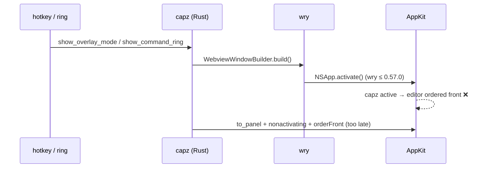

# Keep a buried editor buried on hotkey / ring captures — design (CP-0080)

Date: 2026-10-27 · Source: [capz-inbox#19](https://github.com/wadjakorn/capz-inbox/issues/19) · Ticket: CP-0080 · Scope: **desktop, macOS first**

## 1. Goal

A capture started from a global hotkey, the click ring (v1), the hold ring (v2)
or the tray must never activate capz or reorder the editor before the shot. A
visible editor is captured as seen; a buried one stays buried. Only the
in-editor toolbar capture hides the editor (unchanged). After a successful
capture the editor is still shown with the new image (`load_editor_image` →
`show_editor`), as today.

## 2. Owner repro (real Mac, editor buried, "Always on top" off)

| Route | area | window | scroll | full | system |
|---|---|---|---|---|---|
| Hotkey | ❌ | ❌ | ❌ | ✅ | ✅ |
| Click ring (v1) | ❌ at ring show | ❌ | ❌ | ❌ | ❌ |
| Hold ring (v2) | ❌ | ❌ | ❌ | ❌ | ❌ |
| Tray | ✅ | ✅ | ✅ | ✅ | — |

## 3. Root cause

Every failing route **creates a new webview window** before the shot (overlay
`overlay-<id>` for area / window / scroll, `command-ring` for both rings,
`scroll-hud` during scrolling). Full and system capture create none — and they
are exactly the hotkey modes that work.

`wry 0.55.1` (pulled in by `tauri 2.11`) ends `WryWebView::new` on macOS with an
unconditional

```rust
// make sure the window is always on top when we create a new webview
NSApplication::activate(&app);            // macOS 14+
// else: activateIgnoringOtherApps(true)
```

so building *any* top-level webview activates capz, and activating capz brings
its ordinary windows — the editor — in front of the app being captured. The
non-activating `NSPanel` work from #133 (`panel.rs`) is correct but runs *after*
`build()`, by which time wry has already activated the app. The tray route
escapes because the activation request is issued while the status-item menu is
still tracking and is dropped.

Frontend `setFocus()` calls in `overlay/page.tsx` and `ring/page.tsx` were also
suspects; they are rejected by the capability system (`core:window:default`
has no `allow-set-focus`), so they are not a cause.

Upstream fixed this in **wry 0.57.1** ("Hidden or unfocused webviews must not
activate their containing application"): the activation — and the
`makeFirstResponder(webview)` that came with it — now runs only when the
webview is `visible && focused`.



## 4. Fix

1. **Upgrade Tauri 2.11 → 2.12** (`tauri 2.12.5` → `tauri-runtime-wry 2.12.3`
   → `wry 0.57.1`, `tao 0.37`). Bump the JS side to match the minor
   (`@tauri-apps/api`, `@tauri-apps/cli`) — the CLI refuses mismatched
   minors. There is no smaller lever: `tauri-runtime-wry 2.11.x` pins
   `wry ^0.55`.
2. **Build every capture-time window with `.focused(false)`** — overlays,
   `command-ring` (v1 and v2), `scroll-hud` (`scroll-guide` already is).
   `WebviewWindowBuilder::focused` sets both the tao window and the wry webview
   attribute, so wry skips the activation.
3. **Give the webview first-responder ourselves.** wry 0.57.1 also skips
   `makeFirstResponder(webview)` for unfocused webviews, so a key panel would
   receive Esc/Enter but not forward them to the page. `panel::make_key` now
   makes the window's `WKWebView` first responder after `makeKeyWindow`
   (macOS only; via `with_webview`).
4. **Guards** (cheap, unit tests in Rust):
   - `Cargo.lock` must resolve `wry >= 0.57.1` — a downgrade silently brings the
     bug back.
   - Every `WebviewWindowBuilder::new` in `windows.rs` other than the editor
     must carry `.focused(false)` — a new capture-time window that forgets it
     re-introduces the activation.

## 5. Edge cases

- **Esc in overlays / click ring / scroll HUD** — must still work without a
  click: covered by step 3; owner-test checklist.
- **Hold ring (v2)** stays a plain (non-panel) window and must never become key
  (CP-0038). `.focused(false)` only makes it less able to take focus; its
  `win.show()` path is unchanged.
- **Editor window** keeps the default `focused(true)` — showing the editor
  after a capture must still activate capz (Decision).
- **Windows**: `.focused(false)` makes tao show the window without activating
  it; capture windows that need keys still go through `panel::make_key` →
  `set_focus()`, so behaviour there is unchanged. Not reported on Windows;
  checked only.
- **`/paste` web editor** — unaffected (no capture, no Tauri).
- No UI strings, settings or shortcuts change.

## 6. Out of scope

Changing which captures hide the editor; window-mode listing rules; ring
visuals; Tauri 3.

## 7. Verification

- L1 unit/tsc/build, L2 clippy, L3 web e2e (no frontend change expected), L5
  tauri e2e if `tauri-driver` is present.
- macOS compile via the Mac build host where available.
- **Owner-test (Gate):** real Mac, editor buried behind another app — area /
  full / window / scroll / system hotkeys, click ring (all modes), hold ring
  (all modes), tray; Esc cancels overlays and the click ring without a click.
