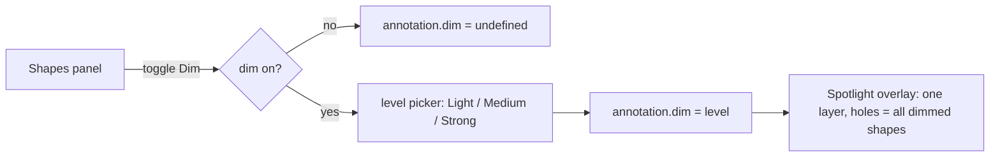
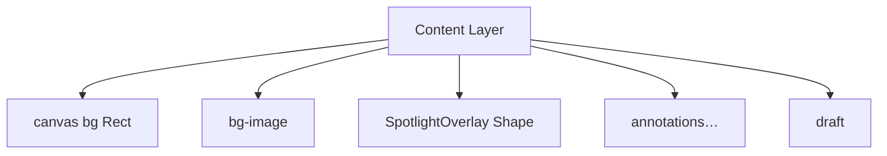

# CP-0095 — Shapes: dim surroundings (spotlight)

> Status: **v2 — revised after /scrutinize, implemented** (findings at the bottom) · Card: CP-0095

## Goal

Rect / ellipse ของ Shapes tool มี option **"หรี่รอบ ๆ" (Dim around)** — ทุกอย่างบนภาพที่อยู่นอก shape จะถูกทับด้วยสีดำโปร่งแสง เพื่อให้จุดที่วงเด่นขึ้น

- มี 3 level: **Light / Medium / Strong**, default = **Medium**
- **ไม่ dim backdrop** (padded frame) และ overflow band — dim เฉพาะพื้นที่ภาพ
- ปรับได้ทั้งตอนเลือก tool (ใช้กับ shape ถัดไป) และหลังวาด (shape ที่เลือกอยู่)

Out of scope: line (ไม่มีพื้นที่), dim สี/สีอื่นนอกจากดำ, feather/blur ขอบ

## Behaviour



| Case | Result |
|---|---|
| 1 shape dim | ภาพนอก shape มืดลงตาม level |
| หลาย shape dim | **overlay เดียว** มีหลายรู — ไม่ซ้อนทึบขึ้นเรื่อย ๆ, รูไม่ถูก dim โดย shape อื่น |
| เปลี่ยน level บน shape ที่เลือก | เขียน level นั้นให้ **ทุก shape ที่ dim อยู่** ด้วย `updateMany` (undo step เดียว) — ทั้งภาพมี level เดียวเสมอ (S1) |
| เปิด dim ให้ shape ใหม่ / shape ที่เลือก ขณะที่มี shape อื่น dim อยู่แล้ว | ใช้ level ที่ภาพใช้อยู่ ไม่ใช่ level ที่จำไว้ (S1) |
| Crop tool active | ซ่อน overlay (crop มี dim ของตัวเอง ซ้อนกันอ่านไม่ออก) (S3) |
| Backdrop on | overlay clip อยู่ใน rect ภาพ (0,0,imgW,imgH) + corner radius เดียวกับภาพ → backdrop/shadow ไม่ถูก dim |
| Overflow (annotation ล้นออกนอกภาพ) | แถบ overflow ไม่ถูก dim |
| Annotation อื่น (arrow, text, pin, image layer…) | วาด **เหนือ** overlay → ไม่ถูก dim (ลูกศร/ข้อความที่ชี้ไปยัง spotlight ยังอ่านชัด) |
| Rotation / drag / transform | รูตาม shape แบบ live ระหว่างลาก |
| Export / copy | ได้ผลลัพธ์เดียวกับบนจอ (overlay อยู่ใน content layer, ไม่ใช่ chrome) |

## Data model

```ts
// src/stores/editor.ts
export type DimLevel = "light" | "medium" | "strong";
export type RectAnnotation = Base & { …; /** Absent = no dim. Ignored for shape "line". */ dim?: DimLevel };
```

```ts
// src/lib/spotlight.ts (ใหม่, pure)
export const DIM_OPACITY: Record<DimLevel, number> = { light: 0.35, medium: 0.55, strong: 0.75 };
export function spotlightShapes(anns: Annotation[]): RectAnnotation[]   // rect/ellipse ที่ dim != undefined
export function spotlightLevel(anns: Annotation[]): DimLevel | null      // level สูงสุดในภาพ
export function spotlightHole(a, liveNode?): SpotlightHole              // geometry ของรู
export function drawSpotlight(ctx, area, holes, opacity): void
```

### Settings (schema v9 → **v10**, additive)

- `tools.rect.dim: boolean` (default `false`)
- `tools.rect.dimLevel: DimLevel` (default `"medium"`)
- `lastUsed.rect.dim`, `lastUsed.rect.dimLevel`
- `CONFIG_MIGRATIONS[9] = identity`, fixture `v10.json`, regenerate `shape.v10.json`, validator `vsec` + `keep("rect")` รับ key ใหม่, `EffectiveTools.rect` + merge lastUsed
- `lastUsedPatchForAnnotation(rect)` เขียน `dim: !!a.dim` และเขียน `dimLevel` **เฉพาะเมื่อ `a.dim` มีค่า** — `mergeSlots` (`src/lib/lastUsedWriter.ts:27`) spread ทีละ field ดังนั้น `dimLevel: undefined` จะทับ level ที่จำไว้ (S2). arrow-line branch ไม่ต้องใส่ dim (merge ทีละ field อยู่แล้ว)
- Rust ไม่อ่าน `tools.rect` (เช็คแล้ว) → ไม่มีผลฝั่ง Rust

แยก `dim` (bool) กับ `dimLevel` เพื่อให้ปิดแล้วเปิดใหม่ยังจำ level เดิม — นี่คือ "default level"

## Rendering — `SpotlightOverlay` (EditorStage)

วางเป็น node เดียว **ถัดจาก `<KonvaImage name="bg-image">`, ก่อน `annotations.map`**, `listening={false}`



`sceneFunc` (native ctx):
1. `ctx.save()`; clip ไว้ใน rect ภาพ (rounded ด้วย `backdropRadius` เมื่อ `backdropRender`)
2. สำหรับแต่ละ hole: `beginPath(); rect(image) ; <hole path ผ่าน transform ของ node>; clip("evenodd")` — clip ซ้อนกันเป็น **intersection** ⇒ พื้นที่ที่เหลือ = ภาพ − ∪holes (overlap ของรูไม่กลับมามืด — ซึ่ง evenodd path เดียวหรือ nonzero ทำไม่ได้)
3. `fillStyle = rgba(0,0,0,opacity)`; `fillRect(image)`; `ctx.restore()`

**Hole geometry แบบ live:** อ่านจาก Konva node จริงผ่าน `nodeRefs.current.get(id)` → `node.getTransform()` + `width/height` (รวม scale ระหว่าง Transformer) แล้ววาด `rect`/`roundRect(cornerRadius)`/`ellipse` ใน local space ของ node; ถ้าไม่มี node (เพิ่งสร้าง) fallback เป็นค่าจาก annotation. เพราะ overlay อยู่ layer เดียวกับ shape, Konva redraw layer ทุก dragmove/transform อยู่แล้ว → overlay ตามทันโดยไม่ต้อง subscribe อะไรเพิ่ม. ต้องยืนยันว่า RectShape node อยู่ใต้ Layer โดยตรง (ไม่มี parent Group ที่มี offset) — ถ้ามี ใช้ `getAbsoluteTransform` relative to layer แทน

Group-drag (`groupOffset`) ขยับ node อยู่แล้ว → ได้ฟรีจากการอ่าน node

## UI — ShapesPanel

ต่อท้าย panel (เฉพาะ shape `rect`/`ellipse`; ซ่อนเมื่อ shape = line):

- Section label **"หรี่รอบ ๆ" / "Dim around"** + `ToggleIconButton` (lucide `Focus`, pattern เดียวกับ toggle อื่นใน `kit.tsx`)
- เมื่อเปิด: `IconSegmented<DimLevel>` 3 ปุ่ม (glyph สี่เหลี่ยมพื้นหลังเทาอ่อน→เข้ม)
- Toolbar.tsx: `dimCtx` ทั้งสองทาง
  - **selected rect** → `updateAnnotation(id, { dim })` + persist (remember ? `patchLastUsed` : `updateSettings("tools")`) ตาม pattern `cornerCtx`
  - **tool mode** → persist อย่างเดียว; EditorStage pointer-up ตอนสร้าง rect ใส่ `dim: toolsCfg.rect.dim ? toolsCfg.rect.dimLevel : undefined`
- i18n: `editor.panel.dimAround`, `dimLight`, `dimMedium`, `dimStrong` ใน `en`/`th` (ดู GLOSSARY)

## Files

| File | Change |
|---|---|
| `src/stores/editor.ts` | `DimLevel`, `RectAnnotation.dim` |
| `src/lib/spotlight.ts` (+test) | pure helpers + `drawSpotlight(ctx, …)` |
| `src/lib/config.ts` (+ fixture, shape json) | v10, defaults, validators, effective tools |
| `src/lib/lastUsedPatch.ts` (+test) | rect slot มี dim/dimLevel |
| `src/components/editor/EditorStage.tsx` | `SpotlightOverlay` node; ใส่ `dim` ตอนสร้าง rect |
| `src/components/editor/Toolbar.tsx` | `dimCtx` |
| `src/components/editor/toolbar/panels/{ShapesPanel,types,glyphs}.tsx` | control |
| `src/i18n/locales/{en,th}/editor.ts` | strings |
| `PROGRESS-FEATURE.md` | entry |

## Tests / verification

- Unit: `spotlightShapes` (กรอง line / dim undefined), `spotlightLevel` (max), config migration v9→v10 + shape test, lastUsedPatch
- Unit (canvas mock): `drawSpotlight` เรียก `clip("evenodd")` ครั้งละ hole และ clip ภาพก่อน
- `pnpm test:unit`, `tsc`, lint
- e2e web `e2e/web/shape-spotlight.spec.ts`: อ่าน pixel จาก stage — ในรูใส, นอกรูมืดตาม level, ปิด + undo, pixel ของ backdrop ไม่เปลี่ยน
- Manual บน Mac (push branch): dim on/off, 3 level, 2 shape overlap, rotate/drag/resize live, backdrop on + radius + shadow ไม่มืด, overflow ไม่มืด, export ตรงกับจอ, undo/redo, workspace switch คงค่า, /paste web

## Known trade-offs (ให้ scrutinize ชั่ง)

1. **Blur / magnify ที่อยู่นอก spotlight** วาดจาก bg image ดิบ เหนือ overlay → จะดูไม่ถูก dim — **non-goal v1**
2. **Image layer** (paste/capture-as-layer) ไม่ถูก dim — **non-goal v1** (S4)
3. ~~Level ต่างกันหลาย shape → ใช้ค่าสูงสุด~~ → แทนด้วย sync level (S1); overlay ยังใช้ max เป็น safety net สำหรับ doc เก่า/template ที่ level ไม่ตรงกัน
4. `dim` sticky ผ่าน lastUsed → เปิดไว้แล้ว shape ถัดไปก็ dim ด้วย (เห็นทันที, undo ได้)

---

## /scrutinize report (v1 → v2)

**Intent:** ผู้ใช้ทำ spotlight ได้จาก shape ที่วาดอยู่แล้ว โดยหรี่เฉพาะเนื้อภาพนอก shape และไม่แตะ backdrop

**Simpler-alternative pass:** (a) tool "Spotlight" แยก — ไม่, owner ขอเป็น option ของ shapes และ geometry/handlers ของ RectShape ใช้ซ้ำได้หมด. (b) segmented 4 ปุ่ม Off/Light/Medium/Strong แทน switch+level — สั้นกว่าแต่เสีย "default level" (ปิดแล้วเปิดใหม่ต้องเลือกอีก) ที่ owner ขอ → คง switch + level. (c) offscreen canvas / แยก Konva Layer เพื่อเจาะรู — clip intersection ทีละรูให้ผลเท่ากัน ไม่ต้อง refactor layer และไม่จอง buffer ขนาดภาพทุก frame → คง clip

**Traced:** `RectShape` (`EditorStage.tsx:2549`) ส่ง Rect/Shape ตรงใต้ Layer (ไม่มี parent Group) → `node.getTransform()` ใช้ได้ตรง ๆ, `onTransformEnd` reset scale แล้วเขียน w/h — ระหว่าง transform scale อยู่บน node ⇒ อ่าน transform รวม scale ถูกต้อง. สร้าง rect ที่ `EditorStage.tsx:1584` (normalize w/h แล้ว). Export = `stage.toDataURL` ของ content layer (`exportImage.ts:44`) ⇒ overlay ไปด้วย, chrome ไม่ไป. lastUsed merge ทีละ field (`lastUsedWriter.ts:27`). `updateMany` push history ครั้งเดียว (`editor.ts:632`). Rust ไม่อ่าน `tools.rect`.

### S1 — major: level ต่อ shape + overlay เดียว = UI โกหก
- **Why:** shape A=Light, B=Strong → overlay ใช้ Strong; เลือก A แล้วกด Medium ไม่มีอะไรเปลี่ยน
- **Change:** level เป็นค่าระดับภาพในทางปฏิบัติ — เปลี่ยนบน shape ใด sync ทุก shape ที่ dim (`updateMany`); เปิด dim ใหม่ใช้ level ที่ภาพใช้อยู่

### S2 — major: `dimLevel: undefined` ลบ level ที่จำไว้
- **Evidence:** `mergeSlots` = `{...cur[s], ...patch[s]}` → key ที่เป็น undefined ทับค่าเดิม; ขยับ rect ที่ไม่ dim ทุกครั้งจะรีเซ็ต level กลับ default
- **Change:** omit key เมื่อไม่มีค่า + unit test

### S3 — minor: overlay ซ้อน crop dim (`EditorStage.tsx:2128`)
- **Change:** ไม่ render overlay เมื่อ `tool === "crop"`

### S4 — decision: image layer / blur ไม่ถูก dim
- **Why:** overlay อยู่ใต้ annotation ทั้งหมด; ทางแก้ (สอด overlay ตาม z-order หรือ clip union ของ image layers) เพิ่มความซับซ้อนมากเพื่อ case รอง
- **Change:** ประกาศเป็น non-goal v1 ใน spec/PR; กรณีหลัก (ภาพเดียว + กรอบ + ลูกศร/ข้อความ) ครบ

### S5 — nit: corner radius ของรูต้องตรงกับ Konva
- Konva `Rect` clamp radius เป็น `min(w,h)/2` — รูต้อง clamp เหมือนกัน ไม่งั้นมุมรูไม่ตรงเส้น

### S6 — nit: clip fill-rule
- ใช้ native `c._context.clip("evenodd")` (Konva Context wrapper ไม่ยืนยันว่าส่ง fill rule) — ทดสอบด้วย mock

**Verdict:** fix-then-ship — แก้ S1/S2 ในแผน (ทำแล้วด้านบน) แล้วลงมือได้
