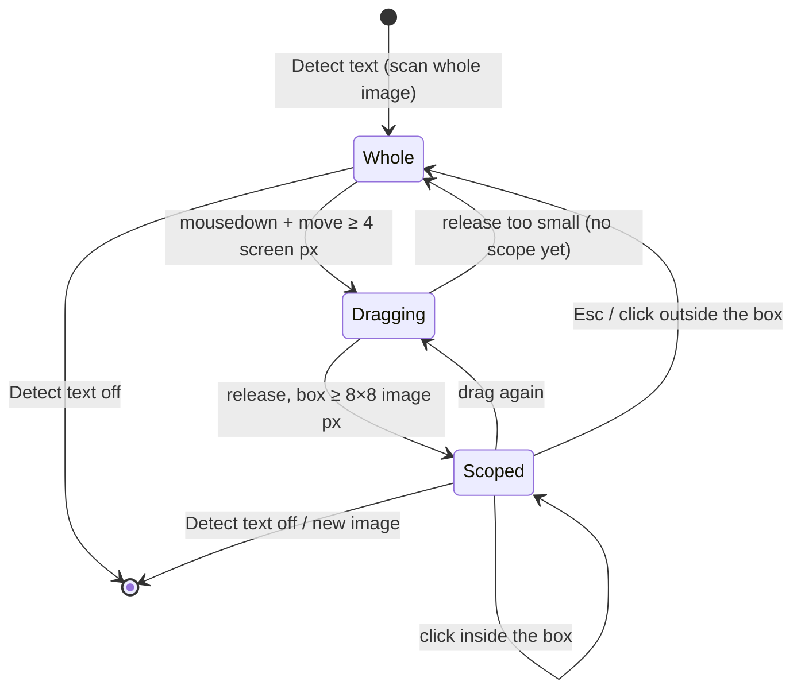

# CP-0099 — OCR: drag a box to copy only that area's text

> Status: **v3 — revised after /scrutinize, owner-approved** · Card: CP-0099 · Follow-up: CP-0100 (re-scan the box)

Source: owner request (chat, 2026-11-16). No inbox issue.

## Goal

The habit after OCR is **Detect text → ⌘/Ctrl+A → ⌘/Ctrl+C → paste**. On a text-heavy
screenshot ⌘A also grabs nav bars, sidebars and labels, so the pasted text needs manual
trimming. Native drag-selection does not help: it follows reading order (one chip per
line in `OcrLayer`), so a drag across columns grabs everything in between.

Keep ⌘A → ⌘C as *the* way to copy, and make "all" mean "the area I care about" — one
gesture inside OCR mode, no new toolbar button, no shortcut, no Copy button.

## Behaviour

1. **Detect text** works as today (whole image). The session's first successful
   detection adds a hint to its toast: "Drag a box to copy only part of the text".
2. In OCR mode, **dragging anywhere on the image** (≥ 4 screen px) draws a box. This
   replaces native drag-selection in OCR mode. Double- and triple-click on a chip stay
   native (word, line).
3. On release, **instantly** (no second OCR call):
   - only the whole-image words whose bbox centre lies inside the box stay;
   - the image outside the box dims and the box keeps a dashed outline;
   - the kept text is **already selected** — ⌘C copies it, and ⌘A → ⌘C gives the same text.
4. Another box replaces the scope. **Esc** or a click outside the box returns to the
   whole-image text. Toggling Detect text off exits OCR mode, as today.
5. ⌘C while a scope is active **never** copies the whole image. A lost selection is
   re-selected first; an empty scope copies nothing.

### Rule: whole words only

- A word is in scope when its bbox centre is inside the box. Words are never cut.
- A partly kept line is rebuilt from its kept words (text joined by a space, bbox =
  their union via `unionAABB`). Lines are ordered by row top-down, then left-to-right
  (a line joins a row when `|cy − row.cy| < 0.5 × min(h, row.h)`).
- If a line's `words` don't cover its text (empty, or Vision skipped a word whose range
  lookup failed — `macos.rs`), that line counts as one word (line granularity).

## Decided defaults (and why)

| Decision | Why |
|---|---|
| One gesture (owner Q1) | ⌘A → ⌘C must give copy-ready text; simplest seamless UX |
| Phrase-level Thai is fine (Q2) | OCR words split at spaces; Thai phrases are the unit we have |
| No shortcut (Q3) | the drag *is* the affordance |
| **Filter only, no re-scan** (Q4) | a re-scan only improves detection (recognition reads the same pixels), OpenThai reloads both models per call (delay on Windows), and its edge rule leaks fragments (`page.rs` last word `+0.5·adv`). Moved to CP-0100 |
| No box while the whole-image scan runs (Q5) | the layer renders only once a result exists |
| No auto-copy on release | the user's ⌘C is the moment of copying |
| Release < 8×8 image px = click | stray jitters must not create a tiny empty scope |
| Esc via the existing Esc ladder (first rung) | a window-capture listener would also steal Esc from menus and Settings fields (EditorStage stays mounted, hidden, in Settings) |
| ⌘C safety net in OcrLayer's capture keydown | `page.tsx`'s ⌘C handler copies the whole image on an empty selection and may close the editor (`copyClosesEditor`) |
| Box + dimming are DOM inside `[data-ocr-layer]` | never appear in an export |
| One new string `app.ocr.scopeHint` | en "Drag a box to copy only part of the text", th "ลากกรอบเพื่อคัดลอกเฉพาะบางส่วน" |
| No settings change → no `CONFIG_SCHEMA_VERSION` bump; no Rust/IPC change | scope is session-only UI state |
| Gate: owner-test | canvas gestures and ⌘C in WKWebView can't be fully checked headless |

## Edge cases

- **Typing in fields:** Esc in an input/textarea is ignored by the ladder's
  `isTypingTarget` guard, so the scope stays. A mousedown on the layer blurs a focused
  input first, otherwise ⌘A/⌘C would go to that field.
- **Settings view:** EditorStage stays mounted with `aria-hidden="true"`. OcrLayer's ⌘A
  and ⌘C handling skip when the layer is inside `[aria-hidden="true"]`.
- **Canvas text editing / annotation tools:** OCR mode already suspends stage pointer
  handling (`EditorStage.handlePointerDown` returns in OCR mode); the box gesture lives
  only on the OCR layer, which covers the image.
- **Crop mode:** unchanged — OCR mode and its layer behave as today; the scope is cleared
  on toggle-off and on a new image.
- **Lost mouseup** (app switch mid-drag, macOS ctrl-click menu): a move with no primary
  button held counts as the release; window blur cancels the draft. No listener leaks.
- **Zoom / scroll / expanded canvas:** the layer rect is re-read on every move; the box is
  stored in image px and drawn at `rect × scale` inside the layer (which already carries
  `originPxX/Y`), so it stays aligned.
- **Engine switch:** dropping the result cache also drops the scope.
- **Desktop vs `/paste`:** OCR is desktop-only (Tauri-gated); `/paste` does not change.

## Out of scope

- Re-scanning the box to recover words the whole-image scan missed (CP-0100).
- Cutting words at the box edge, character-level selection.
- A Copy button, a toolbar control, or a shortcut.
