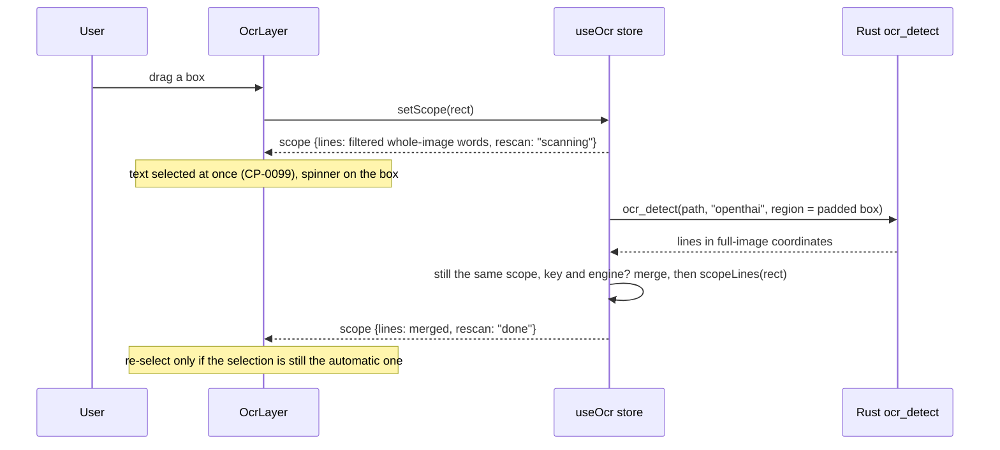

# CP-0100 — OCR: re-scan the scope box with OpenThai

> Status: **v1 — after /scrutinize, owner-approved decisions** · Card: CP-0100 · Builds on CP-0099 · Evidence: `_scratch/cp0100-rescan/EVIDENCE.md` (md-server)

## Goal

When OpenThai reads a scope box (CP-0099), scan that area again at a higher detection
resolution and use what it finds: lines the whole-image scan missed, and better readings
of small lines it did find.

**Why it works:** OpenThai shrinks the whole image to 1280 px on its long side before
detection, which is 0.5× for a 2560 px Retina screenshot. A crop is instead scaled *up*
to 1280 px, capped at 4×. Measured on a 2560×1600 screenshot:

| Area | Whole-image scan | Crop scan |
|---|---|---|
| app mockup | 4 lines | 17 |
| article | 2 lines | 9 |
| sidebar | 0 lines | 6 |

A crop scan takes 0.3–0.6 s on Linux, models loaded per call.

## Behaviour

1. Instant step, unchanged from CP-0099: the filtered whole-image words show and are
   selected.
2. If the whole-image result came from **OpenThai** (`OcrResult.engine === "openthai"`),
   the store re-scans the **padded box** automatically. The box shows a small spinner.
3. When the crop result arrives and the scope is still current, the store merges it (rules
   below) and recomputes the scope lines with CP-0099's rule (word centre inside the
   user's box, reading order).
4. **Selection:** if the selection is still exactly the automatic one, the new text is
   re-selected. Otherwise the user's selection is left alone (owner Q3).
5. **"No text found"** waits for the re-scan. It shows only if the box is still empty
   afterwards.
6. If the re-scan fails, the filtered text stays, the spinner stops, and a warning is
   logged. There is no error toast: the user already has usable text.

## Merge rules

All in image px. `s` = detection scale of the whole image = `min(4, 1280 / max(W, H))`.

1. **Padded region.** The box plus `pad = max(32, 0.1 × max(box.w, box.h))` on each
   side, clamped to the image. A tight box would otherwise make every crop line touch the
   crop edge.
2. **Drop crop lines that touch the padded edge.** Tolerance: `0.5 × line height`. Only
   the sides not clamped by the image border count: there, the line may have been cut by
   the crop. This keeps word fragments out (the last word's box stops short of a cut).
3. **Drop junk:** crop lines with fewer than 2 non-space characters. Toolbar icons came
   back as `ั`, `๑`, `T`, `0` with confidence up to 0.999, so confidence can't separate
   them.
4. For each remaining crop line `c`, find the whole-image lines it overlaps. They overlap
   when the intersection is ≥ 30 % of the smaller box.
   - **None** → add `c`.
   - **All small** (whole line `h × s < 16`, the size where CP-0098 measured OpenThai
     falling behind) → `c` wins. Drop the whole-image words whose centre lies inside
     `c.bbox`, and rebuild what remains of those lines.
   - **Any large** → discard `c`. On large text the crop is no better, and it added junk
     (a bullet read as `อ`).
5. Merged lines = surviving whole-image lines + accepted crop lines. Then
   `scopeLines(merged, rect)` decides membership and order, as in CP-0099.

## Decided defaults (and why)

| Decision | Why |
|---|---|
| Automatic, spinner on the box (owner Q1) | no new control; the instant text already works |
| OpenThai only (Q2) | the downscale is OpenThai's; Vision keeps the filter |
| Re-select only if untouched (Q3) | don't fight a user's own selection |
| Separate from CP-0098 (Q4) | misreads are a recognition problem, measured separately |
| Prefer the crop, but only over small lines (Q5 + scrutiny) | better readings where they happen, no large-text regressions |
| In-memory crop, optional `region` on `ocr_detect`, `engine` on `OcrResult` | no temp PNG to write and sweep; the frontend learns the engine actually used (Windows/Linux ignore the setting) |
| Vision + region → error | the frontend never sends it; this fails loudly instead of silently |
| One crop scan at a time; a newer box replaces the pending one | each call loads models and uses up to 8 threads |
| No settings change, no schema bump | — |
| Gate: owner-test | Windows latency, macOS tract latency (re-optimises per shape), real screenshots |

## Edge cases

- **Esc, click outside, a new box, a new image, or toggling off during a scan:** the result
  is discarded, because the scope object, key or engine is no longer the same.
- **Engine switch:** the cache and the scope are dropped (CP-0099), so the stale result is
  discarded.
- **A box at the image border:** the clamped sides don't count as cut edges.
- **Empty box:** no toast until the re-scan ends; the crop may find text there.
- **Settings view / typing:** unchanged from CP-0099.
- **`/paste`:** no OCR. Desktop only.

## Out of scope

- Small-text misreads (CP-0098).
- Re-scanning with Vision.
- Raising the whole-image detection limit or tiling. That would help without a box, but
  costs ~4× on every scan and overlaps CP-0098.
- Caching the engine between calls (measure first).
